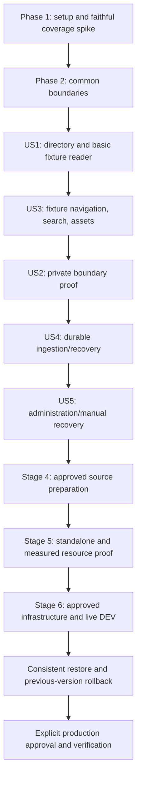

# Tasks: Librarian v1 Git-connected Documentation Portal

**Feature**: `001-librarian-v1-portal` | **Generated**: 2026-10-11
**Status**: Tasks generated and validated; none executed.
**Git branch**: `main`, unchanged. Feature identifier is not a newly created branch.
**Input**: [spec.md](spec.md), [plan.md](plan.md), [research.md](research.md),
[data-model.md](data-model.md), [contracts/http.md](contracts/http.md), [quickstart.md](quickstart.md).
**Authority**: [AGENTS.md](../../AGENTS.md), [constitution](../../.specify/memory/constitution.md),
[agreed brief](../../docs/requirements/v1-requirements.md).

This list retains all five stories and six delivery stages. This command writes only tasks.md:
no application implementation, source preparation, branch/commit/push, publication or deployment.
Later operational tasks document required work and do not grant approval.

## Format and Paths

Each task is `- [ ] Tnnn [P?] [USn?] Description with file paths`. Paths are relative to the
application root unless the task explicitly refers to its feature artifacts or a separately
confirmed source/infrastructure repository. [P] indicates disjoint-file work after stated
prerequisites; it does not override ordering, reviews, approvals or shared-file conflicts.
All unchecked boxes represent future work.

The three P1 stories are grouped US1, US3, US2 to follow the binding fixture-reader-before-private-proof
sequence; their priority is unchanged. US1/US3 close Stage 1 together. US2 closes Stage 2.
US4/US5 close Stage 3. Source preparation, packaging and infrastructure follow as Stages 4-6.
Story tests are independently runnable against synthetic seeds/provider fixtures without depending
on a live upstream; overlapping support files and final integrated acceptance have explicit dependencies.

**Mandatory completion rule**: Every added/changed feature has automated acceptance tests; every
bug fix has a regression demonstrating the defect before its fix. Write tests before or alongside
implementation, and show new behavior tests fail meaningfully first. Each story gate runs its required
unit/integration/browser tests, typecheck, lint and production build; each applicable metric is
**>=95% separately for statements, branches, functions and lines**, globally AND for every affected
C1-C6 scope in [plan.md](plan.md#test-coverage-and-completion-design). Include unexecuted first-party
files and shared code in every affected scope. CI fails any required test/report/instrumentation/
membership/threshold failure. Only generated, third-party, test or purely declarative files may be
excluded with reasons; no runtime ignore annotations, blanket mocks, placeholder assertions, skipped
required tests, percentage averages, fabricated evidence or retries that conceal failure. A genuine
zero denominator requires a recorded explanation. Documentation/config-only edits receive meaningful
validation rather than artificial coverage.

Provider fixtures supplement actual Mongo/filesystem/Next boundaries. Live DEV, performance and
recovery evidence remain separate; mocked success cannot satisfy ST-14. No current application
commands except existing dev/build/start should be assumed runnable until setup implements them.

## Phase 1: Setup

Establish safe local application boundaries and required test tooling before feature code.

- [ ] T001 Extend existing .gitignore and establish explicit application allowlist in .dockerignore before installing deps; exclude secrets/snapshots/build/coverage. Preserve Librarian requirements/specifications/governance and original reviewed assets; copied MDX/navigation/Mintlify files were removed at owner request and must not be recreated as fixtures or bundled content.
- [ ] T002 Update package.json and package-lock.json with exact research.md dependency pins and all quickstart.md package scripts; keep compatible framework pins, verify engines/peers/advisories and reproducible lockfile; no arbitrary upgrades.
- [ ] T003 Configure vitest.config.ts, playwright.config.ts, eslint.config.mjs, tsconfig.json and lib/config.ts for strict types, Node/client-browser tests, Chromium/Firefox/WebKit journeys and validated server runtime configuration; required test retries are disabled. Implement the exact runtime variable names and file-backed secret paths documented in .env.example, test missing/invalid settings in tests/unit/config.test.ts, never require live credentials at build time, and expose no server secret through NEXT_PUBLIC_ variables.
- [ ] T004 Create disposable real Mongo/filesystem and actual Next HTTP harness in tests/integration/http-harness.ts plus signed GitHub/OIDC/JWKS fixtures in tests/fixtures/providers.ts; generated throwaway keys/deterministic clocks only, real application logic and no production auth bypass.
- [ ] T005 [P] Seed tests/fixtures/catalogs.ts and tests/fixtures/content/ with one public/two differently private repositories, equal paths/terms, nested links/anchors/local files, optional YAML/meta.json, private/token sentinels and syntax/limit fixtures; do not copy real source documents.
- [ ] T006 [P] Write failing checker tests in tests/unit/coverage-checker.test.ts for absent reports/maps/process captures, empty suites, unexecuted/missing scope files, shared scope overlap, incompatible hashes/maps and rounding below 95%.
- [ ] T007 Implement source inventory, Node/browser/actual-server collection and canonical raw-count merging in scripts/check-coverage.mjs, vitest.config.ts and tests/integration/http-harness.ts; enforce every global/C1-C6 four-metric gate and permitted exclusions, never average percentages/add denominators or ignore runtime code.
- [ ] T008 Prove research.md actual-Next coverage spike in tests/integration/coverage-spike.test.ts: original async page/metadata/route/client paths, uncalled function/untaken branch/untouched file uncovered, denied hits real and duplicated source merged once. Try subprocess collector then researched converter; local maps never published, missing/incompatible mapping blocks features.
- [ ] T009 Add .github/workflows/ci.yml running isolated mandatory tests, global/per-scope coverage, typecheck, lint and production build from the first executable feature; fail missing evidence/skipped required tests; no live credentials, publication or deployment in CI.

**Checkpoint**: Complete applicable tests/gates and preserve authorization/scope boundaries.

## Phase 2: Foundational Prerequisites

Depends on Phase 1. Complete shared boundaries before story implementation; fixtures seed disposable catalogs and generations. Registration/admin and ingestion remain Stage 3.

- [ ] T010 [P] Write catalog schema/index tests in tests/unit/catalog-schema.test.ts for every data-model.md field constraint, duplicate/reserved slug/source, safe directory projection, disabled/unpublished state and compatible versus incompatible changes.
- [ ] T011 [P] Write conformance/security tests in tests/unit/content-validation.test.ts and tests/integration/content-validation.test.ts: preserve GFM/autolinks/escaped braces/code, reject MDX/JSX/imports/expressions/raw HTML without execution, unsafe YAML/meta.json/Git modes/path escapes/route collisions; empty/missing docs invalid; ST-05/ST-11.
- [ ] T012 Define validated catalog records and safe directory projection in lib/catalog.ts; enforce all exact catalog field constraints below, unique slug and (repositoryId, branch, docsPath), singleton <=20 creation reservations with safe overcount; no deletion API. Exact data-model field constraints: _id: "Server-generated catalog UUID; never derive a filesystem path from user title/slug"; github: "Stable numeric repositoryId and installationId; owner/name; one branch and POSIX docsPath validated with read-only App lookup"; slug: "Lowercase ASCII letter/digit/hyphen, 1-63 chars, starts with letter; unique; reserve admin, api, _next, auth, health and framework asset names"; title / publicDescription: "Explicit safe directory strings, <=120 / <=500 Unicode characters; strip control characters, no source-derived defaults for private catalogs"; visibility / readerRole / enabled: "public or private; default private for private source; default role docs:{slug}:reader; role string <=200 chars; enabled Boolean"; accessState: "unverified, ready, blocked; confirmed App removal/access loss becomes blocked and disables serving"; configRevision / authEpoch: "Monotonic integers; changes to source/branch/folder/slug/role/visibility invalidate incompatible publication and delivery"; published: "Nullable complete generation pointer: generationId, commitSha, jobId, fence, configRevision, manifestDigest, publishedAt"; publicationRevision: "Monotonic conditional-update counter; distinguishes pointer races"; retained: "Up to two previous selectable generations valid for current config, within plan's grace/age/slot rules"; lease: "Nullable owner UUID, fence, expiresAt, heartbeatAt; catalog's leaseFence monotonically increases on claim"; readPins: "Bounded requestId/generationId/expiresAt entries; select/pin and retention eligibility update in this aggregate"; admissionReservations: "Monotonic lifetime count <=100,000; reserves a slot before inserting a durable job; safe overcount is acceptable, undercount is not"; rateWindow: "Server minute/window and count for valid admission attempts; <=60/minute; checked atomically"; approvalRef: "Nonsecret reference to owner-provisioned public approval; absent for private catalogs"; lastSuccess / lastFailure: "Last successful commit/time and sanitized code/time/job identifiers; no provider payload or document body"; createdAt / updatedAt: "Server timestamps and optimistic update version".
- [ ] T013 Implement all exact finite values/failure outcomes in plan.md initial policies in lib/limits.ts with tests/unit/limits.test.ts at limit-1/limit/limit+1; cover bytes/count/depth/node/type/time/lease/retry/cache/retention/session/rate/quota bounds, no hidden unlimited defaults.
- [ ] T014 Implement canonical POSIX path/route/link/anchor resolution in lib/content/paths.ts and tests/unit/paths.test.ts: decode once, server UUID filesystem identity, realpath/no-follow/root containment, .md/index collisions, generation-preserving links, safe https/mailto without fetch; reject remote images/unsafe schemes/double-encoding/escapes.
- [ ] T015 Implement bounded Markdown/YAML/meta.json/asset-byte validation in lib/content/validate.ts: parse-only executable candidates outside code nodes, strict YAML1.2 no tags/anchors/aliases/merges, allowlisted bounded schema and canonical frontmatter, optional title fallback, safe navigation/existing pages; no compiler/rehype-raw/repository scripts or dependencies.
- [ ] T016 Implement shared official Mongo driver and indexes in lib/mongo.ts with tests/integration/mongo.test.ts: dedicated scoped database, primary reads/journaled acknowledged writes, majority if supported, no replica-set transaction assumption; maxPoolSize 10, minPoolSize 0 and finite selection timeout; unavailable storage fails closed.
- [ ] T017 Implement manifest validation/selection and atomic read pins in lib/content/generations.ts with tests/integration/generation-reads.test.ts: complete current-config current/retained generation, server-generated identities, "max 64 pins and 60-second lease, with 30-second delivery timeout", release on abort/error, expired g reload_required and pin/cleanup race safety. Versioned manifest fields: formatVersion, catalogId/configRevision, generationId, commitSha/tree SHA, worker fence, complete timestamp, normalized byte count and per-document/asset path/SHA-256/size/allowed type; route/title/description/headings/links/asset mapping remain protected; JSON attachment is not navigation JSON.
- [ ] T018 Establish server catalog/content boundary in lib/auth/authorization.ts and tests/integration/content-boundary.test.ts: current enabled/access/config before generation/cache/file access, public fixture reads only, private/admin denied until real verified-session integration; request-only memoization, sanitized errors and pre-delivery recheck.
- [ ] T019 [P] Implement bounded sanitized operational errors/context and health primitives in lib/operations/logging.ts and lib/operations/health.ts with tests/unit/operations.test.ts; redact tokens/provider payloads/private bodies/physical paths while retaining safe catalog/job/delivery/generation diagnosis.
- [ ] T020 Replace lib/source.ts with guarded lib/content/source.ts localMd/dynamicLoader using explicit Markdown/meta.json includes, repository base URL and trusted components/mdOptions transforms; test immutable rendering in tests/integration/runtime-source.test.ts. Replace affected app/[[...slug]]/ callers and remove global app/api/search/route.ts/static params; remove fumadocs-mdx plugin/dependency from next.config.mjs/package.json/package-lock.json together; no root source content bundled.

**Checkpoint**: Complete applicable tests/gates and preserve authorization/scope boundaries.

## Phase 3: US1 — Discovery and Reading (P1, Fixture MVP)

**Goal**: Discover enabled projects and read public synthetic documentation.

**Independent test**: Without live GitHub/Zitadel, seed disposable catalogs/generations and verify exact safe cards/name filter, public overview/articles, responsive columns/themes/keyboard and all empty/error states; restricted bodies denied. SC-001/002; ST-12/13.

### Mandatory Tests for US1

- [ ] T021 [P] [US1] Write homepage/reader HTTP contracts in tests/integration/discovery.test.ts for US1.1-3,5: safe enabled catalog cards/badges/routes, case-insensitive title-only filter, disabled exclusion, Mongo error distinct from empty, unpublished/missing pages and no source-derived private metadata.
- [ ] T022 [P] [US1] Write phone/tablet/desktop, keyboard/focus/theme/reader tests in tests/browser/discovery-reader.spec.ts for US1.4: supported public Markdown/GFM rendering, readable content and loading/empty/not-found/error states with observable assertions.
### Implementation and Integration for US1

- [ ] T023 [US1] Implement safe query in lib/catalog.ts and app/page.tsx/components/directory.tsx: Perspective V / Docs, Project documentation, configured Public/Restricted cards, title filter and one/two/three responsive columns.
- [ ] T024 [US1] Reuse trusted original branding/theme/provider/standard Fumadocs presentation in app/layout.tsx, app/globals.css, lib/layout.shared.tsx and mdx-components.tsx; inspect callers and remove unused executable MDX adapters; no source-dependent global tree or metadata/fork.
- [ ] T025 [US1] Implement guarded runtime overview/article in app/[repoSlug]/[[...page]]/page.tsx and layout.tsx; independently guard tree/page/generateMetadata, render loaded ReactNode from complete selected generation, no source-based static params or sitemaps.
- [ ] T026 [US1] Implement accessible loading/error/not-found/unavailable states in app/[repoSlug]/[[...page]]/loading.tsx, error.tsx, not-found.tsx and components/directory.tsx; denied/unpublished states expose no protected title/body.
- [ ] T027 [US1] Validate available US1 directory/basic reader fixtures, global/C1/affected C6 four-metric gates, typecheck/lint/production build and record in specs/001-librarian-v1-portal/tasks.md; full public navigation/search/assets acceptance closes at T037 and US1.6 runtime Git updates at T066. This local checkpoint must not claim full US1/v1 completion or block its required US3 support.

**Checkpoint**: Run this story's explicit gate and retain unresolved integrated/live evidence.

## Phase 4: US3 — Scoped Navigation, Search, Links and Assets (P1)

**Goal**: Complete Stage 1's fixture reader with project/generation-scoped controls.

**Independent test**: Equal paths/terms in synthetic repositories prove scoped trees/hits/anchors/assets, direct-request denial and no mixed output; keyboard/mobile/theme controls work. SC-002/005; ST-04/05/11/12. Rerun private-positive cases after US2.

### Mandatory Tests for US3

- [ ] T028 [P] [US3] Write scoped search HTTP tests in tests/integration/search.test.ts: freeze actual pinned Fumadocs shape, authorized empty query, <=256 UTF-8 bytes/<=20 results, repository/generation URLs, equal-term isolation, no index/staticGET export and auth before cache.
- [ ] T029 [P] [US3] Write GET/HEAD/conditional asset tests in tests/integration/assets.test.ts: public positives/private denial, local raster/attachment bytes, size/type/path/expired-generation rejection, missing file and no unauthorized 304/image-optimizer bypass.
- [ ] T030 [P] [US3] Write US3.1-7 navigation/link/anchor/code-copy/search/project-switch tests in tests/browser/navigation.spec.ts: optional versus derived tree, breadcrumbs/prev-next/TOC, keyboard Search this project, mobile sidebar/themes/focus and repo isolation.
### Implementation and Integration for US3

- [ ] T031 [US3] Implement components/project-selector.tsx and standard selected-source tree/breadcrumb/prev-next/TOC/code-copy controls in app/[repoSlug]/[[...page]]/layout.tsx and page.tsx; safe directory selector projection stays separate from protected tree.
- [ ] T032 [US3] Implement lib/content/search.ts and app/api/search/[repoSlug]/route.ts behind common boundary: pinned live search response, bounded query/results, repo+generation source/cache, safe empty/error states and no global/downloadable index.
- [ ] T033 [US3] Implement manifest-only authorized GET/HEAD in lib/content/assets.ts and app/api/assets/[repoSlug]/[...path]/route.ts: raster inline, PDF/TXT/CSV/JSON attachment, safe filename/MIME/nosniff/sandbox as applicable; no SVG/HTML/JS/remote fetch/private optimization; release pins on timeout/abort.
- [ ] T034 [US3] Wire generation-preserving document/link-definition/anchor/image transforms in lib/content/paths.ts, lib/content/source.ts and app/[repoSlug]/[[...page]]/page.tsx; missing/renamed destination is safe not-found; expired g reloads through current authorization, no silent mixed/latest fallback.
- [ ] T035 [US3] Implement combined repo/generation source/search LRU in lib/content/source.ts and lib/content/search.ts with tests/integration/content-cache.test.ts: 4 entries, <=96 MiB serialized input/index, 5 min idle expiry, no shared auth/session caching; pressure/eviction preserves active pins.
- [ ] T036 [US3] Add synthetic generation replacement during article/search/assets tests in tests/integration/generation-coherence.test.ts: atomic response selection/pins, retained/expired g and no cross-repo/mixed-generation output, ST-04/ST-11.
- [ ] T037 [US3] Run US3 and affected US1 tests, global/C1/C3/C6/shared gates, typecheck/lint/production build; record in specs/001-librarian-v1-portal/tasks.md. Stage 1 complete only after both fixture story gates; private-positive proof remains US2.

**Checkpoint**: Run this story's explicit gate and retain unresolved integrated/live evidence.

## Phase 5: US2 — Public and Private Authorization (P1)

**Goal**: Prove Stage 2 identity/role/private browser boundaries while preserving admin/reader separation.

**Independent test**: Full fixture reader/search/assets identity/path matrix yields zero denied bytes and authorized positives; 899.999/900/>900-second verification and renewal/failed refresh, logout/back/background/visibility tests pass in three browsers. SC-003/004/010; ST-01/02/03/10/13.

### Mandatory Tests for US2

- [ ] T038 [P] [US2] Write session/token/role tests in tests/integration/auth.test.ts and tests/unit/roles.test.ts: issuer/subject/project binding, safe callbacks/encrypted accounts, absolute expiry, active assignments/complete pagination, refresh fence/rotation races and malformed/wrong-project/empty/provider failures.
- [ ] T039 [P] [US2] Write full overview/article/tree/metadata/RSC/search/assets GET/HEAD/conditional identity matrix in tests/integration/private-boundary.test.ts: public/anonymous-private/authorized/wrong-role-project/expired/admin-without-reader, including cache; assert positive delivery and zero denied private bytes before cache/file access.
- [ ] T040 [P] [US2] Write Chromium/Firefox/WebKit tests in tests/browser/private-cache.spec.ts for same/cross-tab logout, back/forward/bfcache/background/foreground, deadline/removal/disable/visibility, title/tree/search/assets/prefetch/no-JS and malicious returnTo.
### Implementation and Integration for US2

- [ ] T041 [US2] Implement auth.ts, lib/auth/adapter.ts, lib/auth/tokens.ts and app/api/auth/[...nextauth]/route.ts with pinned official Mongo database sessions, secure HttpOnly same-site opaque cookies, encrypted OAuth access/refresh/ID token adapter read/write boundary, minimal safe callback, allowlisted issuer/local redirect, PKCE/state/nonce and validated offline/project/API audience scopes; enforce exact identity/session model constraints below. Model rules: "User/account linkage binds provider issuer and subject; no authorization solely from an email."; "Session uses official opaque HttpOnly, secure in production, same-site cookie; createdAt and absoluteExpiresAt enforce 8-hour absolute lifetime even if Auth.js renews its expires field. Sessions are checked server-side, not accepted from a client session callback."; "OAuth access/refresh/ID token fields are encrypted at the account-storage boundary with authenticated encryption and a scoped operator-provided key. Official adapter account writes and token reads pass that boundary; tokens are decrypted only in server memory for provider use.". Enforce adapter lookup, unique provider+providerAccountId/sessionToken and cleanup indexes; TTL is not authorization.
- [ ] T042 [US2] Implement lib/auth/roles.ts and lib/auth/tokens.ts with issuer/subject/project identity-state, current active assignments, verifiedAt separate from expiry, >=900 s synchronous refresh, <=10 pages of 100 roles, 5 s provider timeout/10 s lease/<=2 s contender wait, fenced atomic token rotation and all exact model permission constraints below; stale claims and incomplete/provider/storage failures deny. Model rules: "Separate identity-state keyed by issuer/subject/project: roles, verifiedAt, token/role lease owner, fence/expiresAt, and sanitized refresh state. Records never enter client payloads/raw logs."; "Token renewal compares lease fence/current token version; store rotated tokens atomically. If logout/session expiry occurs during refresh, do not deliver or resurrect that local session."; "Current-role API uses bounded complete active assignments for the exact user/project; malformed, wrong-subject/project, incomplete pagination and provider/storage failures deny. Successful empty roles are a verified denial. Session renewal never modifies verifiedAt."; "Role lease 10 seconds; provider timeout 5 seconds; contenders wait <=2 seconds for completed current verification, otherwise fail closed. No expired grant is served while refresh is pending.".
- [ ] T043 [US2] Complete lib/auth/authorization.ts with valid DB session, fresh configured-project repository-reader/admin checks and current catalog state; admin never implies reader, reader never implies admin. Recheck auth/config before first private bytes and after refresh; logout/expiry cannot resurrect session or cached permission.
- [ ] T044 [US2] Integrate independent guards into app/[repoSlug]/[[...page]]/page.tsx, layout.tsx, generateMetadata, lib/content/source.ts, search.ts, assets.ts and scoped routes; private/no-store catalog-dependent HTML/RSC/JSON/assets, HEAD/304 guard, no shared public/private image/index/static caches.
- [ ] T045 [US2] Integrate account/sign-in/sign-out and safe local return in app/layout.tsx/lib/layout.shared.tsx and accessible denied state in app/[repoSlug]/[[...page]]/error.tsx; reject open redirects and use safe document-history title where needed.
- [ ] T046 [US2] Implement components/private-content-guard.tsx with protected layout/control overrides: hidden until active, hard document links/private prefetch off including Fumadocs controls, hide/scrub pagehide/background/expiry, fresh authorized reload before restore reveal, no-JS safe explanation.
- [ ] T047 [US2] Complete local session revocation first, cross-tab broadcast/private state clearing/hard replacement in auth.ts, lib/auth/authorization.ts, components/private-content-guard.tsx and account controls; allowed provider end-session may fail without undoing local logout; test concurrent refresh/expiry.
- [ ] T048 [US2] Implement read-only operator approval manifest validation in lib/catalog.ts with tests/integration/public-approval.test.ts: exact approved repo/branch/folder/slug, reviewed commit/digest and explicit future same-scope updates; "A client Boolean claiming approval or librarian-admin role is insufficient." Scope changes require review, upstream visibility never auto-publishes; synthetic approvals only. Approval record contains approval ID/version, owner date/reference, repository ID, branch/docsPath/slug, reviewed commit/candidate digest and explicit future updates for that scope; no secret/body or admin-write approval API.
- [ ] T049 [US2] Add 899.999/900/>900-second tests in tests/integration/role-freshness.test.ts for renewed session, removed/empty roles, failed refresh and contention; current verification precedes delivery at deadline and expiry cannot extend verifiedAt.
- [ ] T050 [US2] Run ST-01/02/03/04/10/13 and US1/US3 regressions, three-browser privacy, global/C2/affected scopes gates, typecheck/lint/production build; record in specs/001-librarian-v1-portal/tasks.md. Stage 3 may proceed locally; private production delivery awaits live DEV/approval gates.

**Checkpoint**: Run this story's explicit gate and retain unresolved integrated/live evidence.

## Phase 6: US4 — GitHub Sync and Recovery (P2)

**Goal**: Deliver Stage 3 signed durable intake and same-container worker with complete fenced publication.

**Independent test**: Seed disposable catalogs directly, call actual signed HTTP intake, run workers/restarts and inject every Mongo/filesystem transition failure. Durable ack/dedupe/current-head ordering/lost-lease denial/last-good retention/access-loss block pass. SC-006/007/008; ST-05/06/07/08/09/11/13.

### Mandatory Tests for US4

- [ ] T051 [P] [US4] Write tests/integration/webhooks.test.ts for original-byte/missing/bad/modified signatures, <=1 MiB body, wrong repo/branch/unsupported event, durable ack with blocked worker, duplicate restart/digest conflict and multi-catalog partial persistence; no request-time ingestion.
- [ ] T052 [P] [US4] Write real Mongo/filesystem fault/overlap tests in tests/integration/sync-recovery.test.ts at manifest/file flush, rename, pointer CAS and terminal job writes; lost lease/cancellation, head change/force push/reordered events, orphan staging, no stale/partial result and <=45 s abandoned recovery.
- [ ] T053 [P] [US4] Write tests/integration/github.test.ts for selected read-only short-lived App tokens, current head/immutable tree/blob traversal, truncated/missing docs/unsafe modes/symlinks/submodules, bounded concurrency/timeouts and outage/rate limit versus confirmed access loss.
### Implementation and Integration for US4

- [ ] T054 [US4] Implement validated durable jobs/receipts and indexes in lib/sync/jobs.ts with every exact job field constraint below; unique _id plus state/availableAt/requestedAt/catalog indexes, bounded metadata/no raw body, per-catalog multi-match receipts, replay ID never expires. Exact data-model field constraints: _id: "github:{appId}:{deliveryId}:{catalogId} or manual:{catalogId}:{idempotencyKey}; bounded validated identifiers"; catalogId / configRevision: "Accepted source scope; configuration changes cannot reuse a candidate"; origin / event / payloadDigest: "github/manual, accepted event/action, SHA-256 of original verified payload for replay conflict detection"; admissionSequence: "Catalog-assigned monotonic sequence; gaps are safe; NOT a Git commit ordering rule"; state: "queued, running, retry_wait, succeeded, failed, cancelled"; requestedAt / availableAt / attempts: "Indexed scheduling; at most 5 actual ingestion attempts"; owner / fence / targetCommit: "Claimed lease and provider-resolved current branch SHA, not blindly trusted webhook SHA"; generationId / result: "Published pointer identity or sanitized terminal failure"; completedAt / detailExpiresAt: "Terminal details compact after 14 days; unique receipt never expires automatically".
- [ ] T055 [US4] Implement catalog quota/rate/sequence conditional admission in lib/sync/jobs.ts/lib/catalog.ts: reserve before unique insert, acknowledged durable write before ack, safe overcount/crash gaps no false acceptance, <=100,000 lifetime reservations/<=60 valid admissions per minute, duplicate digest/scope conflicts, 14-day detail compaction/permanent tombstone and explicit exhaustion; no blind decrement/dedupe TTL purge.
- [ ] T056 [US4] Implement native raw-byte constant-time HMAC/signature and stable App/installation/repository/branch matching in lib/sync/webhook.ts/app/api/webhooks/github/route.ts; contract statuses, per-catalog durable receipt retry on partial admission, no fetch/render or private/provider/token errors.
- [ ] T057 [US4] Implement lib/sync/github.ts native fetch/crypto App client: short-lived selected installation tokens, branch current head under lease, exact docs tree/immutable blobs, concurrency 2/call timeout 15 s/attempt deadline 120 s, incomplete traversal rejects; no checkout/repository scripts/dependency install.
- [ ] T058 [US4] Implement catalog Mongo-server-time 30 s lease/10 s heartbeat/monotonic fence in lib/sync/jobs.ts/lib/sync/worker.ts: one ingestion/instance, query <=20 references, owner/current config/access/fence checks, lost-lease shutdown cancellation, recover <=45 s after last heartbeat with healthy storage; job state grants no authority.
- [ ] T059 [US4] Implement fully validated candidate staging in lib/sync/worker.ts/lib/content/validate.ts/lib/content/generations.ts: cumulative byte/count/type/time bounds, all-page render/index checks, current head recheck, complete versioned manifest/checksums, file/directory durability and same-filesystem rename; orphan/incomplete candidate never selectable.
- [ ] T060 [US4] Implement one-catalog authoritative CAS in lib/content/generations.ts/lib/catalog.ts matching owner/fence/nonexpired lease/config/enabled/access/publicationRevision; pointer/lastSuccess/retention transition atomically, terminal job afterward; retain job/fence publication proof and reconcile it before next publication.
- [ ] T061 [US4] Implement cleanup in lib/content/generations.ts with tests/integration/retention.test.ts: 3 committed + 1 staging slots/catalog, two previous/5 min grace/24 h max age, <=200 MiB/catalog/<=4 GiB payload; protect active/pinned/live-owner staging, atomic selectable removal and safe delay/failure under pressure.
- [ ] T062 [US4] Implement finite retry/restart reconciliation/sanitized statuses in lib/sync/jobs.ts/lib/sync/worker.ts: <=5 attempts/5,20,60,180 s delays/Retry-After <=1 h else terminal, idle 5 s/active 1 s poll, config cancellation, rename/pointer/terminal/reservation crash reconciliation; invalid/transient failures preserve compatible last-good.
- [ ] T063 [US4] Implement confirmed worker and signed installation/repository-removal handling in lib/sync/webhook.ts/lib/sync/github.ts/lib/catalog.ts: block/fence all serving before control receipt admission regardless normal quota/rate/enablement; ack only all durable disables/receipts, partial failure retries without reversing disable, no access-loss inference from transport/rate/missing branch.
- [ ] T064 [US4] Implement Node worker startup/shutdown in instrumentation.ts/lib/sync/worker.ts and tests/integration/worker-startup.test.ts: no build/edge/static-analysis/ordinary-test worker, explicit harness enablement, bounded cancellation and overlapping process leases; prove runtime externalization, no separate service.
- [ ] T065 [US4] Write tests/integration/sync-last-good.test.ts for invalid/empty/missing content, outage/rate/worker/full-disk failure, first-sync-unavailable, successful retry and confirmed access-loss versus transient reads; all protected paths block until resolved current access/config.
- [ ] T066 [US4] Prove intake-to-publish without application rebuild in tests/integration/runtime-sync.test.ts/tests/browser/sync-reader.spec.ts: changed/deleted pages, tree/links/assets/search update coherently, correct commit/time and pinned old readers remain consistent.
- [ ] T067 [US4] Run US4/fault/restart/dedupe tests and reader/private regressions, global/C4/shared four-metric gates, typecheck/lint/production build; record actual results in specs/001-librarian-v1-portal/tasks.md.

**Checkpoint**: Run this story's explicit gate and retain unresolved integrated/live evidence.

## Phase 7: US5 — Catalog Administration and Manual Sync (P2)

**Goal**: Complete Stage 3 configuration/status/disable/manual recovery without granting admin private reading.

**Independent test**: Real disposable persistence and controlled worker with admin/reader/wrong-project identities; create/edit/disable/status/manual work succeeds, stale/invalid/forged/public-approval requests preserve prior state. SC-008/009/010; ST-03/09/10/12/13.

### Mandatory Tests for US5

- [ ] T068 [P] [US5] Write tests/integration/admin.test.ts for GET view/list, POST registration, PATCH If-Match and sync UUID Idempotency-Key; identities/CSRF/exact Origin/unknown fields/32 KiB/slug/path/default-private/approval/quota/stale revision rejected without partial mutation.
- [ ] T069 [P] [US5] Write tests/browser/admin.spec.ts for mobile/keyboard/themes/focus/loading/denied/error, every configuration field, pending/running/succeeded/failed commit/time/sanitized error, disable/reenable and Sync now; admin-only private reading remains denied.
### Implementation and Integration for US5

- [ ] T070 [US5] Implement registration/update/indexes in lib/catalog.ts/lib/mongo.ts with all foundation model constraints: stable read-only App ID lookup, private-source default, public approval, unique source/slug, <=20 quota reservations/safe overcount, optimistic If-Match and metadata-only publication preservation; no deletion API.
- [ ] T071 [US5] Enforce project-fresh librarian-admin/exact Origin/session-bound CSRF for admin in lib/auth/authorization.ts with tests/integration/admin.test.ts; reader-only/wrong-project denial, deadline refresh, no credentialed wildcard CORS and GET never mutates.
- [ ] T072 [US5] Implement app/api/admin/repos/route.ts and app/api/admin/repos/[id]/route.ts contract GET/POST/PATCH: bounded allowed fields/summaries, unknown/unsafe/stale preconditions reject, failed source lookup not ready/public; no credentials/private bodies/physical paths in admin responses.
- [ ] T073 [US5] Implement configuration transitions in lib/catalog.ts and tests/integration/catalog-changes.test.ts: metadata-only preserve, source/slug/role/visibility increment configRevision/authEpoch/fence/remove incompatible selectable pointers; disabled blocks caches/delivery; access-loss reenable requires validated access and compatible sync/review.
- [ ] T074 [US5] Implement app/api/admin/repos/[id]/sync/route.ts via lib/sync/jobs.ts: guarded UUID key/durable 202, duplicate stored outcome/conflicting scope 409, disabled/capacity/rate failures explicit; automatic current-head/lease/content/publication rules unchanged.
- [ ] T075 [US5] Implement app/admin/page.tsx/loading.tsx/error.tsx and components/catalog-form.tsx: compact safe table/form all required settings/default role, enable/private/approval reference, validation and accessible states; cannot provision owner approval or expose source bodies.
- [ ] T076 [US5] Implement components/sync-status.tsx and bounded status refresh in app/admin/page.tsx: four distinct states, retry_wait pending/next-attempt, published commit/last success/readable error, accessible Sync now; saving is not ingestion success.
- [ ] T077 [US5] Write tests/integration/manual-sync.test.ts and tests/browser/admin.spec.ts proving initial failure/missed webhook/manual recovery, blocked-worker prompt durable ack, duplicate clicks one job and successful retry correct publication; admin gains no reader privilege.
- [ ] T078 [US5] Rerun config/disable/visibility/role/approval and live-worker races in tests/integration/catalog-changes.test.ts/tests/browser/private-cache.spec.ts: zero denied bytes, no old incompatible content/stale publication, rejected changes preserve valid state.
- [ ] T079 [US5] Run US5 and US2/US4 affected regressions, global/C5/shared gates, typecheck/lint/production build; record in specs/001-librarian-v1-portal/tasks.md. All prior gates must pass before local story completion.

**Checkpoint**: Run this story's explicit gate and retain unresolved integrated/live evidence.

## Phase 8: Cross-Cutting Completion and Stages 4–6

All story gates are prerequisites. Local artifact preparation is ordinary DEV work; source edits, credentials, image/private-content publication and live infrastructure changes require concrete scoped authorization. Record genuine blockers; do not check off unrun work.

- [ ] T080 Implement app/api/health/route.ts using lib/operations/health.ts with tests/integration/health.test.ts: 200 only for required storage/content/worker operational or 503 not_ready; no source names/private commits/paths/provider errors/versions/secrets.
- [ ] T081 Implement scripts/validate-artifacts.mjs/tests/unit/artifact-checker.test.ts for FR/QG/ST/SC trace, C1-C6 source inventory and secret/private sentinels in records/errors/logs/responses/static/public bundles/sitemaps/indexes/health; fail missing evidence and copied/private payloads, ST-13.
- [ ] T082 Stage 4: inspect actual source docs and sibling application provenance, prepare developer-owned safe Markdown conversion and exact intended public docs/assets review; record confirmed paths and nonsecret approval scope in specs/001-librarian-v1-portal/tasks.md/quickstart.md. Source edits stay in their own confirmed repositories and require scoped authorization; never auto-publish.
- [ ] T083 Write tests/integration/container.test.ts for standalone artifacts/nonroot permissions: no copied docs/snapshots/fixtures/secrets/coverage maps, runtime local-md/Shiki files present, no build worker, real server worker/health/restart/overlap and persistent-root access.
- [ ] T084 Stage 5: complete Dockerfile/.dockerignore/next.config.mjs using reviewed pinned Node standalone nonroot app and same-container worker; original approved branding only in public, no blanket images/source copying; build outside VPS, inspect artifacts before separately approved versioned Gitea publication.
- [ ] T085 Implement scripts/measure-workload.mjs/tests/unit/workload-checker.test.ts for exact plan corpus/load: 3 catalogs/500 pages+100 assets each/50 KiB average page/10 MiB assets, 10 readers at 20 requests/s for 15 min with sync/restart; report latency/ack/publish/RSS/memory peak/CPU/disk/cache/retries and fail bounds/budget/privacy/correctness/OOM violations.
- [ ] T086 Run actual local standalone image at 0.5 CPU/512 MB/one replica with disposable Mongo/scratch volume via quickstart.md; warm page p95 <=2 s/search <=1 s/durable ack <=2 s with blocked worker/cold <=5 s/publish <=120 s/recover <=45 s; max-bound/retention pressure too; record sanitized measured evidence in specs/001-librarian-v1-portal/tasks.md, never infer capacity from health.
- [ ] T087 Execute all quickstart.md acceptance commands, five story scenarios and ST-01 through ST-13, typecheck/lint/production build and global/C1-C6 four independent >=95% gates including unexecuted sources; record actual results in specs/001-librarian-v1-portal/tasks.md. Fix bugs with defect-demonstrating regression tests; no ignored/skipped/retried-away failures.
- [ ] T088 Stage 6: read-only revalidate actual infrastructure checkout/Mongo topology-durability/Zitadel role API-audience/GitHub App/Gitea/Swarm volume placement-network-secrets-Traefik-Watchtower/DEV hostname; prepare exact infrastructure-owned integration/rollback at confirmed descriptor/script paths and record them in specs/001-librarian-v1-portal/tasks.md/quickstart.md. No sibling/live mutation authorized by this task-generation command.
- [ ] T089 After concrete approval/operator Swarm-secret provisioning, execute separate DEV login/refresh/rotation/logout/live role removal at >=15 min/every path-browser/signed GitHub push/manual sync/access loss/no-rebuild proof from quickstart.md; record ST-14/SC-013 actual Auth.js/Zitadel compatibility in specs/001-librarian-v1-portal/tasks.md. Unsupported current-role API blocks release, no stale-claim fallback.
- [ ] T090 Prepare/test approved infrastructure-owned consistent Mongo/content backup and previous-image/config rollback at confirmed paths recorded by infrastructure preparation; drain/fence intake/requests/worker, isolated DEV restore/manifests/pointers/auth/browser/health, each <=30 min for corpus; record ST-14 in specs/001-librarian-v1-portal/tasks.md. Never use unguarded legacy reader or assume Compose rollback.
- [ ] T091 Only after complete local/live gates and concrete owner approvals, publish versioned Gitea image and use approved infrastructure-owned ssh contabo deployment procedure in quickstart.md; retain prior image/config/recovery set, verify browser/health/rollback readiness and record approval/image/evidence in specs/001-librarian-v1-portal/tasks.md. No Git branch/commit/push/release/deployment without explicit authorization.
- [ ] T092 Update specs/001-librarian-v1-portal/spec.md, plan.md, quickstart.md and tasks.md only to reflect verified final behavior/evidence/outstanding blockers; full FR/QG/ST/SC and constitution/architecture recheck, no second state ledger or manufactured reports.

**Checkpoint**: Complete applicable tests/gates and preserve authorization/scope boundaries.

## Dependencies and Execution Order

- Setup: T001 precedes dependency/state writes. T003/T004 establish tools;
  T005 and T006 may overlap after their prerequisites. T007
  follows checker tests; T008 proves collection before T009 and story work.
- Foundation: schema/content tests precede related implementations. Catalog types and limits precede
  Mongo/generation/guard/source integration. T020 updates/removes every inherited global
  caller together. T019 is disjoint after catalog types are established.
- US1 depends on Foundation. T027 is a basic fixture checkpoint; T037 completes
  its navigation/search/assets cases and T066 proves US1.6 updates. These dependencies
  must not be hidden by marking the whole story complete at its first checkpoint.
- US3 depends on the US1 reader for actual UI integration; tests use controlled seeds. Tests precede
  handlers, which precede controls/coherence/cache acceptance. Stage 1 is T037.
- US2 depends on completed fixture reader/search/assets. Session/token storage precedes roles;
  roles precede common authorization; guards precede all delivery/browser integration.
  T050 is required before integrating ingestion/administration into protected content.
- US4 tests use seeded catalogs, so live admin/source onboarding is not required. Job schema precedes
  admission/intake; client and lease precede staging; complete candidate precedes CAS, then terminal
  reconciliation/retention/retries/startup. T065/T066 follow the full worker.
- US5 depends on shared US2 guards and US4 durable jobs; admin tests use disposable catalog seeds.
  Registration validation precedes endpoints/form; config invalidation precedes disable/cache checks;
  manual endpoint precedes recovery browser tests.
- Cross-cutting: T080 follows worker startup. T083 precedes final packaging.
  T085 precedes measurements. T087 requires every earlier acceptance gate.
  Source changes/approval precede real publication; packaging requires public-scope preparation.
  T088 supplies actual external paths before T089/T090/T091.
  T089 and T090 require scoped approval and real prerequisites. Production follows
  all evidence gates and concrete approval, never a fixture MVP.
- Within a phase, unmarked implementation tasks run in listed order. Tasks editing the same file,
  particularly lib/catalog.ts, authorization.ts, generations.ts and reader layouts, run sequentially
  even if different stories could draft tests in parallel. A failed gate blocks dependent release;
  do not waive it to continue.

## Parallel Execution Examples

These examples describe potential implementation work; no agents are launched by this command.

| Work group | Ready prerequisite | Disjoint tasks that may run together |
|---|---|---|
| Setup | test config/harness ready | T005, T006 |
| Foundation tests | Phase 1 complete | T010, T011 |
| US1 tests | Foundation complete | T021, T022 |
| US3 tests | fixture reader/harness ready | T028, T029, T030 |
| US2 tests | Stage 1 ready | T038, T039, T040 |
| US4 tests | private gate and provider harness ready | T051, T052, T053 |
| US5 tests | auth/jobs ready | T068, T069 |

Each test task owns its listed test file. Freeze shared fixture/harness contracts first.
Actual new/modified runtime code remains subject to tests and the relevant scope gates.

## Requirement and Acceptance Traceability

The task descriptions, quoted model constraints and design documents are the executable scope.
The following inventory ensures no lower-priority story or required negative case disappears.

| Functional requirement | Implementation and proof tasks |
|---|---|
| FR-001 | T012, T023, T082 |
| FR-002 | T012, T070 |
| FR-003 | T023, T031 |
| FR-004 | T026, T032, T075 |
| FR-005 | T025, T033, T044 |
| FR-006 | T041, T045 |
| FR-007 | T042, T043 |
| FR-008 | T043, T071, T069 |
| FR-009 | T018, T044, T039 |
| FR-010 | T042, T049 |
| FR-011 | T020, T044, T081, T084 |
| FR-012 | T046, T047, T078 |
| FR-013 | T048, T070, T082 |
| FR-014 | T031, T032, T030 |
| FR-015 | T014, T034, T033 |
| FR-016 | T015, T025, T031 |
| FR-017 | T011, T014, T015 |
| FR-018 | T013, T059, T061, T086 |
| FR-019 | T017, T036, T060 |
| FR-020 | T020, T066 |
| FR-021 | T051, T054, T055, T056 |
| FR-022 | T055, T056, T074 |
| FR-023 | T059, T060, T052 |
| FR-024 | T062, T065, T077 |
| FR-025 | T058, T052, T064 |
| FR-026 | T063, T073, T078 |
| FR-027 | T013, T035, T061, T062 |
| FR-028 | T071, T068, T072 |
| FR-029 | T012, T070, T075 |
| FR-030 | T073, T078 |
| FR-031 | T074, T077 |
| FR-032 | T062, T072, T076 |
| FR-033 | T022, T030, T069 |
| FR-034 | T019, T081, T041 |
| FR-035 | T080, T090 |
| FR-036 | T085, T086 |
| FR-037 | T089, T090 |
| FR-038 | T088, T090, T091 |

| Required security/recovery set | Automated implementation proof / separate live evidence |
|---|---|
| ST-01 | T039, T044, T050 |
| ST-02 | T042, T049, T050 |
| ST-03 | T040, T046, T047, T078 |
| ST-04 | T028, T029, T036, T039 |
| ST-05 | T011, T014, T015, T065 |
| ST-06 | T051, T055, T056 |
| ST-07 | T052, T058, T060, T062 |
| ST-08 | T065, T062, T077 |
| ST-09 | T063, T065, T073, T078 |
| ST-10 | T038, T045, T068, T071 |
| ST-11 | T013, T036, T061, T086 |
| ST-12 | T021, T022, T030, T069 |
| ST-13 | T019, T081, T083 |
| ST-14 | T088, T089, T090, T091 |

| Measurable outcome | Validation tasks |
|---|---|
| SC-001 | T021, T023 |
| SC-002 | T022, T030, T033, T037 |
| SC-003 | T039, T040, T078 |
| SC-004 | T049, T042 |
| SC-005 | T028, T029, T034, T036 |
| SC-006 | T066, T060 |
| SC-007 | T051, T055, T056 |
| SC-008 | T052, T065, T077 |
| SC-009 | T068, T069, T076 |
| SC-010 | T048, T070, T078 |
| SC-011 | T006, T007, T008, T009, T087 |
| SC-012 | T013, T035, T061, T085, T086 |
| SC-013 | T089, T090, T091 |
| SC-014 | T019, T081, T080 |

| Quality requirement | Enforcement |
|---|---|
| QG-001 | Mandatory tests in each phase; all story gates; T087 regression/completion rule |
| QG-002 | T006, T007, T008, T009, T087 global four-metric inventory |
| QG-003 | T007, T009, T027, T037, T050, T067, T079, T087 C1-C6 shared scopes |
| QG-004 | T006, T007, T009, T087 missing/failing/empty evidence fails |
| QG-005 | T006, T007, T009, T087 reasoned exclusions and no threshold gaming |
| QG-006 | T004, T005, T039, T052, T069, T089 real boundaries and distinct live proof |
| QG-007 | Every ST row above; all story gates and T087, T092 |

| Story acceptance scenarios | Completion evidence |
|---|---|
| US1.1-2,4-5 | T021, T022, T023, T026, T027 |
| US1.3 | T025, T015, T033, T030, T037 completes full public fixture reading |
| US1.6 | T066, T067 real runtime update without rebuild |
| US2.1-5,8 | T038, T039, T041, T042, T045, T049, T050 |
| US2.6-7 | T040, T046, T047, T048, T078, T050 |
| US3.1-7 | T028, T029, T030, T031, T032, T033, T034, T036, T037; private positives rerun at T050 |
| US4.1-8 | T051, T052, T053, T065, T066, T067 |
| US5.1-8 | T068, T069, T073, T077, T078, T079 |

Coverage scope ownership stays exactly as the plan's C1-C6 table; it is not replaced by story labels.
C1 reader spans US1, C2 authorization US2, C3 navigation/search/assets US3, C4 sync/recovery US4,
C5 administration US5, C6 packaging/operations/tooling shared and final work. Shared runtime/config/
scripts stay globally counted and included in each affected scope.

## Implementation Strategy and MVP

1. Complete Setup/Foundation and their meaningful tests. Do not proceed past failed faithful-coverage
   or runtime/parser spikes by changing the stack or excluding application behavior.
2. Deliver a **local fixture MVP**: US1 directory/basic reader plus required US3 support.
   The first visible slice is US1; complete Stage 1 includes navigation/search/assets. This is not
   permission to publish copied docs or deploy private content.
3. Prove US2 against the finished fixture delivery paths before adding ingestion/admin.
4. Add US4 then US5 using the same tested source/auth/publication boundaries. Seeded catalogs let
   sync tests run without admin UI; actual registration/manual recovery completes Stage 3.
5. Prepare approved real sources, package and measure before proposing any capacity increase.
6. Prepare exact external integration/rollback; provision and operate only after the required concrete
   approvals. Validate separate live DEV, consistent recovery and previous-version rollback before
   approved production. Finishing a local slice does not satisfy complete v1 acceptance.
7. Maintain this task list as the single implementation evidence record. Preserve unverified boxes
   and blockers, inspect each affected caller on changes, and do not commit/push unless requested.

## Generation Validation and Handoff

All 92 tasks are unchecked, sequentially identified and path-specific. The required design documents
were loaded through the active feature/template resolver; installed skills/templates are unchanged.
All FR-001 through FR-038, QG-001 through QG-007, ST-01 through ST-14 and SC-001 through SC-014
have explicit ownership above. No extension hooks are configured at generation time.

Task format, identifiers, story labels, path presence, dependency/trace references and local document
links must pass the task-generation validation before handoff. These checks assess artifact quality;
they do not claim application tests, coverage, build, live compatibility or resource proof have run.
No unresolved product decision is added. The plan's remaining executable/live evidence gates remain
explicit implementation and release blockers. Recommended next step: non-destructive
`$speckit-analyze` across spec, plan and this task list before `$speckit-implement`.
