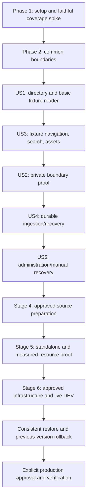

# Tasks: Librarian v1 Git-connected Documentation Portal

**Feature**: `001-librarian-v1-portal` | **Generated**: 2026-10-11
**Status**: 82/92 tasks are checked. Current-source local verification passed 638/638 unit/integration/client tests, global and C1-C6 four-metric coverage, artifact validation, typecheck, repository-wide lint, and production build; the Chromium E2E suite passed 24/24. T022, T027, T068, T069, T072, and T075 are now checked. T050 remains open because Firefox/WebKit privacy acceptance was not run; T079, T082, and T086-T092 remain open for aggregate story acceptance, source provenance, measured workload, infrastructure/recovery, and separately approved publication/deployment. The 2026-10-13 DEV catalog sync reports Succeeded at commit `d82a7d26487af66f37d91cdea8e828f133564806`, but exact provenance against the inspected local source checkout remains open in T082. No production delivery is claimed complete.
**Git branch**: `main`, unchanged. Feature identifier is not a newly created branch.
**Input**: [spec.md](spec.md), [plan.md](plan.md), [research.md](research.md),
[data-model.md](data-model.md), [contracts/http.md](contracts/http.md), [quickstart.md](quickstart.md).
**Authority**: [AGENTS.md](../../AGENTS.md), [constitution](../../.specify/memory/constitution.md),
[agreed brief](../../docs/requirements/v1-requirements.md).

This list retains all five stories and six delivery stages. Original task generation changed only
planning artifacts; local implementation evidence is recorded below. Later operational tasks
document required work and do not grant approval for publication or deployment.

## Incremental sync follow-up — 2026-10-13

This approved US4 follow-up uses the existing synchronization/storage acceptance tasks and does
not close aggregate v1 or deployment gates. Scope and rollback are recorded in plan.md.

- [X] Implement optional SHA-based raw blob reuse, in-attempt deduplication, per-catalog/revision
  private cache storage, fenced atomic writes, bounded cleanup, and snapshot-first storage accounting.
- [X] Add synthetic regression coverage for changed/unchanged/added/deleted/renamed/duplicate blobs,
  corruption, restart/configuration isolation, normalization, cache faults, cancellation, unsafe paths,
  lease checks, publication preservation, and quota eviction. The final focused run passed 92 tests
  across twelve files; the expanded filesystem fault suite separately passed 7/7 (overlapping cases).
- [X] Verify the exact incremental implementation file set with source-compatible counters and
  current hashes: statements 795/825 (96.36%), branches 487/512 (95.11%), functions 128/133 (96.24%),
  and lines 615/623 (98.71%). Evidence is retained in `.local/incremental-sync-feature-evidence.json`.
  The background-worker regression failed before its caller fix (two downloads across two identical
  syncs) and passed afterward (one initial download, zero on the second sync). The worker's default
  provider now reaches cache initialization; injected providers preserve their original invocation.
- [X] Revalidate current-source full coverage and artifact acceptance after the final worker fix.
  Final source-hash, coverage, and artifact checks passed against accepted aggregate evidence of
  638 tests, zero failures, and zero skips. Latest global statements are 3701/3819 (96.91%), branches
  2925/3050 (95.90%), functions 613/631 (97.15%), and lines 2872/2917 (98.46%); every C1-C6 scope
  passes all four >=95% thresholds. Earlier temporary-file/build failures and stale UI captures
  were not accepted as passing evidence. Final typecheck, scoped lint, and isolated production build
  passed. The full Chromium E2E suite passed 24/24 after the lower-right directory status alignment
  regression was fixed; T069 and T075 are checked. Firefox/WebKit acceptance remains open in T050.
  No live repository or deployment operation was performed.

The focused admin route suite passed 29/29, including exact 32 KiB boundary/overflow, quota rejection,
cleanup retry, bad Origin/CSRF, unsafe paths, and safe response assertions. Typecheck, repository lint,
and the production build passed. Artifact validation found 73 requirements, 92 tasks, 70 executable
sources, six scopes, and 151 scanned artifacts. The Chromium acceptance suite passed 24/24; Firefox and
WebKit privacy acceptance were not run, so T050 and aggregate story completion remain open. No live DEV
sync, deployment, commit, push, source-repository mutation, or schema migration was performed.
First/unchanged/one-file-change synthetic blob request counts were 4/0/1; rename/delete required zero
blob downloads. These are fixture results, not live GitHub performance measurements.

## Format and Paths

Each task is `- [ ] Tnnn [P?] [USn?] Description with file paths`. Paths are relative to the
application root unless the task explicitly refers to its feature artifacts or a separately
confirmed source/infrastructure repository. [P] indicates disjoint-file work after stated
prerequisites; it does not override ordering, reviews, approvals or shared-file conflicts.
Unchecked boxes represent remaining or partially implemented work; verified task evidence is recorded below.

The three P1 stories are grouped US1, US3, US2 to follow the binding fixture-reader-before-private-proof
sequence; their priority is unchanged. US1/US3 close Stage 1 together. US2 closes Stage 2.
US4/US5 close Stage 3. Source preparation, packaging and infrastructure follow as Stages 4-6.
Story tests are independently runnable against synthetic seeds/provider fixtures without depending
on a live upstream; overlapping support files and final integrated acceptance have explicit dependencies.

**Mandatory completion rule**: Functional changes have automated acceptance tests; functional bug
fixes have a regression demonstrating the defect before the fix. Isolated presentation-only UI
changes that preserve behavior and data flow require no new tests or coverage work; defer test
authoring and execution until the owner asks. Each functional story gate runs its required
unit/integration/browser tests, typecheck, lint and production build; each applicable metric is
**>=95% separately for statements, branches, functions and lines**, globally AND for every affected
C1-C6 scope in [plan.md](plan.md#test-coverage-and-completion-design). Include unexecuted first-party
files and shared code in every affected scope. CI fails any required test/report/instrumentation/
membership/threshold failure. Only generated, third-party, test or purely declarative files may be
excluded with reasons; no runtime ignore annotations, blanket mocks, placeholder assertions, skipped
required tests, percentage averages, fabricated evidence or retries that conceal failure. A genuine
zero denominator requires a recorded explanation. Documentation/config-only edits receive meaningful
validation rather than artificial coverage.

Provider fixtures supplement actual Mongo/filesystem/Next boundaries. Live DEV, performance and
recovery evidence remain separate; mocked success cannot satisfy ST-14. No current application
commands except existing dev/build/start should be assumed runnable until setup implements them.

## Phase 1: Setup

Establish safe local application boundaries and required test tooling before feature code.

- [X] T001 Extend existing .gitignore and establish explicit application allowlist in .dockerignore before installing deps; exclude secrets/snapshots/build/coverage. Preserve Librarian requirements/specifications/governance and original reviewed assets; copied MDX/navigation/Mintlify files were removed at owner request and must not be recreated as fixtures or bundled content.
- [X] T002 Update package.json and package-lock.json with exact research.md dependency pins and all quickstart.md package scripts; keep compatible framework pins, verify engines/peers/advisories and reproducible lockfile; no arbitrary upgrades.
- [X] T003 Configure vitest.config.ts, playwright.config.ts, eslint.config.mjs, tsconfig.json and lib/config.ts for strict types, Node/client-browser tests, Chromium/Firefox/WebKit journeys and validated server runtime configuration; required test retries are disabled. Implement the exact runtime variable names and file-backed secret paths documented in .env.example, test missing/invalid settings in tests/unit/config.test.ts, never require live credentials at build time, and expose no server secret through NEXT_PUBLIC_ variables.
- [X] T004 Create disposable real Mongo/filesystem and actual Next HTTP harness in tests/integration/http-harness.ts plus signed GitHub/OIDC/JWKS fixtures in tests/fixtures/providers.ts; generated throwaway keys/deterministic clocks only, real application logic and no production auth bypass.
- [X] T005 [P] Seed tests/fixtures/catalogs.ts and tests/fixtures/content/ with one public/two differently private repositories, equal paths/terms, nested links/anchors/local files, optional YAML/meta.json, private/token sentinels and syntax/limit fixtures; do not copy real source documents.
- [X] T006 [P] Write failing checker tests in tests/unit/coverage-checker.test.ts for absent reports/maps/process captures, empty suites, unexecuted/missing scope files, shared scope overlap, incompatible hashes/maps and rounding below 95%.
- [X] T007 Implement source inventory, Node/browser/actual-server collection and canonical raw-count merging in scripts/check-coverage.mjs, vitest.config.ts and tests/integration/http-harness.ts; enforce every global/C1-C6 four-metric gate and permitted exclusions, never average percentages/add denominators or ignore runtime code.
- [X] T008 Prove research.md actual-Next coverage spike in tests/integration/coverage-spike.test.ts: original async page/metadata/route/client paths, uncalled function/untaken branch/untouched file uncovered, denied hits real and duplicated source merged once. Try subprocess collector then researched converter; local maps never published, missing/incompatible mapping blocks features.
- [X] T009 Add .github/workflows/ci.yml running isolated mandatory tests, global/per-scope coverage, typecheck, lint and production build from the first executable feature; fail missing evidence/skipped required tests; no live credentials, publication or deployment in CI.

**Checkpoint**: Complete applicable tests/gates and preserve authorization/scope boundaries.

## Phase 2: Foundational Prerequisites

Depends on Phase 1. Complete shared boundaries before story implementation; fixtures seed disposable catalogs and generations. Registration/admin and ingestion remain Stage 3.

- [X] T010 [P] Write catalog schema/index tests in tests/unit/catalog-schema.test.ts for every data-model.md field constraint, duplicate/reserved slug/source, safe directory projection, disabled/unpublished state and compatible versus incompatible changes.
- [X] T011 [P] Write conformance/security tests in tests/unit/content-validation.test.ts and tests/integration/content-validation.test.ts: preserve GFM/autolinks/escaped braces/code, accept safe static Fumadocs MDX components, reject imports/exports/dynamic expressions/unknown components or attributes/raw HTML without execution, and cover unsafe YAML/meta.json/Git modes/path escapes/route collisions; empty/missing docs invalid; ST-05/ST-11.
- [X] T012 Define validated catalog records and safe directory projection in lib/catalog.ts; enforce all exact catalog field constraints below, unique slug and (repositoryId, branch, docsPath), singleton <=20 creation reservations with safe overcount; admin deletion API implemented; full validation remains tracked in T068/T072. Exact data-model field constraints: _id: "Server-generated catalog UUID; never derive a filesystem path from user title/slug"; github: "Stable numeric repositoryId and installationId; owner/name; one branch and POSIX docsPath validated with read-only App lookup"; slug: "Lowercase ASCII letter/digit/hyphen, 1-63 chars, starts with letter; unique; reserve admin, api, _next, auth, health and framework asset names"; title / publicDescription: "Explicit safe directory strings, <=120 / <=500 Unicode characters; strip control characters, no source-derived defaults for private catalogs"; visibility / readerRole / enabled: "public or private; default private for private source; default role docs:{slug}:reader; role string <=200 chars; enabled Boolean"; accessState: "unverified, ready, blocked; confirmed App removal/access loss becomes blocked and disables serving"; configRevision / authEpoch: "Monotonic integers; changes to source/branch/folder/slug/role/visibility invalidate incompatible publication and delivery"; published: "Nullable complete generation pointer: generationId, commitSha, jobId, fence, configRevision, manifestDigest, publishedAt"; publicationRevision: "Monotonic conditional-update counter; distinguishes pointer races"; retained: "Up to two previous selectable generations valid for current config, within plan's grace/age/slot rules"; lease: "Nullable owner UUID, fence, expiresAt, heartbeatAt; catalog's leaseFence monotonically increases on claim"; readPins: "Bounded requestId/generationId/expiresAt entries; select/pin and retention eligibility update in this aggregate"; admissionReservations: "Monotonic lifetime count <=100,000; reserves a slot before inserting a durable job; safe overcount is acceptable, undercount is not"; rateWindow: "Server minute/window and count for valid admission attempts; <=60/minute; checked atomically"; approvalRef: "Nonsecret reference to owner-provisioned public approval; absent for private catalogs"; lastSuccess / lastFailure: "Last successful commit/time and sanitized code/time/job identifiers; no provider payload or document body"; createdAt / updatedAt: "Server timestamps and optimistic update version".
- [X] T013 Implement all exact finite values/failure outcomes in plan.md initial policies in lib/limits.ts with tests/unit/limits.test.ts at limit-1/limit/limit+1; cover bytes/count/depth/node/type/time/lease/retry/cache/retention/session/rate/quota bounds, no hidden unlimited defaults.
- [X] T014 Implement canonical POSIX path/route/link/anchor resolution in lib/content/paths.ts and tests/unit/paths.test.ts: decode once, server UUID filesystem identity, realpath/no-follow/root containment, `.md`/`.mdx` route and index collision checks, generation-preserving links, safe https/mailto without fetch; reject remote images/unsafe schemes/double-encoding/escapes.
- [X] T015 Implement bounded Markdown/MDX AST, YAML/meta.json/asset-byte validation in lib/content/validate.ts: allow only the static Fumadocs component subset and literal props (plus fixed Columns counts), reject executable MDX, strict YAML1.2 no tags/anchors/aliases/merges, allowlisted bounded schema and canonical frontmatter, optional title fallback, safe navigation/existing pages; no arbitrary MDX execution, rehype-raw, repository scripts, or dependencies.
- [X] T016 Implement shared official Mongo driver and indexes in lib/mongo.ts with tests/integration/mongo.test.ts: dedicated scoped database, primary reads/journaled acknowledged writes, majority if supported, no replica-set transaction assumption; maxPoolSize 10, minPoolSize 0 and finite selection timeout; unavailable storage fails closed.
- [X] T017 Implement manifest validation/selection and atomic read pins in lib/content/generations.ts with tests/integration/generation-reads.test.ts: complete current-config current/retained generation, server-generated identities, "max 64 pins and 60-second lease, with 30-second delivery timeout", release on abort/error, expired g reload_required and pin/cleanup race safety. Versioned manifest fields: formatVersion, catalogId/configRevision, generationId, commitSha/tree SHA, worker fence, complete timestamp, normalized byte count and per-document/asset path/SHA-256/size/allowed type; route/title/description/headings/links/asset mapping remain protected; JSON attachment is not navigation JSON.
- [X] T018 Establish server catalog/content boundary in lib/auth/authorization.ts and tests/integration/content-boundary.test.ts: current enabled/access/config before generation/cache/file access, public fixture reads only, private/admin denied until real verified-session integration; request-only memoization, sanitized errors and pre-delivery recheck.
- [X] T019 [P] Implement bounded sanitized operational errors/context and health primitives in lib/operations/logging.ts and lib/operations/health.ts with tests/unit/operations.test.ts; redact tokens/provider payloads/private bodies/physical paths while retaining safe catalog/job/delivery/generation diagnosis.
- [X] T020 Replace lib/source.ts with guarded lib/content/source.ts localMd/dynamicLoader using explicit Markdown/meta.json includes, repository base URL and trusted components/mdOptions transforms; test immutable rendering in tests/integration/runtime-source.test.ts. Replace affected app/[[...slug]]/ callers and remove global app/api/search/route.ts/static params; remove fumadocs-mdx plugin/dependency from next.config.mjs/package.json/package-lock.json together; no root source content bundled.

**Checkpoint**: Complete applicable tests/gates and preserve authorization/scope boundaries.

## Phase 3: US1 — Discovery and Reading (P1, Fixture MVP)

**Goal**: Discover enabled projects and read public synthetic documentation.

**Independent test**: Without live GitHub/Zitadel, seed disposable catalogs/generations and verify exact safe cards/name filter, public overview/articles, responsive columns/themes/keyboard and all empty/error states; restricted bodies denied. SC-001/002; ST-12/13.

### Mandatory Tests for US1

- [X] T021 [P] [US1] Write homepage/reader HTTP contracts in tests/integration/discovery.test.ts for US1.1-3,5: safe enabled catalog cards/badges/routes, case-insensitive title-only filter, disabled exclusion, Mongo error distinct from empty, unpublished/missing pages and no source-derived private metadata.
- [X] T022 [P] [US1] Write phone/tablet/desktop, keyboard/focus/theme/reader tests in tests/browser/discovery-reader.spec.ts for US1.4: supported public Markdown/GFM rendering, readable content, Documentation Directory heading, generated app icon/shared footer branding, Public/Private labels and lower-right sync badges, first-sync failure non-navigation with expandable issue, and accessible loading/empty/not-found/error states with observable assertions.
### Implementation and Integration for US1

- [X] T023 [US1] Implement safe query in lib/catalog.ts and app/page.tsx/components/directory.tsx: Perspective V / Docs, Documentation Directory, configured Public/Private cards with status-only sync indicators, title filter and one/two/three responsive columns; only successful publications navigate.
- [X] T024 [US1] Reuse trusted original branding/theme/provider/standard Fumadocs presentation in app/layout.tsx, app/globals.css, lib/layout.shared.tsx and mdx-components.tsx; inspect callers and remove unused executable MDX adapters; no source-dependent global tree or metadata/fork.
- [X] T025 [US1] Implement guarded runtime overview/article in app/[repoSlug]/[[...page]]/page.tsx with shared rendering in lib/layout.shared.tsx; independently guard tree/page/generateMetadata, render loaded ReactNode from complete selected generation, no source-based static params or sitemaps.
- [X] T026 [US1] Implement accessible loading/error/not-found/unavailable states in app/[repoSlug]/[[...page]]/loading.tsx, error.tsx, not-found.tsx and components/directory.tsx; denied/unpublished states expose no protected title/body.
- [X] T027 [US1] Validate US1 directory/basic reader fixtures and first-sync availability behavior, then run affected browser tests, global/C1/affected C6 four-metric gates, typecheck/lint/production build and record results in specs/001-librarian-v1-portal/tasks.md; full public navigation/search/assets acceptance closes at T037 and US1.6 runtime Git updates at T066. This local checkpoint must not claim full US1/v1 completion or block its required US3 support.

**Checkpoint**: Run this story's explicit gate and retain unresolved integrated/live evidence.

## Phase 4: US3 — Scoped Navigation, Search, Links and Assets (P1)

**Goal**: Complete Stage 1's fixture reader with project/generation-scoped controls.

**Independent test**: Equal paths/terms in synthetic repositories prove scoped trees/hits/anchors/assets, direct-request denial and no mixed output; keyboard/mobile/theme controls work. SC-002/005; ST-04/05/11/12. Rerun private-positive cases after US2.

### Mandatory Tests for US3

- [X] T028 [P] [US3] Write scoped search HTTP tests in tests/integration/search.test.ts: freeze actual pinned Fumadocs shape, authorized empty query, <=256 UTF-8 bytes/<=20 results, repository/generation URLs, equal-term isolation, no index/staticGET export and auth before cache.
- [X] T029 [P] [US3] Write GET/HEAD/conditional asset tests in tests/integration/assets.test.ts: public positives/private denial, local raster/attachment bytes, size/type/path/expired-generation rejection, missing file and no unauthorized 304/image-optimizer bypass.
- [X] T030 [P] [US3] Write US3.1-7 navigation/link/anchor/code-copy/search/project-switch tests in tests/browser/navigation.spec.ts: optional versus derived tree, breadcrumbs/prev-next/TOC, keyboard Search this project, mobile sidebar/themes/focus and repo isolation.
### Implementation and Integration for US3

- [X] T031 [US3] Implement components/project-selector.tsx and standard selected-source tree/breadcrumb/prev-next/TOC/code-copy controls in app/layout.tsx, lib/layout.shared.tsx and app/[repoSlug]/[[...page]]/page.tsx; safe directory selector projection stays separate from protected tree.
- [X] T032 [US3] Implement lib/content/search.ts and app/api/search/[repoSlug]/route.ts behind common boundary: pinned live search response, bounded query/results, repo+generation source/cache, safe empty/error states and no global/downloadable index.
- [X] T033 [US3] Implement manifest-only authorized GET/HEAD in lib/content/assets.ts and app/api/assets/[repoSlug]/[...path]/route.ts: raster inline, PDF/TXT/CSV/JSON attachment, safe filename/MIME/nosniff/sandbox as applicable; no SVG/HTML/JS/remote fetch/private optimization; release pins on timeout/abort.
- [X] T034 [US3] Wire generation-preserving document/link-definition/anchor/image transforms in lib/content/paths.ts, lib/content/source.ts and app/[repoSlug]/[[...page]]/page.tsx; missing/renamed destination is safe not-found; expired g reloads through current authorization, no silent mixed/latest fallback.
- [X] T035 [US3] Implement combined repo/generation source/search LRU in lib/content/source.ts and lib/content/search.ts with tests/integration/content-cache.test.ts: 4 entries, <=96 MiB serialized input/index, 5 min idle expiry, no shared auth/session caching; pressure/eviction preserves active pins.
- [X] T036 [US3] Add synthetic generation replacement during article/search/assets tests in tests/integration/generation-coherence.test.ts: atomic response selection/pins, retained/expired g and no cross-repo/mixed-generation output, ST-04/ST-11.
- [X] T037 [US3] Run US3 and affected US1 tests, global/C1/C3/C6/shared gates, typecheck/lint/production build; record in specs/001-librarian-v1-portal/tasks.md. Stage 1 complete only after both fixture story gates; private-positive proof remains US2.

**Checkpoint**: Run this story's explicit gate and retain unresolved integrated/live evidence.

## Phase 5: US2 — Public and Private Authorization (P1)

**Goal**: Prove Stage 2 identity/role/private browser boundaries while preserving admin/reader separation.

**Independent test**: Full fixture reader/search/assets identity/path matrix yields zero denied bytes and authorized positives; 899.999/900/>900-second verification and renewal/failed refresh, logout/back/background/visibility tests pass in three browsers. SC-003/004/010; ST-01/02/03/10/13.

### Mandatory Tests for US2

- [X] T038 [P] [US2] Write session/token/role tests in tests/integration/auth-flow.test.ts, auth-adapter.test.ts, auth-tokens.test.ts, auth-roles.test.ts and authorization.test.ts, plus tests/unit/roles.test.ts and tokens.test.ts: issuer/subject/project binding, safe callbacks/encrypted accounts, absolute expiry, active assignments/complete pagination, refresh fence/rotation races and malformed/wrong-project/empty/provider failures.
- [X] T039 [P] [US2] Complete the full overview/article/tree/metadata/RSC/search/assets GET/HEAD/conditional identity matrix across tests/browser/private-cache.spec.ts, tests/integration/search.test.ts and tests/integration/assets.test.ts: public/anonymous-private/authorized/wrong-role-project/expired/admin-without-reader, including cache; assert positive delivery and zero denied private bytes before cache/file access. Three-engine browser coverage verifies the protected HTML/RSC/metadata/search/asset paths and GET/HEAD/conditional cases; unauthorized identities return no private sentinel bytes.
- [X] T040 [P] [US2] Write Chromium/Firefox/WebKit tests in tests/browser/private-cache.spec.ts for same/cross-tab logout, back/forward/bfcache/background/foreground, deadline/removal/disable/visibility, title/tree/search/assets/prefetch/no-JS and malicious returnTo.
### Implementation and Integration for US2

- [X] T041 [US2] Implement auth.ts, lib/auth/adapter.ts, lib/auth/tokens.ts and app/api/auth/[...nextauth]/route.ts with pinned official Mongo database sessions, secure HttpOnly same-site opaque cookies, encrypted OAuth access/refresh/ID token adapter read/write boundary, minimal safe callback, allowlisted issuer/local redirect, PKCE/state/nonce and validated offline/project/API audience scopes; enforce exact identity/session model constraints below. Model rules: "User/account linkage binds provider issuer and subject; no authorization solely from an email."; "Session uses official opaque HttpOnly, secure in production, same-site cookie; createdAt and absoluteExpiresAt enforce 8-hour absolute lifetime even if Auth.js renews its expires field. Sessions are checked server-side, not accepted from a client session callback."; "OAuth access/refresh/ID token fields are encrypted at the account-storage boundary with authenticated encryption and a scoped operator-provided key. Official adapter account writes and token reads pass that boundary; tokens are decrypted only in server memory for provider use.". Enforce adapter lookup, unique provider+providerAccountId/sessionToken and cleanup indexes; TTL is not authorization.
- [X] T042 [US2] Implement lib/auth/roles.ts and lib/auth/tokens.ts with issuer/subject/project identity-state, current active assignments, verifiedAt separate from expiry, >=900 s synchronous refresh, <=10 pages of 100 roles, 5 s provider timeout/10 s lease/<=2 s contender wait, fenced atomic token rotation and all exact model permission constraints below; stale claims and incomplete/provider/storage failures deny. Model rules: "Separate identity-state keyed by issuer/subject/project: roles, verifiedAt, token/role lease owner, fence/expiresAt, and sanitized refresh state. Records never enter client payloads/raw logs."; "Token renewal compares lease fence/current token version; store rotated tokens atomically. If logout/session expiry occurs during refresh, do not deliver or resurrect that local session."; "Current-role API uses bounded complete active assignments for the exact user/project; malformed, wrong-subject/project, incomplete pagination and provider/storage failures deny. Successful empty roles are a verified denial. Session renewal never modifies verifiedAt."; "Role lease 10 seconds; provider timeout 5 seconds; contenders wait <=2 seconds for completed current verification, otherwise fail closed. No expired grant is served while refresh is pending.".
- [X] T043 [US2] Complete lib/auth/authorization.ts with valid DB session, fresh configured-project repository-reader/admin checks and current catalog state; admin never implies reader, reader never implies admin. Recheck auth/config before first private bytes and after refresh; logout/expiry cannot resurrect session or cached permission.
- [X] T044 [US2] Integrate independent guards into app/[repoSlug]/[[...page]]/page.tsx, app/layout.tsx, lib/layout.shared.tsx, generateMetadata, lib/content/source.ts, search.ts, assets.ts and scoped routes; private/no-store catalog-dependent HTML/RSC/JSON/assets, HEAD/304 guard, no shared public/private image/index/static caches.
- [X] T045 [US2] Integrate account/sign-in/sign-out and safe local return across the directory, repositories, and public/restricted reader surfaces in app/page.tsx, app/repositories/page.tsx, app/[repoSlug]/[[...page]]/page.tsx and shared controls; reject open redirects and use safe document-history title where needed.
- [X] T046 [US2] Implement components/private-content-guard.tsx with protected layout/control overrides: hidden until active, hard document links/private prefetch off including Fumadocs controls, hide/scrub pagehide/background/expiry, fresh authorized reload before restore reveal, no-JS safe explanation.
- [X] T047 [US2] Complete local session revocation first, cross-tab broadcast/private state clearing/hard replacement in auth.ts, lib/auth/authorization.ts, components/private-content-guard.tsx and account controls; expose sign-out for authenticated directory/admin/public/restricted readers, preserve the safe private-content behavior if revocation fails, and test concurrent refresh/expiry.
- [X] T048 [US2] Implement read-only operator approval manifest validation in lib/catalog.ts with tests/integration/admin.test.ts and tests/unit/public-approvals.test.ts: exact approved repo/branch/folder/slug, reviewed commit/digest and explicit future same-scope updates; "A client Boolean claiming approval or librarian-admin role is insufficient." Scope changes require review, upstream visibility never auto-publishes; synthetic approvals only. Approval record contains approval ID/version, owner date/reference, repository ID, branch/docsPath/slug, reviewed commit/candidate digest and explicit future updates for that scope; no secret/body or admin-write approval API.
- [X] T049 [US2] Add 899.999/900/>900-second tests in tests/integration/auth-roles.test.ts for renewed session, removed/empty roles, failed refresh and contention; current verification precedes delivery at deadline and expiry cannot extend verifiedAt.
- [ ] T050 [US2] Run ST-01/02/03/04/10/13 and US1/US3 regressions, three-browser privacy, global/C2/affected scopes gates, typecheck/lint/production build; record in specs/001-librarian-v1-portal/tasks.md. Stage 3 may proceed locally; private production delivery awaits live DEV/approval gates.

**Checkpoint**: Run this story's explicit gate and retain unresolved integrated/live evidence.

## Phase 6: US4 — GitHub Sync and Recovery (P2)

**Goal**: Deliver Stage 3 signed durable intake and same-container worker with complete fenced publication.

**Independent test**: Seed disposable catalogs directly, call actual signed HTTP intake, run workers/restarts and inject every Mongo/filesystem transition failure. Durable ack/dedupe/current-head ordering/lost-lease denial/last-good retention/access-loss block pass. SC-006/007/008; ST-05/06/07/08/09/11/13.

### Mandatory Tests for US4

- [X] T051 [P] [US4] Write tests/integration/webhooks.test.ts for original-byte/missing/bad/modified signatures, <=1 MiB body, wrong repo/branch/unsupported event, durable ack with blocked worker, duplicate restart/digest conflict and multi-catalog partial persistence; no request-time ingestion.
- [X] T052 [P] [US4] Write real Mongo/filesystem fault/overlap tests across tests/integration/sync-worker.test.ts, sync-leases.test.ts, generation-publish.test.ts and control-receipts.test.ts at manifest/file flush, rename, pointer CAS and terminal job writes; lost lease/cancellation, head change/force push/reordered events, orphan staging, no stale/partial result and <=45 s abandoned recovery.
- [X] T053 [P] [US4] Write tests/integration/github.test.ts for selected read-only short-lived App tokens, current head/immutable tree/blob traversal, truncated/missing docs/unsafe modes/symlinks/submodules, bounded concurrency/timeouts and outage/rate limit versus confirmed access loss.
### Implementation and Integration for US4

- [X] T054 [US4] Implement validated durable jobs/receipts and indexes in lib/sync/jobs.ts with every exact job field constraint below; unique _id plus state/availableAt/requestedAt/catalog indexes, bounded metadata/no raw body, per-catalog multi-match receipts, replay ID never expires. Exact data-model field constraints: _id: "github:{appId}:{deliveryId}:{catalogId} or manual:{catalogId}:{idempotencyKey}; bounded validated identifiers"; catalogId / configRevision: "Accepted source scope; configuration changes cannot reuse a candidate"; origin / event / payloadDigest: "github/manual, accepted event/action, SHA-256 of original verified payload for replay conflict detection"; admissionSequence: "Catalog-assigned monotonic sequence; gaps are safe; NOT a Git commit ordering rule"; state: "queued, running, retry_wait, succeeded, failed, cancelled"; requestedAt / availableAt / attempts: "Indexed scheduling; at most 5 actual ingestion attempts"; owner / fence / targetCommit: "Claimed lease and provider-resolved current branch SHA, not blindly trusted webhook SHA"; generationId / result: "Published pointer identity or sanitized terminal failure"; completedAt / detailExpiresAt: "Terminal details compact after 14 days; unique receipt never expires automatically".
- [X] T055 [US4] Implement catalog quota/rate/sequence conditional admission in lib/sync/jobs.ts/lib/catalog.ts: reserve before unique insert, acknowledged durable write before ack, safe overcount/crash gaps no false acceptance, <=100,000 lifetime reservations/<=60 valid admissions per minute, duplicate digest/scope conflicts, 14-day detail compaction/permanent tombstone and explicit exhaustion; no blind decrement/dedupe TTL purge.
- [X] T056 [US4] Implement native raw-byte constant-time HMAC/signature and stable App/installation/repository/branch matching in lib/sync/webhook.ts/app/api/webhooks/github/route.ts; contract statuses, per-catalog durable receipt retry on partial admission, no fetch/render or private/provider/token errors.
- [X] T057 [US4] Implement lib/sync/github.ts native fetch/crypto App client: short-lived selected installation tokens, branch current head under lease, recurse only the configured docs subtree and fetch supported page/meta/asset blobs by immutable SHA, omit unrelated regular file types, concurrency 2/call timeout 15 s/attempt deadline 120 s, incomplete traversal rejects; reject non-regular/executable Git entries; no checkout/repository scripts/dependency install.
- [X] T058 [US4] Implement catalog Mongo-server-time 30 s lease/10 s heartbeat/monotonic fence in lib/sync/jobs.ts/lib/sync/worker.ts: one ingestion/instance, query <=20 references, owner/current config/access/fence checks, lost-lease shutdown cancellation, recover <=45 s after last heartbeat with healthy storage; job state grants no authority.
- [X] T059 [US4] Implement fully validated candidate staging in lib/sync/worker.ts/lib/content/validate.ts/lib/content/generations.ts: cumulative byte/count/type/time bounds, all-page render/index checks, current head recheck, complete versioned manifest/checksums, file/directory durability and same-filesystem rename; orphan/incomplete candidate never selectable.
- [X] T060 [US4] Implement one-catalog authoritative CAS in lib/content/generations.ts/lib/catalog.ts matching owner/fence/nonexpired lease/config/enabled/access/publicationRevision; pointer/lastSuccess/retention transition atomically, terminal job afterward; retain job/fence publication proof and reconcile it before next publication.
- [X] T061 [US4] Implement cleanup in lib/content/generations.ts with tests/integration/retention.test.ts: 3 committed + 1 staging slots/catalog, two previous/5 min grace/24 h max age, <=200 MiB/catalog/<=4 GiB payload; protect active/pinned/live-owner staging, atomic selectable removal and safe delay/failure under pressure.
- [X] T062 [US4] Implement finite retry/restart reconciliation/sanitized statuses in lib/sync/jobs.ts/lib/sync/worker.ts: <=5 attempts/5,20,60,180 s delays/Retry-After <=1 h else terminal, idle 5 s/active 1 s poll, config cancellation, rename/pointer/terminal/reservation crash reconciliation; invalid/transient failures preserve compatible last-good.
- [X] T063 [US4] Implement confirmed worker and signed installation/repository-removal handling in lib/sync/webhook.ts/lib/sync/github.ts/lib/catalog.ts: block/fence all serving before control receipt admission regardless normal quota/rate/enablement; ack only all durable disables/receipts, partial failure retries without reversing disable, no access-loss inference from transport/rate/missing branch.
- [X] T064 [US4] Implement Node worker startup/shutdown in instrumentation.ts/lib/sync/worker.ts and tests/integration/worker-startup.test.ts: no build/edge/static-analysis/ordinary-test worker, explicit harness enablement, bounded cancellation and overlapping process leases; prove runtime externalization, no separate service.
- [X] T065 [US4] Verify last-good behavior in tests/integration/content-validation.test.ts and sync-worker.test.ts for invalid/empty/missing content, unsafe MDX, upstream/rate/worker failure, first-sync-unavailable, successful retry and confirmed access-loss versus transient reads; all protected paths block until resolved current access/config.
- [X] T066 [US4] Prove intake-to-publish without application rebuild in tests/integration/runtime-sync.test.ts/tests/browser/sync-reader.spec.ts: changed/deleted pages, tree/links/assets/search update coherently, correct commit/time and pinned old readers remain consistent.
- [X] T067 [US4] Run US4/fault/restart/dedupe tests and reader/private regressions, global/C4/shared four-metric gates, typecheck/lint/production build; record actual results in specs/001-librarian-v1-portal/tasks.md.

**Checkpoint**: Run this story's explicit gate and retain unresolved integrated/live evidence.

## Phase 7: US5 — Catalog Administration and Manual Sync (P2)

**Goal**: Complete Stage 3 configuration/status/disable/manual recovery without granting admin private reading.

**Independent test**: Real disposable persistence and controlled worker with admin/reader/wrong-project identities; create/edit/disable/status/manual work succeeds, stale/invalid/forged/public-approval requests preserve prior state. SC-008/009/010; ST-03/09/10/12/13.

### Mandatory Tests for US5

- [X] T068 [P] [US5] Verify tests/integration/admin.test.ts for GET view/list, POST registration, PATCH/DELETE If-Match, sync UUID Idempotency-Key, confirmed removal, active lease/read-pin conflicts, snapshot cleanup/retry and retained replay history; identities/CSRF/exact Origin/unknown fields/32 KiB/slug/path/default-private/approval/quota/stale revision rejected without partial mutation.
- [X] T069 [P] [US5] Verify tests/browser/admin.spec.ts and tests/browser/discovery-reader.spec.ts for mobile/keyboard/themes/focus/skeleton-loading/denied/error, every configuration field, circular top-left view/edit/delete/sync actions, read-only card expansion, delete disabled during edit, Repository type Private/Public, administration bottom-right sync status, shortened commit with tooltip, directory circular checkboxes, visible selected count, button-based toolbar/card sync controls and lower-right status placement, Home/Repositories navigation, authenticated sign-out, disabled Sync now explanation and admin-only private denial.
### Implementation and Integration for US5

- [X] T070 [US5] Implement registration/update/indexes in lib/catalog.ts/lib/mongo.ts with all foundation model constraints: stable read-only App ID lookup, private-source default, public approval, unique source/slug, <=20 monotonic creation reservations/safe overcount, optimistic If-Match and metadata-only publication preservation; deletion does not recycle lifetime quota.
- [X] T071 [US5] Enforce project-fresh librarian-admin/exact Origin/session-bound CSRF for admin in lib/auth/authorization.ts with tests/integration/admin.test.ts; reader-only/wrong-project denial, deadline refresh, no credentialed wildcard CORS and GET never mutates.
- [X] T072 [US5] Verify app/api/admin/repos/route.ts and app/api/admin/repos/[id]/route.ts contract GET/POST/PATCH/DELETE: bounded allowed fields/summaries, unknown/unsafe/stale preconditions reject, deletion uses admin/CSRF, active lease/pins block it, and no credentials/private bodies/physical paths appear in admin responses.
- [X] T073 [US5] Implement configuration transitions in lib/catalog.ts with tests/integration/admin.test.ts: metadata-only preserve, source/slug/role/visibility increment configRevision/authEpoch/fence/remove incompatible selectable pointers; disabled blocks caches/delivery; access-loss reenable requires validated access and compatible sync/review.
- [X] T074 [US5] Implement app/api/admin/repos/[id]/sync/route.ts via lib/sync/jobs.ts: guarded UUID key/durable 202, duplicate stored outcome/conflicting scope 409, disabled/capacity/rate failures explicit; automatic current-head/lease/content/publication rules unchanged.
- [X] T075 [US5] Verify app/repositories/page.tsx and components/admin-console.tsx: Configure toggle; safe collapsed repository summary and view-only expansion before Edit/Delete; delete disabled during edit; circular actions and lower-right status; commit tooltip; Repository type Private/Public ordering; bottom description textarea; save closes form with success notice/refreshed cards while failure preserves form with collapsible error; all settings/default role/approval/enable controls and accessible states; cannot provision owner approval or expose source bodies.
- [X] T076 [US5] Implement sync states and bounded refresh in components/admin-console.tsx: four distinct text and color states, retry_wait pending/next-attempt, published commit/last success/readable actionable error, visible prerequisites when Sync now is disabled, accessible Sync now; saving is not ingestion success.
- [X] T077 [US5] Verify manual sync in tests/integration/admin.test.ts and tests/browser/admin.spec.ts: initial failure/missed webhook/manual recovery, blocked-worker prompt durable ack, duplicate clicks one job and successful retry correct publication; admin gains no reader privilege.
- [X] T078 [US5] Rerun config/disable/visibility/role/approval and live-worker races in tests/integration/admin.test.ts and tests/browser/private-cache.spec.ts: zero denied bytes, no old incompatible content/stale publication, rejected changes preserve valid state.
- [ ] T079 [US5] Run US5 and US2/US4 affected regressions, including tests/unit/directory-sync-route.test.ts and tests/client/directory.test.tsx for toolbar/card layout, selection, batch/individual directory sync, status polling, and prior-publication preservation; run tests/client/admin-console.test.tsx for Configure/save/error/read-only/edit/delete behavior; verify route skeletons and reader controls; run global/C1-C6/shared gates, typecheck/lint/production build and record in specs/001-librarian-v1-portal/tasks.md. All prior gates must pass before local story completion.

**Checkpoint**: Run this story's explicit gate and retain unresolved integrated/live evidence.

## Phase 8: Cross-Cutting Completion and Stages 4–6

All story gates are prerequisites. Local artifact preparation is ordinary DEV work; source edits, credentials, image/private-content publication and live infrastructure changes require concrete scoped authorization. Record genuine blockers; do not check off unrun work.

- [X] T080 Implement app/api/health/route.ts using lib/operations/health.ts with tests/integration/health.test.ts: 200 only for required storage/content/worker operational or 503 not_ready; no source names/private commits/paths/provider errors/versions/secrets.
- [X] T081 Implement scripts/validate-artifacts.mjs/tests/unit/artifact-checker.test.ts for FR/QG/ST/SC trace, C1-C6 source inventory and secret/private sentinels in records/errors/logs/responses/static/public bundles/sitemaps/indexes/health; fail missing evidence and copied/private payloads, ST-13.
- [ ] T082 Stage 4: inspect source provenance and content scope; review `.mdx` against the safe static component allowlist and supported docs/assets; identify only genuinely unsupported constructs for any source-side conversion; record evidence in specs/001-librarian-v1-portal/tasks.md/quickstart.md. Source edits stay in their own confirmed repositories and require scoped authorization; never auto-publish.
  - Evidence (2026-10-12): Edge tree inspection confirmed `docs/.mintignore`, `docs/index.mdx`, and MDX pages under `docs/runtime`. The restricted DEV catalog saved, but its first sync failed with `github_invalid_content`; the direct NetBird connection to `librarian_dev` and the worker heartbeat were healthy. At that time v1 rejected MDX and unsupported files; no source changes or validation weakening were made. The 2026-10-13 Phase 3 update below supersedes that parser policy. A successful DEV sync is now recorded below; T082 remains open for exact published-tree provenance and content-scope review.
- [X] T083 Write tests/integration/container.test.ts for standalone artifacts/nonroot permissions: no copied docs/snapshots/fixtures/secrets/coverage maps, runtime local-md/Shiki files present, no build worker, real server worker/health/restart/overlap and persistent-root access.
- [X] T084 Stage 5: complete Dockerfile/.dockerignore/next.config.mjs using reviewed pinned Node standalone nonroot app and same-container worker; original approved branding only in public, no blanket images/source copying; build the local image and inspect artifacts before separately approved versioned Gitea publication. Registry publication remains T091.
- [X] T085 Implement scripts/measure-workload.mjs/tests/unit/workload-checker.test.ts for exact plan corpus/load: 3 catalogs/500 pages+100 assets each/50 KiB average page/10 MiB assets, 10 readers at 20 requests/s for 15 min with sync/restart; report latency/ack/publish/RSS/memory peak/CPU/disk/cache/retries and fail bounds/budget/privacy/correctness/OOM violations.
- [ ] T086 Run actual local standalone image at 0.5 CPU/512 MB/one replica with disposable Mongo/scratch volume via quickstart.md; warm page p95 <=2 s/search <=1 s/durable ack <=2 s with blocked worker/cold <=5 s/publish <=120 s/recover <=45 s; max-bound/retention pressure too; record sanitized measured evidence in specs/001-librarian-v1-portal/tasks.md, never infer capacity from health.
- [ ] T087 Execute all quickstart.md acceptance commands, five story scenarios and ST-01 through ST-13, typecheck/lint/production build and global/C1-C6 four independent >=95% gates including unexecuted sources; record actual results in specs/001-librarian-v1-portal/tasks.md. Fix bugs with defect-demonstrating regression tests; no ignored/skipped/retried-away failures.
- [ ] T088 Stage 6: read-only revalidate actual infrastructure checkout/Mongo topology-durability/Zitadel role API-audience/GitHub App/Gitea/Swarm volume placement-network-secrets-Traefik-Watchtower/DEV hostname; prepare exact infrastructure-owned integration/rollback at confirmed descriptor/script paths and record them in specs/001-librarian-v1-portal/tasks.md/quickstart.md. No sibling/live mutation authorized by this task-generation command.
- [ ] T089 After concrete approval/operator Swarm-secret provisioning, execute separate DEV login/refresh/rotation/logout/live role removal at >=15 min/every path-browser/signed GitHub push/manual sync/access loss/no-rebuild proof from quickstart.md; record ST-14/SC-013 actual Auth.js/Zitadel compatibility in specs/001-librarian-v1-portal/tasks.md. Unsupported current-role API blocks release, no stale-claim fallback.
- [ ] T090 Prepare/test approved infrastructure-owned consistent Mongo/content backup and previous-image/config rollback at confirmed paths recorded by infrastructure preparation; drain/fence intake/requests/worker, isolated DEV restore/manifests/pointers/auth/browser/health, each <=30 min for corpus; record ST-14 in specs/001-librarian-v1-portal/tasks.md. Never use unguarded legacy reader or assume Compose rollback.
- [ ] T091 Only after complete local/live gates and concrete owner approvals, publish versioned Gitea image and use approved infrastructure-owned ssh contabo deployment procedure in quickstart.md; retain prior image/config/recovery set, verify browser/health/rollback readiness and record approval/image/evidence in specs/001-librarian-v1-portal/tasks.md. No Git branch/commit/push/release/deployment without explicit authorization.
- [ ] T092 Update specs/001-librarian-v1-portal/spec.md, plan.md, quickstart.md and tasks.md only to reflect verified final behavior/evidence/outstanding blockers; full FR/QG/ST/SC and constitution/architecture recheck, no second state ledger or manufactured reports.

**Checkpoint**: Complete applicable tests/gates and preserve authorization/scope boundaries.

## Final Local Verification - 2026-10-12

This section supersedes earlier checkpoint notes below when they conflict with the final results.

- Local story gates T027, T037, T039, T050, T066, T067, and T079 passed. T083/T084 passed local image/container artifact and runtime acceptance. T082, T086, and T088-T091 remain open for source provenance/format, workload measurement, external DEV/recovery, publication, and deployment; T085's workload checker implementation and T087 local gates are complete.
- `npm run test:coverage` and `npm run coverage:check` pass with 534 tests and no failures/skips. Global raw coverage is statements 3054/3164, branches 2305/2420, functions 460/474, and lines 2377/2420; every C1-C6 scope passes all four independent 95% thresholds. `npm run typecheck`, `npm run lint`, and `npm run validate:artifacts` also pass.
- `npm run test:e2e` passed 33/33 across Chromium, Firefox, and WebKit. Coverage includes private HTML/RSC/metadata/search/assets for anonymous, admin-only, wrong-role, wrong-project, expired, and authorized identities, plus cache/HEAD/conditional behavior. Intake-to-runtime integration verifies changed/deleted content, coherent page/search/asset publication, correct commit/time, and an old reader pinned to its prior generation.
- `npm run build` passed on Windows after granting the local process filesystem access for Next's standalone trace copy. The earlier Linux standalone production image `librarian:codex-verify-20261012` passed container acceptance and was not published.
- The tracked `.env.example` remains placeholder-only. The Docker context contains only the approved application/runtime inputs and referenced original branding, not snapshots, fixtures, secrets, or coverage data. The coverage collector removes the generated Next standalone test build after capturing its reports, avoiding retained local environment/build output. `npm run validate:artifacts` reports 73 requirements, 92 tasks, 62 sources, 6 scopes, and 115 scanned artifacts; `git diff --check` passed before the current documentation update.
- Tests use synthetic providers and disposable loopback Mongo/content fixtures. Separate local DEV verification on 2026-10-12 confirmed the direct NetBird Mongo connection to `librarian_dev` and a healthy worker heartbeat. The restricted `HassanTaj/contabo` catalog saved and its first GitHub App sync failed with `github_invalid_content`; source tree metadata showed `.mdx` pages and `.mintignore`, both rejected by the importer at that time. No document bodies were reviewed or source files changed. T082 remains open. No 15-minute workload measurement, broader live Zitadel/role/browser integration, infrastructure change, backup/recovery, image publication, deployment, branch, commit, or push was performed.

## Phase 3 MDX and Subtree Sync Update - 2026-10-13

- The local `HassanTaj/contabo` checkout has `HEAD` and `origin/main` at `567e6d3`; `git ls-tree` reports 74 entries / 530,249 bytes under `docs/` (72 `.mdx`, one JSON, one `.mintignore`), with the largest page 92,591 bytes. All 72 pages and the complete supported candidate pass validation within current limits. No size/count limit was raised. This does not prove the running app fetched the same ref.
- The importer resolves the configured subtree by immutable Git tree SHA and fetches only supported pages, navigation metadata, and assets by blob SHA; it does not clone or download the repository archive. Unrelated regular file types are omitted before blob fetch. Symlinks, submodules, executable modes, unsafe paths, unsupported MDX syntax, and oversized supported files still fail safely. No source-repository edit, App permission change, or limit change was made.
- `.mdx` supports Markdown/GFM and static `Info`, `Note`, `Warning`, `Columns`, `Card`, `Steps`, and `Step` components. Only literal string attributes are allowed, except literal `Columns cols={1..4}`. Imports, exports, dynamic expressions, unknown components/attributes, unsafe HTML, and unsafe links remain rejected. Card links are rewritten to the selected catalog and generation route. Focused unit validation/path/admin tests passed 79/79; GitHub importer integration tests passed 23/23; TypeScript and full lint passed. The full unit attempt reported 346 passed and 6 failed: two stale admin assertions were corrected and focused tests passed, while four tests still hit Windows sandbox `EPERM` creating symlinks; the full suite was not rerun. The guarded runtime component-render integration test and refreshed coverage gates remain open. A production build passed with `next build --webpack` using a temporary output directory because the existing `.next` directory was not writable in the sandbox.
- A manual sync from the local admin page was accepted and visibly transitioned Pending → Running → Failed without a page reload. The final code was `github_invalid_content`; no generation was published. The generic code does not identify which remote tree/blob or validation stage failed, and the running app's loaded worker version was not verified. No GitHub App settings or source files changed.
- The admin UI now uses a shared navigation bar, compact icon actions, accessible error/info banners, a ten-second transient notice, and live status polling. Manual browser inspection confirmed the status transitions and updated error copy. Full coverage, refreshed artifact validation, three-engine browser acceptance, source provenance, measured workload, recovery, publication, and deployment remain open. T082, T087, and T092 remain open; no production delivery is claimed.
- Follow-up DEV retry (2026-10-13): after adding specific importer failure codes, one sync request was durably accepted but remained Pending in the directory for more than 10 minutes; the open admin view continued to display the previous `github_invalid_content` failure. No generation was published. The current localhost worker health/code version and remote branch SHA could not be inspected from this shell/browser session, so this retry does not prove a successful import or identify the earlier validation stage. No limit was raised, no source-repository file or GitHub App setting was changed, and the accepted job was left intact. Validation for this delta: GitHub importer integration 23/23; focused unit suite 93/93 with a workspace-local temp folder; batch sync route 3/3; typecheck, ESLint, and production build passed. Full coverage collection was attempted with default Chromium, installed Edge, and installed Chrome; Chromium is absent, Edge closed before Playwright attached, and Chrome was blocked from Vitest's randomized loopback endpoint. `coverage/evidence.json` was therefore not produced; `coverage:check` and artifact validation remain blocked on that evidence, and no three-engine browser test passed in this run. T082, T087, and T092 remain open.
- Follow-up DEV result (2026-10-13): the current directory and admin views now show Succeeded. The admin view reports published commit `d82a7d26487af66f37d91cdea8e828f133564806` and last successful sync `13/10/2026, 02:51:01`; the catalog is configured for `HassanTaj/contabo`, `main/docs`. This confirms one successful DEV publication after the earlier failure and pending request. The inspected local checkout remains at `567e6d3`, so its file counts/validator result do not prove exact identity with the published tree; T082 remains open for that provenance/content review. No limit or source file or GitHub App setting changed, and no production publication/deployment occurred. Coverage evidence and three-engine acceptance remain open as recorded above.
## Dependencies and Execution Order

- Setup: T001 precedes dependency/state writes. T003/T004 establish tools;
  T005 and T006 may overlap after their prerequisites. T007
  follows checker tests; T008 proves collection before T009 and story work.
- Foundation: schema/content tests precede related implementations. Catalog types and limits precede
  Mongo/generation/guard/source integration. T020 updates/removes every inherited global
  caller together. T019 is disjoint after catalog types are established.
- US1 depends on Foundation. T027 is a basic fixture checkpoint; T037 completes
  its navigation/search/assets cases and T066 proves US1.6 updates. These dependencies
  must not be hidden by marking the whole story complete at its first checkpoint.
- US3 depends on the US1 reader for actual UI integration; tests use controlled seeds. Tests precede
  handlers, which precede controls/coherence/cache acceptance. Stage 1 is T037.
- US2 depends on completed fixture reader/search/assets. Session/token storage precedes roles;
  roles precede common authorization; guards precede all delivery/browser integration.
  T050 is required before integrating ingestion/administration into protected content.
- US4 tests use seeded catalogs, so live admin/source onboarding is not required. Job schema precedes
  admission/intake; client and lease precede staging; complete candidate precedes CAS, then terminal
  reconciliation/retention/retries/startup. T065/T066 follow the full worker.
- US5 depends on shared US2 guards and US4 durable jobs; admin tests use disposable catalog seeds.
  Registration validation precedes endpoints/form; config invalidation precedes disable/cache checks;
  manual endpoint precedes recovery browser tests.
- Cross-cutting: T080 follows worker startup. T083 precedes final packaging.
  T085 precedes measurements. T087 requires every earlier acceptance gate.
  Source changes/approval precede real publication; packaging requires public-scope preparation.
  T088 supplies actual external paths before T089/T090/T091.
  T089 and T090 require scoped approval and real prerequisites. Production follows
  all evidence gates and concrete approval, never a fixture MVP.
- Within a phase, unmarked implementation tasks run in listed order. Tasks editing the same file,
  particularly lib/catalog.ts, authorization.ts, generations.ts and reader layouts, run sequentially
  even if different stories could draft tests in parallel. A failed gate blocks dependent release;
  do not waive it to continue.

## Parallel Execution Examples

These examples describe potential implementation work; no agents are launched by this command.

| Work group | Ready prerequisite | Disjoint tasks that may run together |
|---|---|---|
| Setup | test config/harness ready | T005, T006 |
| Foundation tests | Phase 1 complete | T010, T011 |
| US1 tests | Foundation complete | T021, T022 |
| US3 tests | fixture reader/harness ready | T028, T029, T030 |
| US2 tests | Stage 1 ready | T038, T039, T040 |
| US4 tests | private gate and provider harness ready | T051, T052, T053 |
| US5 tests | auth/jobs ready | T068, T069 |

Each test task owns its listed test file. Freeze shared fixture/harness contracts first.
Actual new/modified runtime code remains subject to tests and the relevant scope gates.

## Requirement and Acceptance Traceability

The task descriptions, quoted model constraints and design documents are the executable scope.
The following inventory ensures no lower-priority story or required negative case disappears.

| Functional requirement | Implementation and proof tasks |
|---|---|
| FR-001 | T012, T023, T082 |
| FR-002 | T012, T070 |
| FR-003 | T023, T031 |
| FR-004 | T026, T032, T075 |
| FR-005 | T025, T033, T044 |
| FR-006 | T041, T045 |
| FR-007 | T042, T043 |
| FR-008 | T043, T071, T069 |
| FR-009 | T018, T044, T039 |
| FR-010 | T042, T049 |
| FR-011 | T020, T044, T081, T084 |
| FR-012 | T046, T047, T078 |
| FR-013 | T048, T070, T082 |
| FR-014 | T031, T032, T030 |
| FR-015 | T014, T034, T033 |
| FR-016 | T015, T025, T031 |
| FR-017 | T011, T014, T015 |
| FR-018 | T013, T059, T061, T086 |
| FR-019 | T017, T036, T060 |
| FR-020 | T020, T066 |
| FR-021 | T051, T054, T055, T056 |
| FR-022 | T055, T056, T074 |
| FR-023 | T059, T060, T052 |
| FR-024 | T062, T065, T077 |
| FR-025 | T058, T052, T064 |
| FR-026 | T063, T073, T078 |
| FR-027 | T013, T035, T061, T062 |
| FR-028 | T071, T068, T072 |
| FR-029 | T012, T068, T069, T070, T072, T075 |
| FR-030 | T073, T078 |
| FR-031 | T074, T077 |
| FR-032 | T062, T072, T076 |
| FR-033 | T022, T030, T069 |
| FR-034 | T019, T081, T041 |
| FR-035 | T080, T090 |
| FR-036 | T085, T086 |
| FR-037 | T089, T090 |
| FR-038 | T088, T090, T091 |

| Required security/recovery set | Automated implementation proof / separate live evidence |
|---|---|
| ST-01 | T039, T044, T050 |
| ST-02 | T042, T049, T050 |
| ST-03 | T040, T046, T047, T078 |
| ST-04 | T028, T029, T036, T039 |
| ST-05 | T011, T014, T015, T065 |
| ST-06 | T051, T055, T056 |
| ST-07 | T052, T058, T060, T062 |
| ST-08 | T065, T062, T077 |
| ST-09 | T063, T065, T073, T078 |
| ST-10 | T038, T045, T068, T071 |
| ST-11 | T013, T036, T061, T086 |
| ST-12 | T021, T022, T030, T069 |
| ST-13 | T019, T081, T083 |
| ST-14 | T088, T089, T090, T091 |

| Measurable outcome | Validation tasks |
|---|---|
| SC-001 | T021, T023 |
| SC-002 | T022, T030, T033, T037 |
| SC-003 | T039, T040, T078 |
| SC-004 | T049, T042 |
| SC-005 | T028, T029, T034, T036 |
| SC-006 | T066, T060 |
| SC-007 | T051, T055, T056 |
| SC-008 | T052, T065, T077 |
| SC-009 | T068, T069, T076 |
| SC-010 | T048, T070, T078 |
| SC-011 | T006, T007, T008, T009, T087 |
| SC-012 | T013, T035, T061, T085, T086 |
| SC-013 | T089, T090, T091 |
| SC-014 | T019, T081, T080 |

| Quality requirement | Enforcement |
|---|---|
| QG-001 | Mandatory tests in each phase; all story gates; T087 regression/completion rule |
| QG-002 | T006, T007, T008, T009, T087 global four-metric inventory |
| QG-003 | T007, T009, T027, T037, T050, T067, T079, T087 C1-C6 shared scopes |
| QG-004 | T006, T007, T009, T087 missing/failing/empty evidence fails |
| QG-005 | T006, T007, T009, T087 reasoned exclusions and no threshold gaming |
| QG-006 | T004, T005, T039, T052, T069, T089 real boundaries and distinct live proof |
| QG-007 | Every ST row above; all story gates and T087, T092 |

| Story acceptance scenarios | Completion evidence |
|---|---|
| US1.1-2,4-5 | T021, T022, T023, T026, T027 |
| US1.3 | T025, T015, T033, T030, T037 completes full public fixture reading |
| US1.6 | T066, T067 real runtime update without rebuild |
| US2.1-5,8 | T038, T039, T041, T042, T045, T049, T050 |
| US2.6-7 | T040, T046, T047, T048, T078, T050 |
| US3.1-7 | T028, T029, T030, T031, T032, T033, T034, T036, T037; private positives rerun at T050 |
| US4.1-8 | T051, T052, T053, T065, T066, T067 |
| US5.1-8 | T068, T069, T073, T077, T078, T079 |

Coverage scope ownership stays exactly as the plan's C1-C6 table; it is not replaced by story labels.
C1 reader spans US1, C2 authorization US2, C3 navigation/search/assets US3, C4 sync/recovery US4,
C5 administration US5, C6 packaging/operations/tooling shared and final work. Shared runtime/config/
scripts stay globally counted and included in each affected scope.

## Implementation Strategy and MVP

1. Complete Setup/Foundation and their meaningful tests. Do not proceed past failed faithful-coverage
   or runtime/parser spikes by changing the stack or excluding application behavior.
2. Deliver a **local fixture MVP**: US1 directory/basic reader plus required US3 support.
   The first visible slice is US1; complete Stage 1 includes navigation/search/assets. This is not
   permission to publish copied docs or deploy private content.
3. Prove US2 against the finished fixture delivery paths before adding ingestion/admin.
4. Add US4 then US5 using the same tested source/auth/publication boundaries. Seeded catalogs let
   sync tests run without admin UI; actual registration/manual recovery completes Stage 3.
5. Prepare approved real sources, package and measure before proposing any capacity increase.
6. Prepare exact external integration/rollback; provision and operate only after the required concrete
   approvals. Validate separate live DEV, consistent recovery and previous-version rollback before
   approved production. Finishing a local slice does not satisfy complete v1 acceptance.
7. Maintain this task list as the single implementation evidence record. Preserve unverified boxes
   and blockers, inspect each affected caller on changes, and do not commit/push unless requested.

## Generation Validation and Handoff

All 92 tasks retain their sequential identifiers and paths. Current execution state is recorded in the markers and evidence below. The required design documents
were loaded through the active feature/template resolver; installed skills/templates are unchanged.
All FR-001 through FR-038, QG-001 through QG-007, ST-01 through ST-14 and SC-001 through SC-014
have explicit ownership above. No extension hooks are configured at generation time.

Task format, identifiers, story labels, path presence, dependency/trace references and local document
links must pass the task-generation validation before handoff. These checks assess artifact quality;
they do not claim application tests, coverage, build, live compatibility or resource proof have run.
No unresolved product decision is added. The plan's remaining executable/live evidence gates remain
explicit implementation and release blockers. Recommended next step: non-destructive
`$speckit-analyze` across spec, plan and this task list before `$speckit-implement`.

## Local Implementation Evidence - 2026-10-12

- T001: Extended Git ignores for local state/browser/generated artifacts. Docker has an explicit application-input allowlist and trailing sensitive/generated exclusions. git check-ignore confirmed local secret/state, .env, coverage, browser and .source paths are ignored; .env.example remains trackable. No existing public assets were present to allowlist.
- T002: Exact research pins resolved without peer/engine errors; npm ci --ignore-scripts passed in ignored .local/setup-validation with 678 installed packages, preserving the pre-existing pnpm node_modules and pnpm-lock.yaml. Registry engine checks support installed Node22.17.0. Script interfaces are established; validate:artifacts/measure:workload/e2e and complete coverage collection remain future task implementations, not passing commands. Direct node CLI invocation fixes the Windows npm shim failure under the ampersand-containing workspace path.
- Advisory review: npm audit reports five high findings in the development-only ESLint -> fast-glob -> micromatch -> braces chain. GHSA-vfj7-8cjw-p6xm has no patched braces release; npm's suggested eslint-config-next14 downgrade conflicts with Next16. Pins are retained and the issue remains open. npm audit --omit=dev reports zero vulnerabilities. This is not a clean full advisory result.
- T003: Lazy server runtime configuration and strict Node/client/browser test configuration implemented. No application entry point is wired to runtime configuration yet. 53 configuration tests pass; targeted config coverage is statements100%, branches100%, functions100%, lines100%. Includes missing/invalid/file-size/secret-error handling, public-root rejection and a defect-demonstrating multi-host Mongo URI regression fixed via the official driver. Typecheck passed. Lint passed with one existing postcss anonymous-export warning. Normal and local coverage-only production builds passed without provider credentials. Production source maps remain off by default; LIBRARIAN_COVERAGE_BUILD=1 is local evidence only.
- T004: Five integration tests passed using a disposable real Mongo8 container on loopback27018, dedicated librarian_test_* database and scratch filesystem, actual built Next HTTP requests, original-byte HMAC, generated OIDC/JWKS/PKCE and token-rotation fixtures. Fixture role responses follow the documented Connect ListAuthorizations shape. These tests verify harness/provider mechanics, not application authorization or live integrations. Docker Desktop startup was owner-approved; the task container was stopped and removed, and its temporary database/filesystem was cleaned. Docker Desktop is left running. Tests use IPC-triggered Next shutdown for Windows raw coverage flushing.
- T005: Synthetic one-public/two-private equal-path/term fixtures, optional YAML/navigation, local raster/attachment assets, nested links/anchors, sentinels and unsafe/size-bound content generators added. No real source documents copied; fixtures are outside the image allowlist.
- T006: Seven checker tests pass for absent reports/process/maps, empty/failed/skipped suites, missing/unexecuted source/scope membership, overlapping scope merge, incompatible hashes/maps and exact raw-count rounding below95%. The initial run failed because the checker did not exist; implementation makes these cases pass. Total current unit suite:60 passed.
- T007: Canonical coverage/evidence.json now combines explicit zero-hit inventory, actual Vitest Node tests, native Node executable-config tests, actual Next server exit captures and browser counters when first-party client modules are present. Source hashes, exact statement/function/branch maps, raw counters, inventory and capability assignment are enforced. Missing/failed/skipped suites, missing browser/server capture and prohibited ignore comments fail. Production build maps stay disabled. Reproducible root npm ci --ignore-scripts installed705 packages using checksum-verified portable Node22.18; system Node22.17 was unchanged. Babel8's dependency engine requirements are reflected in package.json.
- T008: The retained raw-V8 spike and original provenance assertions pass. Shared source instrumentation fixed incompatible converter function ranges without weakening strict merge. Coverage-only macro counter placement/map composition handles Fumadocs initializer constraints and discarded input maps. Real Next async metadata, denied/admin responses, Chromium interaction, uncalled function, untaken branch and untouched file are verified by a synthetic conformance app. These are collection proofs, not Librarian authorization. All113 unit/integration tests passed with no skips. Global statements346/360 (96.11%), branches271/282 (96.10%), functions62/62 (100%), lines261/268 (97.39%). C1/C3 are100% in all metrics; C6 separately passes (329/343 statements,265/276 branches,56/56 functions,246/253 lines). C2/C4/C5 have no implementation files yet and are not claimed complete.
- T009: Added read-only CI with verified exact official action SHAs, planned Node22.23.3, pinned disposable Mongo, all browser engines, mandatory coverage/evidence/type/lint/normal-build/browser checks and no credential/publication/deployment steps. YAML/permission/action/gate checks passed locally; workflow has not run on GitHub. Normal production build and typecheck passed; lint has zero errors and one inherited PostCSS warning. Chromium/Firefox/WebKit each passed the current empty-scaffold not-found/search smoke. These are not future story acceptance tests.
- No story, stage, private-content delivery, live DEV integration, resource measurement, image publication or deployment is complete. No branch, commit, push, sibling repository edit or live infrastructure operation was performed during this implementation resumption. The disposable local Mongo test container remains task-owned during ongoing foundation work. Installed Spec Kit skills/templates and reviewer-owned checklist markers are unchanged.

### Foundation resumption

- T010/T011: Catalog schema and real unique-index/quota tests, Markdown/YAML/navigation/asset conformance, filesystem containment and invalid-candidate preservation tests are verified. New regressions failed before fixes for heading ordering, reference-image URLs, Windows filename aliases/data streams, malformed anchors, quota undercount and generation-directory symlinks. All fixtures and document bodies are synthetic.
- T012 remains partial: catalog fields/defaults, safe projection, revision/permission invalidation, unique indexes and <=20 atomic lifetime creation reservations are implemented and tested. New sources remain unverified. Read-only GitHub App validation and actual owner-approval enforcement belong to the later provider/admin integration and have not been represented as verified here.
- T013 remains partial: all finite policy constants and cross-policy units are frozen by tests; current file/byte/path/metadata/catalog/pin/retention/delivery boundaries have observable boundary tests. Enforcement and limit-1/limit/limit+1 evidence for unbuilt webhook/job/retry/cache/session/role callers remain with their implementation tasks; constants alone do not prove those behaviors.
- T014/T015: Canonical decoded paths, UUID roots, scoped generation-preserving links, no-follow/realpath checks, safe frontmatter and fallback titles, parse-only executable rejection, local reference images, optional navigation and allowed asset signatures are implemented. Aggregate normalized bytes include metadata, with manifest overhead rechecked by generation reads. Current tests cover individual byte caps, exact file/page caps, unsafe modes/routes and normalized aggregate overflow.
- T016: Shared lazy official Mongo connection, primary reads, maxPoolSize10/minPoolSize0, finite selection/socket timeouts, supported primary/server checks, journaled writes and catalog indexes are implemented. Real standalone Mongo8 integration passed; replica/router majority selection and failed-connection cleanup use controlled driver fault/topology fixtures. Live topology, scoped production user and live connectivity are not verified.
- T017: Strict complete manifest/digest/scope validation, server-time atomic <=64 read pins with60-second lifetime, current/retained selection, 30-second delivery deadline, abort/error release and pinned/current/grace-protected retirement are implemented. Real Mongo/filesystem tests cover concurrent pins, expiry, explicit stale generations, cleanup/read races, corrupt/oversized/wrong-scope manifests and a real30-second timeout. Retained pointers now require server-set retiredAt; the data model/plan explicitly measure grace and maximum retained age from retirement. No worker publication or cleanup daemon exists yet.
- T018: Public-only server boundary checks current catalog state before snapshot access and rechecks enablement/access/config/authEpoch/generation before returning data. Private catalogs remain denied without any fixture/session/admin-role bypass. Real tests prove zero callback reads on private denial, storage/corrupt-state failure, and denial when visibility/config/enablement changes during a read. This boundary is not wired into application routes until T020 and later story tasks; Auth.js/Zitadel positive access remains US2.
- T019: Allowlisted operational errors/context omit raw errors, credentials, bodies and physical paths while retaining validated catalog/job/delivery/generation/fence identities. Real Mongo and filesystem health primitives return only ok/unavailable. No worker or live endpoint health is claimed.
- Combined verification: 276 unit/integration tests passed, zero failed/skipped. Original-source global coverage is statements878/897(97.88%), branches691/707(97.74%), functions149/149(100%), lines648/655(98.93%); all C1-C6 four-metric gates pass for currently inventoried code. Actual Next/server/browser and executable-config captures are included. Populated shared scopes do not imply completed stories.
- Typecheck passes; lint has zero errors and the inherited PostCSS anonymous-export warning. The normal build passed before generation additions; the final normal-build/browser restoration is recorded after it finishes below. Full git diff --check identifies an inherited trailing space in app/globals.css:2, preserved because it predates this resumption. Scoped foundation/planning diff validation is required separately. No branch, commit, push, image publication, sibling edit or live operation was performed.
- Final verification: normal production build and its TypeScript check pass with production browser/server source maps disabled. Chromium/Firefox/WebKit each pass the existing empty-scaffold HTTP/UI smoke; these remain scaffold checks, not reader/auth/admin acceptance. Modified planning-file links and scoped planning diff checks pass. Current source/coverage inventory is unchanged after the final coverage gate. Disposable harness databases/files were cleaned; the task-owned local Mongo container was stopped and removed, and Docker Desktop was left running. No extension hooks are configured. T012/T013 and T020 onward remain unchecked where implementation/evidence is incomplete.

### Sync intake resumption

- Added strict `syncJobs` record validation and scheduler/catalog/terminal-compaction indexes, permanent `_id` receipts, Mongo-journaled admission reservations, monotonic admission sequences, per-catalog minute rate limits, lifetime quota exhaustion, replay conflict checks, and conservative reservation gaps under concurrent duplicate insertion.
- Added original-byte SHA-256 HMAC verification and a Node GitHub push route that bounds request bodies, matches selected App installation/repository/branch identity, persists one job per matching catalog, reports duplicate/conflict outcomes, and resumes partial fan-out without request-time content fetching.
- Focused verification: 19 unit tests and 16 real Mongo integration tests passed; TypeScript and scoped ESLint passed. Tests used only synthetic repositories and isolated loopback databases.
- T051/T054/T055/T056 remain unchecked pending full story acceptance, broader failure/worker/control-event coverage, and global/C4 gates. No GitHub API fetching, worker, administration endpoints/UI, image publication, or deployment is implemented or claimed. Full coverage and production build have not been rerun after this slice.

### Final local acceptance and DEV diagnosis - 2026-10-12

- Local DEV Mongo: the effective ignored `.env.local` configuration targeted loopback port 27019, where the documented SSH forward was stopped. Restored the existing forward to the configured DEV Mongo service and verified a writable-primary handshake plus a sanitized local application database read. No remote service/configuration was changed. The tunnel remains available for this test session.
- Local Edge behavior: the home page renders the empty-catalog state instead of a blank page. Unauthenticated home/private-reader views now show an in-place “Sign in with Zitadel” button and begin provider sign-in directly, avoiding the intermediate generic Auth.js sign-in screen. Regression coverage verifies the unauthenticated CTA and redirect behavior. The catalog remains empty until the administrator successfully registers a source.
- Zitadel: the authenticated Edge session reached `/admin` with the user's configured admin role. No role was granted by this work. The repository-create request reached source verification and returned 503 because the installed GitHub App has no `Contents: read` permission.
- T087 final gates: `npm run test:coverage` passed with 534 tests and no failures/skips; global raw counts are statements 3054/3164, branches 2305/2420, functions 460/474, lines 2377/2420, and every C1-C6 scope passed. `npm run coverage:check`, `npm run typecheck`, `npm run lint`, and `npm run validate:artifacts` passed. `npm run test:e2e` passed 33/33 across Chromium, Firefox and WebKit. `npm run build` passed after granting the local process filesystem access for Next's standalone trace copy. A Linux standalone image built earlier as `librarian:codex-local-20261012` (image ID `sha256:9cdf658afb70b9af8181b753b45fdc900fb57b4f3101907df330f09975daa103`), and `npm run test:container` passed against that image; it was not published.
- Repository setup attempt (Edge, 2026-10-12): entered HassanTaj/contabo, branch `main`, docs path `docs`, slug `contabo`, title `Contabo Server Setup Docs`, and restricted visibility. GitHub verification failed before Mongo catalog insertion, so no catalog was persisted. At that time the selected-repository installation appeared to lack `Contents: read`; revalidate current selection/scope before any future setup attempt. The importer then rejected `.mdx`; the 2026-10-13 Phase 3 update accepts Markdown/GFM with the safe static Fumadocs component subset and rejects executable syntax. T082 remains open for content-scope/provenance review, diagnosis of the latest content failure, and a successful sync. No GitHub setting or source file was changed.
- Remaining at the 2026-10-12 check: T082 awaited confirmed source provenance/content-scope review, diagnosis of the then-current `github_invalid_content` failure, and a successful sync against the validated branch/worker version. The later DEV sync result and remaining provenance question are recorded in the Phase 3 update below. T086 awaits the real 15-minute measured workload; T088 awaits complete provider/infrastructure revalidation and confirmed DEV target/rollback; T089 awaits provisioned DEV integration and full live identity/ingestion checks; T090 awaits approved isolated backup/restore; T091 awaits all gates and explicit publication/deployment approval. No live deployment, publication, credential provisioning, or role grant was performed.

### Authenticated navigation and synchronization-status UX follow-up — 2026-10-12

This follow-up supersedes the prior T050/T079/T087 pass records above for the affected source changes.

- Authenticated directory, reader, and administration views expose sign-out; `/admin` and its denied/unavailable screens expose Back to home. Common GitHub sync errors show safe, actionable guidance instead of raw codes. A disabled Sync now action explains its enablement and GitHub-access prerequisites.
- Edge review: the signed-in home showed Sign out. The current authenticated `/admin` session showed Administrator access denied with Back to home and Sign out, so the add-repository flow could not be verified in this session. The session's Sign out control was left untouched.
- Focused verification passed 14 tests across the home, admin, reader, and sign-out unit files before the disabled-sync hint was added. After that hint, typecheck, targeted ESLint, and production build passed; `git diff --check` passed after the documentation update. An earlier full unit run passed 340/344; the four failures were sandbox `EPERM` errors creating symlinks in coverage-checker, artifact-checker, and coverage-collector tests. The prior coverage evidence is stale for the modified sources.
- The new client regression for the disabled-sync hint could not be run because client-browser tests could not connect to their randomized localhost server in this sandbox. The Playwright acceptance suite was not run because its disposable Mongo at 127.0.0.1:27018 was unavailable to the browser sandbox; refreshed coverage gates were not run. Reopened T050/T079/T087/T092 remain open until the affected browser scenarios and required global/C1-C6 gates pass against the updated source. No session, role, Mongo, GitHub App, or deployment configuration was changed.

### Homepage sync status follow-up — 2026-10-12

This follow-up supersedes earlier T027/T050/T079/T087 pass notes for the updated source. Current coverage and local build gates passed, while the broader story tasks remain open until their full browser scenarios are rerun.

- Directory cards now show an accessible sync badge when status is available. The home query only resolves status for visible catalog slugs and sends only slug/status values to the card; a status-query failure leaves the directory usable. The admin and home views share one badge style: amber pending, green running, app primary succeeded, and red failed.
- Verification: 542 unit/integration/client tests passed with no failures or skips. Merged global raw counts are statements 3076/3186, branches 2326/2441, functions 466/480, and lines 2394/2437; all C1-C6 four-metric gates passed. Typecheck, repository-wide ESLint, production build, `node scripts/check-coverage.mjs`, and artifact validation (63 sources, 6 scopes) passed. The targeted Chromium responsive directory test passed, including the succeeded badge's `text-primary` class. Edge showed the restricted Contabo card with a red Failed badge.
- T022 and T027 remain open pending the full three-engine browser/story rerun. The E2E harness used a synthetic database on 127.0.0.1:27018, separate from the app's DEV Mongo. Fixture files were cleaned, but the database could not be reached for teardown verification after the browser run. No DEV catalog, role, GitHub App, or deployment setting was changed.

### Zitadel role-verification failure and repeat sign-in fix — 2026-10-12

- The active `librarian-admin` assignment matched the configured Zitadel project. The cached role check had aged past the 15-minute freshness limit, so `/admin` attempted a fresh provider verification. Zitadel returned HTTP 401 for both `ListAuthorizations` and UserInfo even though the stored `expires_at` had not yet passed. The account held no refresh token; the configured OIDC app's Refresh Token option was initially off. No role or app setting was changed during the diagnosis.
- After the user enabled Refresh Token in the Zitadel app, the next login still used the stored account credentials: the custom Auth.js adapter only encrypted tokens in `linkAccount`, which Auth.js does not call again for an existing linked account. The account's token version and expiry stayed unchanged.
- `persistOAuthSignInTokens` now saves fresh access/refresh/ID tokens encrypted for an already-linked Zitadel account after issuer and subject validation. It increments the token version and refresh fence and clears a stale refresh lease so an in-flight refresh cannot overwrite the new login. The initial-link path remains in `linkAccount`.
- Regression verification: `tests/integration/auth-adapter.test.ts` passed 4/4 against the isolated local test Mongo; new cases cover repeat sign-in token replacement and the first-link path. Targeted auth/admin unit tests passed 22/22. TypeScript, repository-wide ESLint, and the isolated production build passed after the final source update.
- Live DEV verification after a fresh sign-in: Zitadel still assigned the configured admin role; the encrypted account record now has access, refresh, and ID tokens and token version 2. The authenticated `/admin` rendered the administration form, and the home page showed the requested red Failed badge for Contabo Server Setup Docs. Its sync remains failed because the source folder contains unsupported or oversized content; no sync was triggered and no catalog/role data was changed.
- `node scripts/collect-coverage.mjs` did not complete because the configured Playwright Chromium headless executable is missing. Its intermediate raw summary was statements 87.96%, branches 83.33%, functions 83.33%, and lines 90.29%; it is not accepted coverage evidence. Full three-engine/browser story acceptance has not been rerun after these admin/auth source changes. T050/T079/T087/T092 remain open. No production deployment or publication was performed.

### Documentation directory UX and batch sync — 2026-10-13

- Homepage cards label access as Public/Private beside the title and keep sync status in the lower-right corner. The page is titled Documentation Directory, includes a toolbar, generated Librarian icon, and shared Perspective V footer. Cards without `lastSuccess` are not links and expose a collapsed sanitized issue; a compatible prior publication remains readable after a later sync failure.
- Verified administrators see per-card sync icons and a selected-source action. `POST /api/admin/repos/sync` validates unique catalog UUIDs, requires the existing admin/CSRF/origin guards and idempotency key, and admits independent durable jobs through the current per-catalog job model. Client status polling updates badges and animates active cards without refresh. Partial results preserve the per-catalog outcome.
- Added regressions in `tests/client/directory.test.tsx` and `tests/unit/directory-sync-route.test.ts`; browser assertions cover directory heading, responsive layout, badge, icon, and footer. The full requested test/coverage/browser gates remain open until rerun against this source. The batch endpoint is not live-verified; the separate single-catalog DEV sync is recorded in the Phase 3 update above. No production deployment/publication or data migration occurred. T022/T027/T069/T079/T087/T092 remain open.
- The latest directory polish presents circular selections with the card's 1px theme border, an outlined toolbar Sync button with icon/count badge (including zero), a 32px icon-only card sync button with a 20px status-colored icon, and lower-right status badges. The icon starts muted while queuing and spins during pending/running states. It changes no sync or selection behavior; per Principle V, defer tests for this presentation-only slice until the owner asks. T022/T069/T079/T087/T092 remain open for their functional v1 acceptance and coverage requirements.

### Public approval error guidance — 2026-10-13

- `public_approval_required` now explains the owner-approval gate and points to the manifest setup guide. The guide documents the operator-provisioned record scope, repository ID versus Installation ID, private fallback, and rejected-save behavior. Existing validation-before-write behavior is retained.
- Verification: admin-auth unit tests (4/4), typecheck, production build, scoped lint, and setup-guide local-link checks passed. Client and integration browser tests did not run because Playwright Chromium and disposable MongoDB/Docker are unavailable. No Edge/live catalog, approval manifest, publication, or deployment was used. Two existing explicit-`any` lint errors remain at `tests/integration/admin.test.ts:190-191`; full coverage and acceptance gates remain open.
