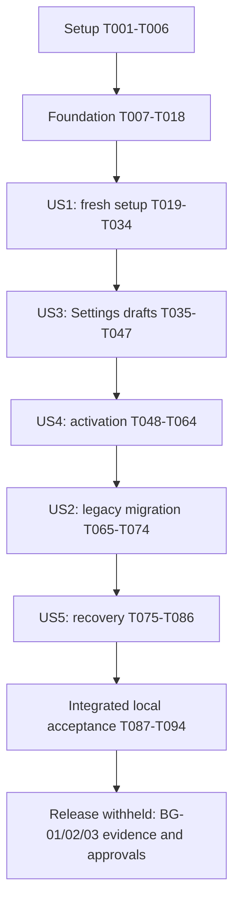

# Tasks: Librarian v2 Secure Installation and Instance Settings

**Input**: [spec.md](spec.md), [plan.md](plan.md), [research.md](research.md), [data-model.md](data-model.md), [API contract](contracts/instance-api.md), [configuration contract](contracts/configuration.md), [quickstart.md](quickstart.md), [reconciliation](requirements-traceability.md), [constitution v3.0.0](../../.specify/memory/constitution.md).
**Generated**: 2026-10-19 | **Feature**: `002-instance-configuration` | **Git branch**: `main`, unchanged.
**Status — 2026-10-21**: 94/94 tasks are checked. T047 closes Phase 4. The full coverage run passed 1,023/1,023 tests with zero failures/skips and fresh server/browser provenance; global and C1-C7 statements, branches, functions, and lines meet 95%. The complete browser matrix passed 99/99 across Chromium, Firefox, and WebKit. Typecheck, lint, production build, artifact validation, and local image/container acceptance passed. T085's isolated parent-revision image swap and consistent restore walkthrough passed; evidence is limited to local synthetic legacy-mode data. BG-01 workload, BG-02 live DEV/provider/storage/rollback, and BG-03 publication/deployment evidence and approvals remain open. No branch/commit/push or shared/live operation has occurred.

**Tests are mandatory** for this functional/security feature. Write tests before implementation and confirm meaningful failures; demonstrate functional defects before fixing them. No styling-class-only assertions. Never weaken security, assertions, instrumentation or the independent 95% statement/branch/function/line thresholds.

**Owner execution-order override — 2026-10-20**: Finish implementation authoring across the feature before beginning test authoring/execution. The owner repeated this instruction when resuming. This overrides test-first/phase-checkpoint ordering for this invocation, not the constitution's final functional acceptance, security, coverage or release gates. Keep implementation tasks unchecked until their stated verification is evidenced.

**Paths**: Relative to `D:\Repos\VPS & Homelab Infrastructure\librarian`. New paths are proposed implementation files. Reuse existing helpers/dependencies; no scaffold, new service or speculative refactor. Preserve original001 and unrelated changes.

**Format**: `- [ ] Tnnn [P?] [USn?] action with exact paths and requirements`. `[P]` identifies independent authoring jobs only within the named ready group; it does not authorize another story early or conflicting servers/databases. Unmarked tasks are sequential within their phase. Shared-file implementations stay sequential. Requirement references use the full V2 namespace.

## Phase 1: Setup — Reuse Existing Infrastructure

All later phases depend on T001-T006. Do not reinitialize the application or install new dependencies.

- [X] T001 Revalidate approved D1-D3/constitution, current callers, installed peers and relevant `node_modules/next/dist/docs/` guides; preserve original001 and unrelated changes, and reconcile actual implementation-file scope in `specs/002-instance-configuration/plan.md` before edits. References: V2-FR-033, V2-FR-034, V2-QG-008.
- [X] T002 Extend `tests/integration/http-harness.ts` through `tests/integration/instance-harness.ts` with explicit instance IDs, protected synthetic marker/root-key/bootstrap files, actual standalone Mongo/Next processes, controlled OIDC/GitHub and safe restart/shutdown. Retain loopback disposable-only DB restrictions; never use `librarian_dev` or shared services. References: V2-QG-003, V2-QG-004, V2-QG-005.
- [X] T003 Add failing C7/global source inventory, missing/zero-hit/stale reports, independent sub-95% metrics and excluded-runtime cases to `tests/unit/coverage-checker.test.ts`, `tests/unit/coverage-collector.test.ts` and `tests/integration/coverage-conformance.test.ts`, preserving existing C1-C6 cases. References: V2-QG-001, V2-QG-002.
- [X] T004 Extend `scripts/check-coverage.mjs` and `scripts/collect-coverage.mjs` to enforce the exact C7 union in `specs/002-instance-configuration/plan.md`, retaining global/C1-C6, source provenance and unexecuted files. Missing instrumentation/report or an applicable metric below95% fails. Make T003 pass. References: V2-QG-002, V2-SC-011.
- [X] T005 Add failing selected-feature artifact tests in `tests/unit/artifact-checker.test.ts` for 002 IDs, task syntax/dependencies, contract/source inventories and links while retaining original001 validation. References: V2-QG-008, V2-SC-013.
- [X] T006 Extend `scripts/validate-artifacts.mjs` for selected002 spec/plan/tasks/contracts without weakening001 or reusing its fixed92-task count; derive inventories from artifacts and distinguish document checks from coverage-required implementation completion. References: V2-FR-033, V2-QG-008, V2-SC-013.

### Implementation evidence — 2026-10-19

- **T001 complete**: See the implementation preflight in [plan.md](plan.md). Requirements checklist 28/28; installed dependency/peer and Node checks match the plan; all 42 existing C7 files and 24 proposed files accounted for; original001/application/test files preserved. No extension hooks are registered because `.specify/extensions.yml` is absent.
- **T002 blocked before harness implementation**: `Test-NetConnection 127.0.0.1 -Port 27018 -InformationLevel Quiet` returned `False`. `docker info --format '{{.ServerVersion}}'` failed because `dockerDesktopLinuxEngine` could not be found. No `mongod` executable was found on PATH or in the standard MongoDB installation directory. The required real isolated storage boundary cannot currently be verified.
- **Execution boundary**: speckit-implement requires halting on a failed sequential task; T002 is sequential and all subsequent phases depend on Setup. No T003+ implementation or speculative harness code was added. Shared `librarian_dev` storage is not an acceptable substitute.
- **Resume at T002**: Make the local Docker Desktop Linux engine available, then inspect/reuse or start only the disposable loopback Mongo service using the pinned Mongo image in `.github/workflows/ci.yml` and original001 quickstart. Keep port binding `127.0.0.1:27018:27017`, unique `librarian_test_*` databases and task-owned temporary roots. Implement and exercise the instance harness, including actual Next/provider restart/shutdown, before proceeding to T003.
- **Verification limits**: No passing application suite, fresh coverage, production build, container/browser acceptance or live/provider result was collected. A focused existing storage-harness test was invoked, but no terminal result was captured; it supplies no acceptance evidence. T001 is inspection/documentation completion only; all functional and release gates remain open.

### Setup continuation — 2026-10-19

- Docker engine 29.8.2 became available outside the sandbox. Inspected/reused only existing disposable librarian-implement-test-mongo, pinned image d0d926f94df0, loopback27018, no shared-service start. Standalone Mongo ping passed; the existing isolated storage probe passed1/1. Initial sandbox EACCES was resolved by running the local tests outside the sandbox.
- T002: new instance harness2/2 passed with protected Windows ACL/synthetic root files, independent key material, real Mongo/controlled providers/Next restart, persistent marker/database and cleanup. No fresh-setup application behavior is claimed by this infrastructure test.
- T003/T004: observed7 expected failures before C7 implementation. Complete affected coverage suites26/26 passed, including real Next/browser conformance, exact66-file plan membership, independent metric rejection, unexecuted baseline and existing provenance protections. collect-coverage.mjs already delegates source membership to the shared checker; no duplicate collector change is needed.
- T005/T006: observed2 expected failures before selected-feature validation. Artifact suite7/7 passed; documents-only CLI validates58 requirements/94 tasks/66 sources/15 API rows and independent original001 traceability, explicitly implementationVerified:false. Full validation rejects missing002 implementation sources before coverage acceptance.
- Type/lint checks and functional foundation checkpoints remain separately required. These targeted suites are not a fresh global95% result or feature completion.

## Phase 2: Foundational — Storage, Root Trust and Shared Guards

**Blocking checkpoint**: Finish T007-T018 before story implementation. Valid legacy operation remains available; missing002 records cannot expose fresh ownership enrollment.

### Tests first

T007-T010 may be authored independently after T002/T006, with distinct fixture resources.

- [X] T007 [P] Add strict schema/state/revision/size/nullable-field tests in `tests/unit/instance-schema.test.ts` for every model entity, safe DTOs, unknown/newer schemas, cross-instance mismatch, invalid/backward timestamps and boundary values. References: V2-FR-003, V2-FR-018, V2-FR-025, V2-QG-003.
- [X] T008 [P] Add host prerequisite/classification/precedence tests in `tests/unit/instance-bootstrap.test.ts`: valid legacy, explicitly prepared fresh, absent optional credentials, sealed/missing marker, mismatched identity/recovery epoch, missing database/key and lost singleton must preserve legacy or fail maintenance, never reset fresh. References: V2-FR-001, V2-FR-002, V2-FR-027, V2-FR-029, V2-FR-030.
- [X] T009 [P] Add crypto/replacement tests in `tests/unit/instance-secrets.test.ts` for canonical malformed envelopes, independent root keys, wrong key, nonce/tag/ciphertext/AAD context substitution, random nonce generation and unchanged legacy OAuth decryptability. References: V2-FR-004, V2-FR-020, V2-QG-003.
- [X] T010 [P] Add real standalone Mongo tests in `tests/integration/instance-store.test.ts` for singleton uniqueness, CAS edits, atomic bundle/owner/bootstrap transitions, concurrent actors, indexes/explicit expiry, audit outbox crash/replay and cross-instance denial. References: V2-FR-003, V2-FR-008, V2-FR-018, V2-FR-021, V2-QG-003.

### Implementation

- [X] T011 Define strict entities in `lib/instance/store.ts`, quoting/enforcing model constraints: `_id/instanceId/schemaVersion` are "Literal `instance`, UUID, integer `1`"; counters are "Monotonic safe integers"; lifecycle is "`configuring`, `awaiting_owner`, `ready`, `maintenance`, `legacy_migrating`"; timestamps are "Server dates; initialization nullable until finalization"; active/previous are "Nullable complete bundles" and candidate is a "Nullable validated draft which may omit unentered provider values/secrets but cannot become active until complete"; bindings are "<=20 stable issuer/subject bindings; exactly one current owner after initialization"; gate is "`open`, `closing`, `maintenance`; activation token; deadline"; admissions are "<=64 request pins and <=1 worker pin"; activation has "at most 20 catalog entries" and outbox "<=128 bounded events". Binding schema includes "kind: owner|administrator, status: active|retired" and "Unique active `(issuer,subject,projectId)` within the installation; exactly one current owner, immutable history of first enrollment". Enforce <=512 KiB encoded BSON, exact supported schema, revision-bound bootstrap/epoch/impact fields and no client-supplied authority/time. References: V2-FR-003, V2-FR-008, V2-FR-018, V2-FR-021.
- [X] T012 Implement `lib/instance/secrets.ts` with independent host-keyring AES-256-GCM and preserve `lib/auth/tokens.ts` format/key. Enforce model wording: "All binary fields are canonical base64; nonce decodes to 12 bytes and tag to 16; key ID must exist in the host keyring". Bind AAD to instance/purpose/format/key/credential version; retain exact version in bundle and reject tampering before plaintext use. References: V2-FR-004, V2-FR-020, V2-FR-028.
- [X] T013 Implement host prerequisites/classification in `lib/instance/bootstrap.ts`, splitting `lib/config.ts`/`lib/mongo.ts` from optional integrations. Enforce contract host names, immutable UUID/trusted setup origin/protected monotonic marker/independent keys, validated legacy precedence, standalone journaled writes and credential-free builds/imports. No DB/key/marker failure becomes fresh or silently falls back to legacy provider files after migration. References: V2-FR-001, V2-FR-002, V2-FR-005, V2-FR-027, V2-FR-029, V2-FR-030, V2-FR-032.
- [X] T014 Implement CAS storage/indexes/editRevision/safe DTOs and bounded audit outbox in `lib/instance/store.ts`. Enforce "Display name 1–120 Unicode code points, description <=500, normalized non-escaping docs folder <=1024 bytes and <=32 segments; reject controls and executable markup", "Exact HTTPS origin, no credentials/path/query/fragment; loopback HTTP only in isolated DEV", "Exact approved issuer origin; client/project/audience identifiers retain current config validation; no subject/email hints as authorization", "Positive decimal App ID; provider fixed to GitHub; no repository write scopes", "<=12 typed revision/time-bound results; status `not_run`, `passed`, `failed`, `warning`; safe code only", "Optional candidate instance/version/issuer/subject/project/security epoch/nonce/expiry; derived from actual candidate callback, not browser input", and "Previous bundle only; <=24 h, or explicit protected maintenance recovery hold". Bundle version/date/actor are "Monotonic safe integer, server date, stable actor or protected operator action ID"; preserve purpose-keyed envelopes/one expiring old webhook secret, separate admission/edit counters, atomic linked writes and server-derived impact/proof. References: V2-FR-003, V2-FR-016, V2-FR-018, V2-FR-019, V2-FR-021.
- [X] T015 Add failing shared authority/CSRF/origin/epoch/admission tests in `tests/unit/instance-access.test.ts` and `tests/integration/instance-access.test.ts`, including binding-only/role-only/wrong-project identities, exact15-minute failed role refresh, unsafe anonymous DTOs and saturated/expired pins. References: V2-FR-007, V2-FR-014, V2-FR-022, V2-FR-025, V2-QG-004.
- [X] T016 Implement shared guards/admission in `lib/instance/access.ts`, reusing `lib/auth/admin.ts`/`lib/auth/roles.ts` mechanics: binding AND current `librarian-instance-admin`, issuer/subject/project and current security/recovery epoch; no implicit catalog/reader authority. Pins have <=30s request/120s worker hard deadlines, <=64 requests/one worker, no late renewals/effects; nested calls reuse context and gate CAS closes new admission. References: V2-FR-007, V2-FR-014, V2-FR-022, V2-FR-025.
- [X] T017 Add fixed bounds in `lib/limits.ts` and safe no-store DTO/error/audit/rate handling in `lib/instance/access.ts`/`lib/operations/logging.ts`: JSON64KiB, App key16KiB/client secret4KiB/webhook secret1KiB, bounded durable quotas, trusted expiry and no submitted secret/ciphertext/path/env/provider-body logging. References: V2-FR-020, V2-FR-021, V2-FR-025, V2-FR-036.
- [X] T018 Run foundation unit/integration/coverage/type/lint/build gates from `package.json` with zero-hit inventory and applicable C7/global/C1-C6 metrics; record exact results/blockers in `specs/002-instance-configuration/tasks.md`. Do not proceed on failed root trust, persistence, authority or coverage. References: V2-QG-001, V2-QG-002, V2-QG-007.

### Foundation progress and initial failed verification — 2026-10-19 (superseded by the completion evidence below)

- Added strict bounded control/bundle/envelope parsing and server CAS storage in `lib/instance/store.ts`, context-bound independent provider encryption in `lib/instance/secrets.ts`, protected host loading/fail-closed classification in `lib/instance/bootstrap.ts`, and role/binding/epoch/admission/CSRF/JSON/rate guards in `lib/instance/access.ts`. Added synthetic unit/integration cases before their corresponding implementation. These modules are not yet wired into public setup/Settings or runtime activation.
- Separated `loadHostConfig` from the legacy provider loader in `lib/config.ts`. `getMongo(settings)` can receive host-only prerequisites explicitly; ordinary `getMongo()` retains full legacy validation until the later lifecycle integration tasks. No current route may bypass its existing legacy prerequisite checks just because host-only loading exists.
- The full coverage attempt executed669 tests with0 failures/0 skips across unit/integration/client projects and actual server/browser captures. The merged provenance-aware inventory contained74 executable sources. Global statement4066/4218=96.39%, branch3233/3409=94.83%, function695/717=96.93%, line3140/3185=98.58%. C7 statement3326/3458=96.18%, branch2577/2727=94.49%, function558/578=96.53%, line2583/2622=98.51%, over46 currently existing declared files. All four metrics passed C1-C5; C6 branch445/471=94.47% failed (other C6 metrics passed). No threshold, source exclusion or assertion was weakened.
- The collector correctly failed on the global branch gate. The later legacy-default compatibility adjustment changes `lib/mongo.ts` after this capture; these figures describe that attempt and cannot certify the final source. A fresh full capture is required after all further foundation changes, never hash substitution or reuse of stale reports.
- Foundation tasks remain unchecked because the complete scenario set and checkpoint have not passed. Remaining work includes exhaustive schemas and revision/timestamp/transition constraints; atomic linked owner/bootstrap transitions and indexes/expiry evidence; strict audit history bounds under concurrent/crashed drainers; complete root trust and recovery cases; request/worker effect fencing, nested admission reuse, safe operational logging and complete rate/error contracts. The current audit drain's trimming is not yet proof of the required hard cap under concurrency. Resolve these within T007-T017 and re-run T018 before starting T019.
- After the final compatibility adjustment, all438 selected unit/affected integration tests passed across51 files; TypeScript, full ESLint and the final production build passed. Documents-only validation passed58 v2 requirements/94 tasks/66 declared sources/15 API rows plus original001 traceability. `git diff --check` passed and original001 has no diff. No extension hooks were registered. The existing disposable Mongo container was returned to its original stopped state; its volumes were preserved.
- Following the invoked skill's failed-sequential-task rule and T018's explicit coverage stop, implementation stops at the foundation checkpoint. No end-to-end setup, live-provider, workload, restore, image publication or deployment evidence is claimed. The full coverage capture must be regenerated for the final source after completing the remaining foundation work.

### Owner route update — 2026-10-19

- The owner explicitly replaced the repositories-based setup/Settings targets with `/instance/setup` and `/instance/settings`. Updated D3, the entry/discovery requirements, plan, research, contracts, quickstart, reconciliation, tasks and exact C7 source paths together. `/repositories` and `/api/admin/*` remain catalog administration; `/api/instance/*` remains the instance API namespace. No former-page aliases or redirects are requested.
- Fresh root entry is specified to lead to setup only after confirmed fresh classification. Ready/valid legacy entry retains the directory. Shared navigation will show Instance Settings only for verified bound instance administrators; each page/API retains its independent guard. Eligible provider secrets are encrypted before MongoDB persistence; host root/database/session/OAuth/bootstrap inputs remain outside the database.
- `instance` is currently a valid catalog slug. T031/T067/T072 now require collision preflight and explicit owner resolution before the new namespace is enabled. This route update does not reserve it prematurely or change existing catalog records. No live catalog inventory was inspected or changed.
- Added a failing exact-route inventory assertion, then updated the checker and plan together; all27 coverage/artifact validator tests passed outside the sandbox after its filesystem/symlink restrictions blocked the first attempt. Documents-only validation passed58 requirements/94 tasks/66 planned sources/15 API rows. Original001 remains unchanged. This is verified route planning/tooling, not implemented wizard/Settings pages; the foundation coverage blocker and remaining implementation tasks stay open.

### Foundation completion — 2026-10-19

- T016 now provides `withInstanceAdmission` and `runInstanceEffect`: nested work in the same instance/purpose reuses one persisted pin; another instance or purpose is rejected; each effect re-reads the active lifecycle/epoch/expiry; and the outer scope releases the pin. Mongo CAS advances `updatedAt` monotonically with the server-created pin. The integration regression failed before the helper existed, then exposed and verified the admission timestamp fix. Existing catalog lease/fence predicates remain required for atomic writes in the later activation/runtime tasks.
- T017 adds an instance audit formatter that accepts only finite operation/result codes, UUIDs and version counters; submitted actor IDs, secrets, ciphertext, paths and provider bodies are discarded. JSON/request and credential bounds, durable quotas, expiry and sanitized response tests remain in the instance access and secret modules.
- Fresh `node scripts/collect-coverage.mjs` passed with 686 tests, 0 failures and 0 skips; server source maps and real browser capture were verified. Global coverage: statements 4176/4319, branches 3392/3558, functions 704/725, lines 3214/3260. C7: statements 3436/3559, branches 2736/2876, functions 567/586, lines 2657/2697. Every global and C1-C7 metric independently met 95%; no sources or thresholds were excluded or weakened.
- `node .\\node_modules\\typescript\\bin\\tsc --noEmit`, full ESLint and `node .\\node_modules\\next\\dist\\bin\\next build --webpack` passed after the final foundation code change. The build still lists the original routes only. An earlier standalone TypeScript invocation raced the build's `.next/types` replacement; the post-build rerun passed.
- T001-T018 are locally complete. No `/instance/setup` or `/instance/settings` page/API exists yet; setup, Settings, activation, provider, migration, recovery, workload and release gates remain open. No provider credentials, live services, deployment, branch, commit or push were used.

## Phase 3: User Story 1 — Authorize and Complete a Fresh Installation (P1, MVP)

**Goal**: Protected seven-step setup commits exactly one verified owner/configuration before normal runtime starts.
**Independent test**: Empty disposable instance, explicit host intent and controlled providers; complete setup, restart/resume and reject unauthorized/expired/replayed/concurrent attempts. No optional provider credentials before setup. This is a local fresh-instance MVP, not release or migration approval.

### Tests first

T019-T022 are parallel authoring groups after T018, using isolated resources.

- [X] T019 [P] [US1] Add US1.1-9 unit scenarios in `tests/unit/instance-setup.test.ts`: >=32-byte random credential/no default or URL exposure,24h fresh authority,30-minute/eight-session bounds,10-minute single-use proof, exact expiry and durable cross-process guessing/replay quotas. References: V2-FR-005, V2-FR-006, V2-FR-007, V2-FR-008, V2-FR-012, V2-FR-013.
- [X] T020 [P] [US1] Add direct status/setup authorize/read/patch/check/finalize/candidate-auth contract/race/crash cases in `tests/integration/instance-setup.test.ts`: If-Match conflict, edited proof invalidation, sealed creation interruption, repeated accepted attempt versus different attempt and committed-but-unadopted state cannot create another owner. References: V2-FR-001, V2-FR-008, V2-FR-009, V2-FR-012, V2-FR-013, V2-QG-003, V2-QG-004.
- [X] T021 [P] [US1] Add typed provider/branding and SSRF tests in `tests/unit/instance-validation.test.ts` and `tests/integration/instance-validation.test.ts`: redirects/rebinding/private/metadata/IPv4-mapped denial, protected private exception, DNS/connect/body/JWKS limits, discovery-success/login-failure, invalid RSA/permissions and absent installation/delivery. References: V2-FR-010, V2-FR-011, V2-FR-019, V2-FR-024, V2-FR-025.
- [X] T022 [P] [US1] Add seven-step/expiry/browser-close/restart/owner-login/concurrent-finalizer/closed-setup journeys in `tests/browser/instance-setup.spec.ts`, with keyboard/mobile/focus/theme/errors and no secret sentinels in HTML/navigation/browser storage. References: V2-FR-009, V2-FR-012, V2-FR-013, V2-QG-005, V2-SC-001, V2-SC-002, V2-SC-003.

### Implementation

- [X] T023 [US1] Implement local protected `prepare` in `scripts/instance-operator.mjs`: verify ignore rules and empty dedicated storage, provision identity/origin/expiring authority safely, seal durable intent before DB initialization, emit only safe action IDs, and require maintenance recovery after ambiguous interruption; no live provisioning. References: V2-FR-001, V2-FR-002, V2-FR-006, V2-FR-030.
- [X] T024 [US1] Implement setup sessions and status/authorize handlers in `lib/instance/access.ts`, `app/api/instance/status/route.ts` and `app/api/instance/setup/authorize/route.ts`. Enforce "Unique `_id`, index `(instanceId,expiresAt)`, TTL index on `purgeAt` with `expireAfterSeconds:0`; purgeAt is expiresAt plus one hour" and "Explicit absolute 30-minute expiry check is mandatory even if TTL deletion is delayed"; hash opaque tokens/CSRF, bind purpose/epochs, cap8 sessions and5 failed attempts/minute/100 per day, require host trusted origin/pre-session CSRF and Secure/HttpOnly/SameSite cookies. References: V2-FR-006, V2-FR-007, V2-FR-008, V2-FR-025.
- [X] T025 [US1] Implement GET/PATCH `app/api/instance/setup/route.ts` using `lib/instance/store.ts`: strict If-Match/editRevision/candidateVersion, encrypted resumable partial setup draft, invalidated checks/proof after edits, safe metadata, host-only database Retry Connection and no partial active change/reveal. References: V2-FR-003, V2-FR-009, V2-FR-018, V2-FR-019, V2-FR-020.
- [X] T026 [US1] Implement pinned DNS/HTTPS/checks in `lib/instance/validation.ts`: approved origin/address plus TLS hostname verification, no redirects,5s DNS/connect,10s request/30s workflow,512KiB total response budget, bounded JWKS and one concurrent check; protect actual candidate provider connections, including narrow private-origin exceptions. References: V2-FR-010, V2-FR-011, V2-FR-024, V2-FR-025.
- [X] T027 [US1] Implement isolated candidate Auth.js in `app/api/instance/auth/[...nextauth]/route.ts`, `auth.ts` and `lib/instance/access.ts`: signature/issuer/audience, PKCE/state/nonce, separate cookies/basePath, exact callback/local return, revision/purpose-bound single-use proof and current instance-admin role. No email/first-login/client-subject ownership or ordinary runtime account linking. References: V2-FR-010, V2-FR-012, V2-FR-023.
- [X] T028 [US1] Implement `app/api/instance/setup/check/route.ts` and bounded signed-proof handling in `app/api/webhooks/github/route.ts`: fixed check enum/revision/time/status, read-only App/installation checks, original-byte signature, no pre-ready operational queue, truthful unperformed/failure/warning results and no invented delivery success. References: V2-FR-005, V2-FR-010, V2-FR-011, V2-FR-019.
- [X] T029 [US1] Implement finalize handler `app/api/instance/setup/finalize/route.ts` and initial CAS in `lib/instance/activation.ts`: current check/owner/role/impact nonce, atomic bundle/binding/consumed-bootstrap/audit commit, one accepted attempt with idempotent reconciliation; pending/maintenance on postcommit adoption failure and no second owner/ready-to-fresh transition. References: V2-FR-008, V2-FR-012, V2-FR-013, V2-FR-021, V2-SC-002.
- [X] T030 [US1] Integrate initial lifecycle/active settings in `auth.ts`, `lib/auth/adapter.ts`, `lib/auth/authorization.ts`, `lib/auth/admin.ts`, `lib/sync/worker-startup.ts`, `lib/mongo.ts` and `lib/config.ts`: normal auth/delivery/catalog/worker only for ready or validated legacy, separate roles and server/cache guards preserved, no002 record leaves valid legacy operational. References: V2-FR-001, V2-FR-005, V2-FR-010, V2-FR-013, V2-FR-033.
- [X] T031 [US1] Implement independently guarded `app/instance/setup/page.tsx` with safe prerequisite/version welcome, protected trusted origin and closed enrollment after readiness; lead confirmed fresh visits at `app/page.tsx` to `/instance/setup`, leave valid legacy/ready directory entry intact, avoid catalog-only parent guards and preserve root setup/settings catalogs. Check legacy `instance` slug collisions before route enablement; no implicit rename or shadowing. References: V2-FR-001, V2-FR-009, V2-FR-014, V2-FR-033.
- [X] T032 [US1] Implement `components/instance-setup.tsx` for seven durable steps, configured-only secrets, accessible validation/focus/loading/navigation, candidate login, precise check warnings and current explicit final review; never persist submitted secrets/bootstrap to browser storage. References: V2-FR-009, V2-FR-010, V2-FR-011, V2-FR-012, V2-FR-013, V2-FR-017.
- [X] T033 [US1] Wire safe initial adoption/restart recovery in `instrumentation.ts`, `lib/sync/worker-startup.ts`, `lib/operations/health.ts` and `app/api/health/route.ts`: current lifecycle/revision/local adoption required, old heartbeat cannot prove readiness, interrupted finalized setup resumes the same identity and health stays non-sensitive no-store200/503. References: V2-FR-013, V2-FR-030, V2-FR-036.
- [X] T034 [US1] Run US1.1-9 and preserved-legacy-startup acceptance plus applicable global/C1-C7 coverage/type/lint/build and browser checks from `package.json`; record exact local counts/results/blockers in `specs/002-instance-configuration/tasks.md`. References: V2-QG-001, V2-QG-002, V2-QG-005, V2-QG-007, V2-SC-001, V2-SC-002, V2-SC-003, V2-SC-011.

### US1 continuation — 2026-10-19

- Added the protected local `prepare` path in `scripts/instance-operator.mjs`: exact setup-origin validation, ignored/private empty destination checks, loopback-only fresh database validation, independent root key/bootstrap verifier, protected non-secret `instance.env`, sealed marker before the singleton insert, and safe action-ID output. Interrupted post-seal insert failures remain non-claimable through the existing sealed-marker classifier.
- A real setup integration run exposed two defects and supplied regression coverage: Windows short-path aliases were mistaken for symlink escapes, and the fresh status probe seeded legacy quota storage before checking whether the database was empty. Canonicalized the destination while still rejecting symlink components; added a `connectMongo` option that skips legacy storage initialization for this read-only setup probe. Legacy callers retain initialization by default.
- Current targeted evidence: setup and Mongo integration files passed14/14; setup operator/status integration passed6/6 before the cross-process quota case was added; that new separate-Next-process quota test passed1/1; targeted unit files passed13/13; TypeScript, targeted ESLint and the production build passed. The sandbox denied one `.next` build write with `EPERM`; the same local build succeeded outside the sandbox. One sandboxed Vitest invocation hit a vanished temporary module-cache path; the targeted rerun outside the sandbox passed.
- Documents-only artifact validation passed58 selected requirements,94 tasks,66 source paths and15 API rows, retained original001's73 requirements/92 tasks, and explicitly reported `implementationVerified:false`; `git diff --check` passed (Git printed existing LF-to-CRLF notices only).
- The US1 test-authoring and completion gates remain open. The browser suite now contains setup journeys, but T019-T022 and T034 have not all passed their required coverage, restart, browser, provider and release checks; no task checkbox was advanced.
- Resumed local implementation: T028 now provides revision-bound setup checks and bounded signed-ping proof; pre-ready operational events are ignored without queue admission. T029 now commits the initial bundle, owner binding, consumed bootstrap and audit outbox in one CAS, then returns a truthful pending/maintenance result until adoption. Evidence: setup/access integration 21/21, T028-focused integration 5/5, focused unit 12/12, typecheck, scoped ESLint and standalone build passed. Live provider and browser runs were not performed; T030/T033 still need ready-runtime adoption.

### US1 continuation — 2026-10-20 coverage checkpoint

- The successful local operator path is now an integration test against a unique `librarian_test_operator_*` database; it passed 1/1 and verifies protected host files, the bootstrap expiry, and verifier-only Mongo storage. The focused operator unit test passed 1/1; the full unit suite passed 502/502. Typecheck, ESLint, and documents-only artifact validation passed. Document counts: 58 selected requirements, 94 tasks, 66 sources, 15 API rows; original 001 remains 73 requirements/92 tasks.
- The complete instrumented suite passed 829 tests with 0 failures and 0 skips. The 95% gate still fails: global statements 5517/5922 (93.16%), branches 4668/5135 (90.91%), functions 925/977 (94.68%), lines 4333/4502 (96.25%); C7 statements 4771/5156 (92.53%), branches 4010/4451 (90.09%), functions 786/836 (94.02%), lines 3772/3935 (95.86%); C6 statements 816/903 (90.37%) and branches 619/708 (87.43%); C4 branches 1316/1405 (93.67%). C1, C2, C3, and C5 meet every metric. T034 remains unchecked; no later phase was advanced.
- The named disposable Mongo container was reachable outside the sandbox; default sandbox commands could not access Docker's named pipe/loopback. The coverage run used the local test path and made no shared-service or live changes. The browser matrix was not rerun in this checkpoint; its prior partial results and remaining Firefox viewport-timeout risk remain open. Production build was not rerun because this checkpoint changed tests and task evidence only; the earlier local build result above is retained as historical evidence.

### US1 implementation and acceptance checkpoint — 2026-10-21

- Completed the US1 implementation and test authoring scope T019-T033. The setup, access, operator, activation, bootstrap, runtime, schema, store, validation and page unit files passed; full unit suite: **55/55 files, 513/513 tests**. Full Mongo-backed integration suite: **47/47 files, 257/257 tests**; this includes the cross-process quota, legacy-startup, setup restart/finalize and expanded migration-preservation fixtures. Full Phase 3 browser suite: **12/12 tests** across Chromium, Firefox and WebKit. Lint, typecheck and production build passed.
- Firefox's installed Playwright runtime hangs on `page.setViewportSize()` even on a blank page. Updated the two mobile setup journeys to configure viewport/color scheme when the browser context is created; the Firefox suite and then all three projects passed. This preserves the tested 375x812 and 360x800 viewports.
- The expanded migration fixture initially omitted the required catalog `lastSuccess.commitSha`; added the real schema field. The migration integration file passed **3/3**, followed by the full integration pass above. No production-code workaround or schema relaxation was made.
- Fresh coverage collection captured **859 passed, 0 failed, 0 skipped** with Node/server/browser provenance and wrote `coverage/evidence.json`; `npm run coverage:check` fails the 95% gate. Exact global totals: statements **6265/6972 (89.85%)**, branches **5377/6235 (86.23%)**, functions **1062/1147 (92.58%)**, lines **4947/5298 (93.37%)**. Additional failing scopes: C2 branches **672/722 (93.07%)**; C4 statements **1806/1912 (94.45%)**, branches **1335/1452 (91.94%)**; C6 statements **933/1049 (88.94%)**, branches **756/904 (83.62%)**; C7 statements **5519/6206 (88.93%)**, branches **4719/5551 (85.01%)**, functions **923/1006 (91.74%)**, lines **4386/4731 (92.70%)**. C1, C3 and C5 meet all four thresholds.
- T034's required checks and blocker report are complete, but the global and per-scope 95% coverage gate is not met, so the feature cannot be declared accepted. Local fixtures do not provide genuine live-provider, DEV, deployment or release evidence; those remain separate gates.

## Phase 4: User Story 3 — Review and Edit Instance Settings (P1)

### Implementation-first continuation and validation — 2026-10-20

- Followed the owner's implementation-first order before starting new test authoring/execution. Added Settings page/client/API, bounded audit pagination, shared encrypted draft handling, canonical Save/Cancel/conflict behavior, explicit secret replacement, guarded navigation, active safe preferences and future-catalog documentation defaults. Existing catalog fields, bottom-left sync badges and three-card skeletons are preserved.
- Added initial and subsequent activation/reconciliation, admission guards around auth/admin/read/webhook/worker paths, separate catalog runtime revision plus lease fencing, expired-effect checks, current/previous webhook rotation deadlines and rollback-as-draft. Added session epoch checks, active provider transport pinning and worker authority/config refresh. Origin changes remain blocked until protected host origin/callback prerequisites match; saved draft is not active configuration.
- Added deliberate legacy enrollment/import with both verified roles, operator authority and keyed source-digest review. Legacy provider precedence remains until committed migration; cutover fences catalog leases without changing catalog content configRevision or deleting retained records. Added protected transfer, two-stage recovery target verification with epoch advance, retained-bundle key rotation and bounded retired-state cleanup. These are implemented paths under acceptance, not verified live migrations/recovery.
- Added six operator guides, a local-only pinned Mongo/0.5CPU/512MB Compose example, README links and commented placeholder-only v2 host settings. Root/marker/snapshot material remains excluded from image inputs; no root/provider credentials were printed, committed, published or provisioned on a shared/live environment.
- Test phase: first unit run exposed a legacy shared-promise regression in `getMongo()` and outdated boundary mocks. Preserved the shared connection contract, updated mocks without weakening assertions, and added behavioral draft/activation/rotation/recovery/session/packaging cases. Full unit suite **510/510 passed**; full Chromium client suite **89/89 passed** across six files, including Settings Save/Cancel/conflict/unsaved-navigation/replacement/pending-state cases and new documentation-folder default/reset/existing-edit regressions. Typecheck and full ESLint passed.
- Added real Mongo/Next Settings access, atomic draft/conflict/restart/audit, native key rotation and protected recovery tests. Their run reached **four fixture-setup failures across three files**: `ECONNREFUSED 127.0.0.1:27018`. Docker's Linux-engine named pipe is absent even outside the sandbox. No assertion-level integration result can be claimed. Requested Docker availability while continuing independent work; did not substitute `librarian_dev`, shared storage or fake persistence.
- Documents-only artifact validation passed **58 v2 requirements /94 tasks /66 sources /15 API rows** and preserved original001 **73 requirements /92 tasks**, explicitly `implementationVerified:false`. Operator script syntax and `git diff --check` passed; original001 has no diff. No extension hooks exist. Final production build **passed**, including compilation, TypeScript, page-data collection, prerendering and standalone tracing. The initial sandbox build hit Windows EPERM creating a generated `.next` directory; the final build outside the sandbox succeeded. This is local packaging evidence, not container/live acceptance.
- **Initial open acceptance checkpoint — 2026-10-20, closed locally on 2026-10-21**: the scenario authoring/execution, two-process fencing/crash/recovery, browser matrix, image/container acceptance, source-provenance coverage and global/C1-C7 95% gates listed here were subsequently completed as recorded under Current Local Verification. IN-01 is locally closed. BG-01 workload and BG-02/03 live/release evidence remain open; no commit/push, image publication, live provider mutation or deployment occurred.

### Test verification update — 2026-10-20

- The implementation-first test phase now has fresh local results: `npm run test:unit` passed **510/510**; `vitest run --project client` passed **87/87** across six files, including five Settings behavior cases. These suites cover draft/save/cancel/conflict/secret replacement, setup/session/proof bounds, provider validation, activation gates, recovery sessions and host packaging.
- The latest full Chromium client run passed **89/89** across six files. It includes seven Settings cases covering Save/Cancel, conflicts, actual unsaved-link and before-unload protection, secret replacement and pending activation, plus two new catalog-folder-default cases covering create/reset and existing-edit preservation.
- Real Mongo Settings access, concurrent draft/CAS, restart/audit and operator recovery tests are authored. The focused run stopped during fixture setup in **four cases across three files** because `127.0.0.1:27018` refused the connection. Additional real-Mongo activation tests now cover draining a request pin, fencing a catalog lease, preserving the previous bundle, rollback-as-candidate, stale confirmation and refusal to revive a retired webhook credential; they have not run. The read-only Docker check still reports the `dockerDesktopLinuxEngine` pipe unavailable, so no assertion-level Mongo integration evidence is available. The owner has said Docker Desktop will be made available; this checkout has not observed the engine ready yet.
- `npm run typecheck`, `npm run lint`, `npm run build`, `node scripts/instance-operator.mjs --help` syntax validation, `git diff --check`, and `node scripts/validate-artifacts.mjs --documents-only` passed. The document validator reports 58 v2 requirements, 94 tasks, 66 declared sources and 15 API rows; original001 still validates at 73 requirements/92 tasks. `implementationVerified:false` remains correct.
- No fresh `npm run test:coverage` / `npm run coverage:check` was collected after the current implementation. The 2026-10-19 829-test capture and its below-threshold metrics are historical only; they cannot certify this source state. Full migration/security scenarios, multi-process activation/fencing, Settings/activation/recovery browser journeys, the three-browser matrix, and disposable-image tests remain unverified or still need authoring. Do not mark T034, T047, T064, T074, T086, or T087-T094 complete from the passing unit/client suites.
- **Next local gate**: restore the Docker Desktop Linux engine, which currently cannot be reached, then inspect/reuse only `librarian-implement-test-mongo` on `127.0.0.1:27018`. Rerun the expanded migration test and full integration suite before collecting fresh global/C1-C7 coverage; then run Playwright/container acceptance. The browser harness also requires the disposable loopback Mongo service. No shared DEV database or live service is an acceptable substitute.

**Goal**: Bound instance administrators inspect/edit durable candidates without secrets or accidental activation.
**Independent test**: Seed a ready instance/active bundle and owner/admin/reader/wrong-role identities through controlled fixtures; test every Settings/audit read/write/check directly and across restart. No setup wizard prerequisite. Apply/rotation depends on US4; draft success is not activation.

### Tests first

T035-T038 may be authored in parallel after T034, each using isolated resources.

- [X] T035 [P] [US3] Add direct page/API authorization cases in `tests/integration/instance-settings-access.test.ts`: anonymous, binding-only, role-only, catalog-only admin, reader, wrong issuer/project, bound admin/owner and exact expired-role denial; instance access grants no catalog mutations/private bytes. References: V2-FR-014, V2-FR-015, V2-FR-025, V2-QG-004, V2-SC-004.
- [X] T036 [P] [US3] Add edit/CAS/blank-secret/schema/provenance/restart tests in `tests/integration/instance-settings.test.ts`: exact stale409, atomic rejection, canonical PATCH, configured-only secrets, no reveal/delete, durable draft/active isolation and unchanged existing catalog fields. References: V2-FR-016, V2-FR-018, V2-FR-019, V2-FR-020, V2-FR-032, V2-SC-005.
- [X] T037 [P] [US3] Add behavioral Save/Cancel/conflict/unsaved-navigation/check-state/replacement tests in `tests/client/instance-settings.test.tsx` using canonical server fixtures/secret sentinels; no class-only assertions or blanket persistence/security mocks. References: V2-FR-017, V2-FR-018, V2-FR-020, V2-QG-001.
- [X] T038 [P] [US3] Add grouped Settings, denied routes, bounded audit pagination, restart persistence and phone/tablet/desktop keyboard/theme/focus/error journeys in `tests/browser/instance-settings.spec.ts`, distinguishing saved candidate from active. References: V2-FR-014, V2-FR-015, V2-FR-017, V2-FR-032, V2-QG-005, V2-SC-004, V2-SC-005, V2-SC-012.

### Implementation

- [X] T039 [US3] Complete bound-owner/admin access in `lib/instance/access.ts`/`lib/auth/roles.ts`: current instance/security/recovery epoch and issuer/subject/project, exact15-minute refresh with no renewal-age reset, owner-only continuity impacts and independent catalog/private-reader permissions. References: V2-FR-012, V2-FR-014, V2-FR-023, V2-FR-025.
- [X] T040 [US3] Implement GET/PATCH `app/api/instance/settings/route.ts`: ETag/If-Match/editRevision/candidateVersion, strict allowlisted fields, explicit encrypted replacement, safe canonical DTOs and proof invalidation on edit; active unchanged and no conflict/oversize/unknown-field partial writes. References: V2-FR-015, V2-FR-016, V2-FR-018, V2-FR-019, V2-FR-020.
- [X] T041 [US3] Implement GET `app/api/instance/audit/route.ts` with `lib/instance/store.ts`, opaque instance-bound cursor and contract limits "limit 1–50"/"<=50 safe events"; return bounded actor/operation/revision/time/result only, never secret/ciphertext/path/provider-body history or unlimited export. References: V2-FR-015, V2-FR-021, V2-FR-025.
- [X] T042 [US3] Implement POST `app/api/instance/settings/check/route.ts` through shared transport and current binding/role/CSRF/rate guards:6 checks/min and30 mutations/min per authorized actor/session, actual revision/time proof and invalidated results after edits. References: V2-FR-017, V2-FR-019, V2-FR-024, V2-FR-025.
- [X] T043 [US3] Implement independently authorized `app/instance/settings/page.tsx` with safe General/Authentication/GitHub/Documentation/Security/System groups, metadata and audit; no inherited catalog-only guard or private config in metadata/prefetch. References: V2-FR-014, V2-FR-015, V2-FR-033.
- [X] T044 [US3] Implement `components/instance-settings.tsx`: safe grouped fields/configured indicators, explicit replacement, canonical Save, Cancel/no-write, stale-refresh guidance, unsaved warning, truthful check/activation/restart status and accessible responsive loading/errors/focus; no reveal/implicit deletion. References: V2-FR-015, V2-FR-017, V2-FR-018, V2-FR-020, V2-FR-032.
- [X] T045 [US3] Add an Instance Settings navigation link to `/instance/settings` only for verified bound instance administrators, and active safe name/description preferences in `components/site-navigation.tsx`, `lib/layout.shared.tsx`, `app/layout.tsx` and `app/page.tsx`; inspect `components/directory.tsx` as the affected directory caller, expose no draft/provider values or broader authority, and preserve bottom-left sync badges/three-card skeletons. References: V2-FR-014, V2-FR-016, V2-FR-033, V2-FR-034.
- [X] T046 [US3] Pass active docs-folder defaults through `app/repositories/page.tsx` and `components/admin-console.tsx` for new-draft initialization/reset only; preserve existing-admin boundaries in `lib/admin.ts`, explicit `docsPath` validation in `app/api/admin/repos/route.ts`, and existing catalogs/edit drafts/visibility/roles. Extend `tests/client/admin-console.test.tsx`; do not invent an absent catalog-form component. References: V2-FR-016, V2-FR-029, V2-FR-033.
- [X] T047 [US3] Run US3.1-7 draft editing/denial/browser/seeded-active persistence and applicable coverage/type/lint/build via `package.json`, recording local evidence in `specs/002-instance-configuration/tasks.md`; complete active Apply/rotation acceptance only after US4. References: V2-QG-001, V2-QG-002, V2-QG-005, V2-QG-007, V2-SC-004, V2-SC-005, V2-SC-011, V2-SC-012.

### US3 verification update — 2026-10-21

- Settings integration acceptance passed for authorization isolation and private-delivery denial (2 files, 3 tests). The browser journey passed in Chromium, Firefox, and WebKit (3/3), covering denied access, draft Save/Cancel and active isolation, secret replacement/no echo, bounded audit pagination, restart persistence, and responsive 375/768/1280px layouts.
- Fresh `npm run test:coverage` completed with 860 passed, 0 failed, and 0 skipped tests, plus server/browser provenance captures. `npm run coverage:check` correctly fails: global statements are 6270/6973 (89.91%). The independent capability metrics below 95% are recorded in the status above; T047 remains unchecked until every applicable metric reaches 95%.
- `npm run typecheck`, `npm run lint`, and `npm run build` passed after the Settings work. `node scripts/validate-artifacts.mjs --documents-only` reports 58 v2 requirements, 94 tasks, 66 source paths, and 15 API rows; original001 remains at 73 requirements/92 tasks. `git diff --check` passed. This is local evidence only; live provider, workload, container-image, and deployment gates remain open.

### Phase 4 final verification — 2026-10-21 (initial run; superseded below)

- T035-T046 are checked (12/12); T047 remains unchecked. The full task ledger is 50/94 checked, 44 unchecked. T047 is the only open Phase 4 task.
- `npm run test:coverage` completed all required unit, integration, and client tests: **883 passed, 0 failed, 0 skipped**. Fresh provenance reports were collected. The command exits 1 because the 95% coverage gate fails; `npm run coverage:check` confirms the same global blocker. Current statement/branch/function/line metrics are:

  | Scope | Statements | Branches | Functions | Lines |
  |---|---:|---:|---:|---:|
  | Global | 6364/6974 (91.25%) | 5478/6235 (87.86%) | 1082/1147 (94.33%) | 5012/5300 (94.57%) |
  | C1 | 546/560 (97.50%) | 475/496 (95.77%) | 144/147 (97.96%) | 427/429 (99.53%) |
  | C2 | 867/897 (96.66%) | 672/722 (93.07%) | 140/146 (95.89%) | 690/702 (98.29%) |
  | C3 | 1167/1206 (96.77%) | 894/933 (95.82%) | 206/212 (97.17%) | 875/885 (98.87%) |
  | C4 | 1807/1912 (94.51%) | 1336/1452 (92.01%) | 254/264 (96.21%) | 1391/1444 (96.33%) |
  | C5 | 1772/1839 (96.36%) | 1432/1500 (95.47%) | 305/316 (96.52%) | 1392/1418 (98.17%) |
  | C6 | 933/1049 (88.94%) | 756/904 (83.63%) | 161/167 (96.41%) | 731/767 (95.31%) |
  | C7 | 5618/6208 (90.50%) | 4820/5551 (86.83%) | 943/1006 (93.74%) | 4451/4733 (94.04%) |

- `npm run test:e2e` passed **87/87** in Chromium, Firefox, and WebKit. Focused Settings checks passed: integration **3/3**, client **21/21**. `npm run typecheck`, `npm run lint`, and `npm run build` passed. The test fixture type inference error found by the coverage build was corrected in `tests/client/instance-settings.test.tsx`.
- `node scripts/validate-artifacts.mjs --documents-only` passed with 58 v2 requirements /94 tasks /66 sources /15 API rows and preserved original001 at 73 requirements /92 tasks. `git diff --check` passed (Git reported existing LF-to-CRLF normalization warnings). `implementationVerified:false` remains accurate.
- At this initial run, T047 remained open until **global, C2, C4, C6, and C7** independently met all four 95% metrics. The fresh rerun and closure evidence follows. This local evidence does not verify live provider behavior, workload targets, a disposable image/container, or deployment; no shared/live service was changed.

### Phase 4 final verification — 2026-10-21 (T047 complete)

- `npm run test:coverage` passed **1,013/1,013 tests, 0 failed, 0 skipped**, with fresh server and browser provenance. Global and C1-C7 each meet all four required 95% metrics:

  | Scope | Statements | Branches | Functions | Lines |
  |---|---:|---:|---:|---:|
  | Global | 6738/6976 (96.59%) | 5937/6238 (95.17%) | 1119/1147 (97.56%) | 5219/5301 (98.45%) |
  | C1 | 546/560 (97.50%) | 475/496 (95.77%) | 144/147 (97.96%) | 427/429 (99.53%) |
  | C2 | 872/897 (97.21%) | 693/722 (95.98%) | 143/146 (97.95%) | 692/702 (98.58%) |
  | C3 | 1167/1206 (96.77%) | 894/933 (95.82%) | 206/212 (97.17%) | 875/885 (98.87%) |
  | C4 | 1857/1912 (97.12%) | 1398/1452 (96.28%) | 256/264 (96.97%) | 1426/1444 (98.75%) |
  | C5 | 1775/1839 (96.52%) | 1439/1500 (95.93%) | 306/316 (96.84%) | 1392/1418 (98.17%) |
  | C6 | 1009/1049 (96.19%) | 862/907 (95.04%) | 165/167 (98.80%) | 747/767 (97.39%) |
  | C7 | 5988/6210 (96.43%) | 5278/5554 (95.03%) | 980/1006 (97.42%) | 4656/4734 (98.35%) |

- `npm run test:e2e` passed **87/87** in Chromium, Firefox, and WebKit, including Settings draft save/cancel, denial, seeded-active persistence, restart, audit, and responsive journeys. The focused health-route integration suite passed **2/2**, including both pending and empty audit-outbox paths. `npm run typecheck`, `npm run lint`, and `npm run build` passed. The sandboxed build first failed on `EPERM` while creating `.next`; the same local build passed with filesystem permission for the build output.
- The C6 threshold was closed by exercising the existing empty-audit-outbox health branch. Instrumented timeout setup was made stable by parallelizing the bounded temporary-file fixture writes and allowing 15 seconds for the RSA configuration case; the focused instrumented unit suites passed **23/23**.
- Evidence is local and synthetic/disposable only. No controlled provider, shared DEV/production infrastructure, image publication, or deployment was tested or changed. The initial Apply/rotation acceptance remains for US4.

## Phase 5: User Story 4 — Activate Settings and Rotate Credentials Safely (P1)

**Goal**: Bounded coherent cutover across Auth.js, delivery, webhook and workers on standalone Mongo.
**Independent test**: Seed active/candidate bundles and two v2-aware processes; serve private content and ingest while activating/rotating/failing at durable boundaries. No setup or migration journey needed; actual runtime/storage remain under test.

### Tests first

T048-T052 may be authored in parallel after T047 with isolated fixture resources.

- [X] T048 [P] [US4] Add unit gate/nonce/revision/rollback/deadline cases in `tests/unit/instance-activation.test.ts`: stale actors/proofs, repeated attempts, monotonic versions/epochs, one active/previous/candidate, expired pins cannot renew or authorize later effects. References: V2-FR-018, V2-FR-019, V2-FR-022, V2-FR-026.
- [X] T049 [P] [US4] Add standalone two-process drain/activation/crash tests in `tests/integration/instance-activation.test.ts` at every CAS/catalog fence, delayed old claim/publication/blob/cleanup, timeout, restart and stale reconciler; require <=120s adoption or coherent maintenance, not mixed runtime. References: V2-FR-022, V2-FR-030, V2-FR-034, V2-QG-003, V2-SC-006.
- [X] T050 [P] [US4] Add issuer/client/project/audience/origin continuity and old-callback/session/role-cache tests in `tests/integration/instance-auth-activation.test.ts`: email substitution, both callbacks, invalid candidate role, late old-epoch writes, preserved OAuth decryption and justified unrelated sessions. References: V2-FR-010, V2-FR-012, V2-FR-023, V2-FR-028, V2-SC-007.
- [X] T051 [P] [US4] Add App replacement/access-loss, original-byte webhook/dedupe and exact five-minute overlap/retirement/rollback cases in `tests/integration/instance-rotation.test.ts`; no automatic sender mutation/deadline resurrection, invalid replacement retains recoverable active credentials. References: V2-FR-011, V2-FR-020, V2-FR-026, V2-FR-033, V2-SC-007.
- [X] T052 [P] [US4] Add save/check/impact/Apply/pending/active/rollback/wrong-owner browser journeys in `tests/browser/instance-activation.spec.ts`, including host-only/pending-restart guidance, failed adoption without false success and affected logout/back/private cache. References: V2-FR-017, V2-FR-022, V2-FR-023, V2-FR-026, V2-FR-032, V2-QG-005.

### Implementation

- [X] T053 [US4] Implement cutover/reconciliation in `lib/instance/activation.ts`/`lib/instance/access.ts`: current check/role/continuity/nonce, exclusive gate CAS, <=30s request/stream drain, <=120s total, complete <=20-catalog fencing, atomic bundle/binding/epoch/audit commit, adoption then reopen/success. A singleton read followed by unrelated catalog write is not atomic fencing. References: V2-FR-018, V2-FR-019, V2-FR-021, V2-FR-022, V2-FR-023, V2-FR-030.
- [X] T054 [US4] Add separate runtime revision/activation authority in `lib/catalog.ts`, `lib/sync/jobs.ts`, `lib/sync/worker.ts` and `lib/sync/worker-startup.ts`: gate creates/claims, monotonic lease fences, revalidate/rebind or supersede old jobs, preserve receipts/mappings; ordinary preferences never bump catalog content configRevision. References: V2-FR-022, V2-FR-028, V2-FR-033, V2-FR-034.
- [X] T055 [US4] Carry live revision/activation/catalog-lease fences through publication/cleanup/blob effects in `lib/content/generations.ts`, `lib/content/blob-cache.ts`, `lib/sync/worker.ts` and `lib/sync/github.ts`; reject expired/fenced late effects, retain active snapshots/read pins/original-blob integrity and stop old workers before reopening. References: V2-FR-022, V2-FR-030, V2-FR-033, V2-FR-034, V2-FR-036.
- [X] T056 [US4] Replace lifetime captures with bounded immutable bundle/security-epoch caches in `auth.ts`, `lib/auth/adapter.ts`, `lib/auth/tokens.ts`, `lib/auth/roles.ts` and `lib/config.ts`; check authority at admission/callback/renewal and invalidate logically before cleanup. Apply pinned transport to actual active auth/token/role clients, preserving legacy ciphertext. References: V2-FR-004, V2-FR-010, V2-FR-022, V2-FR-023, V2-FR-024, V2-FR-028.
- [X] T057 [US4] Enforce operation revision/epoch before cached content and before/after bounded delivery in `lib/auth/authorization.ts`, `lib/content/source.ts`, `app/[repoSlug]/[[...page]]/page.tsx`, `app/api/search/[repoSlug]/route.ts` and `app/api/assets/[repoSlug]/[...path]/route.ts`; track stream drain/abort and retain metadata/navigation/search/assets, freshness/logout/cache protection. References: V2-FR-022, V2-FR-023, V2-FR-025, V2-FR-033, V2-QG-006.
- [X] T058 [US4] Implement current+one-previous webhook secret in `app/api/webhooks/github/route.ts`/`lib/instance/activation.ts`, checking acceptUntil per original-byte delivery. State sender action/gap/manual resync honestly, retain App namespaces/dedupe and reject retired signatures at/after five minutes even on rollback. References: V2-FR-011, V2-FR-022, V2-FR-026, V2-FR-028.
- [X] T059 [US4] Implement `app/api/instance/settings/activate/route.ts` and `app/api/instance/settings/rollback/route.ts` with binding+role/owner/CSRF/origin/If-Match checks; canonical adopted200/pending202/conflict409, rollback becomes a newly validated candidate, never counter rewind/retired-secret revival/setup reopening. References: V2-FR-018, V2-FR-022, V2-FR-023, V2-FR-026, V2-FR-030.
- [X] T060 [US4] Finish check/impact/continuity/confirmation/Apply/rollback in `components/instance-settings.tsx`: current-owner candidate login, saved/pending/adopted distinction, exact callback/webhook URLs and host/restart/operator prerequisites; no false success or root/provider secret exposure. References: V2-FR-017, V2-FR-019, V2-FR-022, V2-FR-023, V2-FR-026, V2-FR-032.
- [X] T061 [US4] Require current lifecycle/schema/revision/local adoption in `lib/operations/health.ts`, `app/api/health/route.ts`, `lib/sync/worker.ts` and `instrumentation.ts`; resume recorded pre/postcommit operations idempotently, keep timeout/failure maintenance and never accept an old healthy-worker heartbeat. References: V2-FR-013, V2-FR-022, V2-FR-030, V2-FR-036.
- [X] T062 [US4] Audit remaining admission/config callers in `lib/auth/admin.ts`, `app/api/admin/csrf/route.ts`, `app/api/admin/repos/route.ts`, `app/api/admin/repos/[id]/route.ts`, `app/api/admin/repos/[id]/sync/route.ts`, `app/api/admin/repos/sync/route.ts` and `app/api/auth/[...nextauth]/route.ts`; enforce shared revision/gate without weakening catalog auth/CSRF/approval/canonical response contracts. References: V2-FR-005, V2-FR-022, V2-FR-025, V2-FR-033.
- [X] T063 [US4] Bound bundle/provider/Auth.js retention to active/previous/candidate and <=24h previous in `lib/instance/store.ts`/`lib/instance/activation.ts`; preserve explicit protected recovery holds/backup-key decryption, prune retired credentials after grace and never revive sessions/signatures. References: V2-FR-019, V2-FR-022, V2-FR-026, V2-FR-031, V2-FR-036.
- [X] T064 [US4] Run US4.1-6 multi-process/stream/rotation/private/browser acceptance and all applicable C1-C7/global coverage/type/lint/build from `package.json`; record measured outcomes in `specs/002-instance-configuration/tasks.md`, complete US3 active-save acceptance and never call controlled providers or unmodified v1 overlap compatible live evidence. References: V2-QG-002, V2-QG-003, V2-QG-004, V2-QG-005, V2-QG-006, V2-QG-007, V2-SC-006, V2-SC-007, V2-SC-011.

## Phase 6: User Story 2 — Upgrade an Existing Installation Safely (P1)

**Goal**: Deliberately import legacy settings through the proved cutover without losing identities/routes/snapshots/jobs/receipts.
**Independent test**: Complete synthetic legacy dataset remains operational until protected enrollment/import; compare before/during/after failed/successful migration/rollback, including setup/settings catalogs. US2 follows US4 because migration needs coherent activation. Legacy startup preservation was mandatory from Phase2.

### Tests first

T065-T067 may be authored independently after T064.

- [X] T065 [P] [US2] Add migration/enrollment/precedence cases in `tests/integration/instance-migration.test.ts` with full legacy accounts/sessions/OAuth ciphertext/grants/catalogs/installations/jobs/leases/control+webhook receipts/operational records/generation pointers; deny role-only/operator-only/wrong identity, blanks and silent merges. References: V2-FR-012, V2-FR-027, V2-FR-028, V2-FR-029, V2-SC-008.
- [X] T066 [P] [US2] Add cutover/failed-import/schema/key/crash/compatible previous-image recovery cases in `tests/integration/instance-migration-rollback.test.ts`; require unmodified v1 drain before commit, old legacy authority before activation, no migrated fallback/destructive collection conversion. References: V2-FR-022, V2-FR-027, V2-FR-028, V2-FR-029, V2-FR-030, V2-FR-031.
- [X] T067 [P] [US2] Add protected legacy enrollment/import and route compatibility in `tests/browser/instance-migration.spec.ts`: root setup/settings and nested catalog pages remain unchanged/no redirects; new pages under `/instance`; detect an existing `instance` catalog before route enablement and require explicit owner resolution without renaming, deleting or shadowing it; preserve existing role/cache/reader/catalog behavior. References: V2-FR-014, V2-FR-027, V2-FR-028, V2-FR-033, V2-QG-005, V2-SC-010.

### Implementation

- [X] T068 [US2] Implement `app/api/instance/migration/authorize/route.ts` and legacy-purpose authority in `lib/instance/access.ts`: protected operator credential plus current verified legacy librarian-admin AND instance-admin roles, CSRF/origin and explicit stable owner confirmation; no automatic binding from role alone. References: V2-FR-007, V2-FR-012, V2-FR-014, V2-FR-027.
- [X] T069 [US2] Implement import/provenance in `lib/instance/store.ts`, `lib/instance/bootstrap.ts` and `app/api/instance/migration/route.ts`; preserve originals/host prerequisites, keyed safe secret fingerprints/field-name conflicts only, no blank overwrite or env/path/secret echo. References: V2-FR-003, V2-FR-004, V2-FR-027, V2-FR-028, V2-FR-029.
- [X] T070 [US2] Implement local `enroll` in `scripts/instance-operator.mjs` and protected legacy review in `components/instance-setup.tsx`/`app/instance/setup/page.tsx`; deliberate immutable host identity/marker, verified target proof/both roles, no open fresh-owner enrollment for existing data. References: V2-FR-001, V2-FR-006, V2-FR-012, V2-FR-027, V2-FR-030.
- [X] T071 [US2] Route confirmed migration through `lib/instance/activation.ts`, `lib/config.ts`, `lib/auth/adapter.ts` and `lib/sync/jobs.ts`; enforce v1 drain, preserve IDs/slugs/content configRevision/installations/accounts/OAuth/receipts/snapshots and switch eligible precedence only at complete committed cutover. References: V2-FR-022, V2-FR-027, V2-FR-028, V2-FR-029, V2-FR-033.
- [X] T072 [US2] Confirm namespace compatibility in `lib/catalog.ts`, `app/repositories/page.tsx`, `app/[repoSlug]/[[...page]]/page.tsx` and `components/site-navigation.tsx`: reserve `instance` only after collision preflight and before enabling `/instance/setup` or `/instance/settings`; do not reserve setup/settings, automatically rename catalogs, add former-route aliases/redirects or change `/api/admin/...`. An existing `instance` catalog blocks route enablement pending explicit owner resolution. Connect actual changed callers to regression tests without editing original001. References: V2-FR-014, V2-FR-028, V2-FR-033.
- [X] T073 [US2] Write `docs/guides/instance-upgrade.md` for explicit import/precedence/v1 drain and proved schema/OAuth/envelope/config compatibility before image rollback; include consistent DB/content/root-key recovery, safe failure/operator/role prerequisites and no unverified rollback claims. References: V2-FR-027, V2-FR-028, V2-FR-029, V2-FR-031, V2-FR-035.
- [X] T074 [US2] Run US2.1-6 preservation/denial/browser/rollback and affected V1/ST-01 through V1/ST-13 with global/C1-C7 coverage/type/lint/build; record actual local evidence and outstanding live recovery proof in `specs/002-instance-configuration/tasks.md`. References: V2-FR-033, V2-QG-002, V2-QG-005, V2-QG-006, V2-QG-007, V2-SC-008, V2-SC-010, V2-SC-011.

## Phase 7: User Story 5 — Recover and Operate a Durable Instance (P2)

**Goal**: Protected operators/owners recover consistent initialized state and follow complete self-hosting/admin guides without turning failures into ownership enrollment.
**Independent test**: Seed configuring/ready/legacy states, disconnect providers/storage, remove/substitute keys/markers and restore synthetic consistent recovery sets. Initialized/consumed state and identities survive; unverified replacement identities cannot recover authority.

### Implementation authoring checkpoint — 2026-10-20

- The remaining T079/T080 implementation gaps are authored: key rotation persists a revision-bound host-key marker, retains old keys, re-encrypts active/previous/candidate and prior-webhook envelopes, verifies the stored bundles before reopening, and resumes interrupted rotation; audit-outbox capacity now blocks ordinary mutations while allowing only reconciliation of already-recorded events, with 48-hour rate-bucket retention. Source-level validation passes, but acceptance evidence is still required before either task is checked.
- The implementation-first authoring phase is complete for the current source inventory. Begin the deferred test authoring/execution now; test failures may reopen implementation work. T079/T080 and all acceptance tasks remain unchecked until their stated evidence exists.
- Latest checks (2026-10-20): `npm run test:unit` passed 55 files/513 tests and the client project passed 6 files/89 tests with host browser access; `npm run lint`, `npm run typecheck`, `git diff --check` and documents-only artifact validation passed. The last full integration run passed 46 files/253 tests before the expanded migration fixture; that fixture's rerun currently fails at Mongo connection setup because the Docker Desktop Linux engine is unavailable. The last complete coverage run passed 855 tests and produced server/browser captures but failed the global and C7 95% metrics above. A refresh was stopped before evidence assembly; `coverage/evidence.json` must be regenerated. The last production build passed before the latest test-only edits. `npm run test:container` and `npm run test:e2e` remain open. T018/T034/T047/T064/T074/T086/T090 remain unchecked; final artifact, quickstart and workload/approval evidence remain open.
- T081-T084 local documentation and packaging authoring is complete: six guides are linked, the local-only Compose example parses and keeps root inputs in separate protected files, and the build-config assertions passed in the previously recorded full unit suite. The Compose example itself has not been run because Docker's Linux engine remains unavailable; these four tasks are checked for their authored/static scope only.

### Tests first

T075-T077 may be authored in parallel after T074, using disposable fixtures.

- [X] T075 [P] [US5] Add outage/record/key/marker/restore/epoch/draft-resume/audit-pressure tests in `tests/integration/instance-recovery.test.ts`, crashing at durable boundaries: no public fresh fallback, no restored bootstrap/OIDC/session replay and coherent catalog/job/receipt/snapshot recovery. References: V2-FR-001, V2-FR-021, V2-FR-030, V2-FR-031, V2-SC-009.
- [X] T076 [P] [US5] Add protected prepare/enroll/transfer/recover/rotate-key cases in `tests/unit/instance-operator.test.ts` and `tests/integration/instance-operator.test.ts`: wrong purpose/instance/revision, missing owner/verified target/dedicated role, command-line/log secret exposure, interrupted re-encryption, retained backup key and unchanged OAuth format. References: V2-FR-004, V2-FR-006, V2-FR-012, V2-FR-023, V2-FR-026, V2-FR-030, V2-FR-031.
- [X] T077 [P] [US5] Add restart/maintenance/recovery/resume/operator walkthrough in `tests/browser/instance-recovery.spec.ts`, with safe truthful diagnostics and keyboard recovery guidance; no public reset or falsely recovered state. References: V2-FR-009, V2-FR-017, V2-FR-030, V2-FR-035, V2-QG-005, V2-SC-009, V2-SC-012.

### Implementation

- [X] T078 [US5] Implement protected transfer/recover in `scripts/instance-operator.mjs`, `lib/instance/access.ts` and `lib/instance/activation.ts`: new out-of-band purpose/epoch, maintenance, verified replacement/current instance-admin role and current owner where available; atomically retire/bind owner, retain first-enrollment/consumption history and never reset setup. References: V2-FR-012, V2-FR-023, V2-FR-030, V2-FR-031.
- [X] T079 [US5] Implement host-assisted rotate-key in `scripts/instance-operator.mjs`/`lib/instance/secrets.ts`: separate root key ID, maintenance CAS re-encryption of all retained envelopes with crash recovery/restart validation, old keys retained for surviving backup sets, OAuth key/format unchanged and no MongoDB root keys. References: V2-FR-004, V2-FR-026, V2-FR-028, V2-FR-031.
- [X] T080 [US5] Complete audit/session/rate/retired-state cleanup in `lib/instance/store.ts`/`lib/instance/access.ts`, enforcing "Unique `_id`; index `(instanceId,at)` and TTL `at + 90 days`; hard count <=10,000 per instance enforced by bounded trimming before insert", "Each event <=1 KiB", outbox128 and48h rate buckets. Full outbox denies mutations, replay remains idempotent and active/recovery-held credentials/snapshots survive. References: V2-FR-021, V2-FR-030, V2-FR-031, V2-FR-036.
- [X] T081 [US5] Write `docs/guides/instance-installation.md` and placeholder-only local `docs/guides/examples/instance.compose.yml`: separate root inputs/protected marker/disposable Mongo, minimal setup, both callbacks, first catalog/sync/read and later Settings; label local-only and keep production Swarm/Traefik/secrets descriptors infrastructure-owned. References: V2-FR-002, V2-FR-009, V2-FR-010, V2-FR-035.
- [X] T082 [US5] Write `docs/guides/instance-administration.md`, `docs/guides/instance-configuration.md` and `docs/guides/instance-secrets.md` covering finite settings/classes/precedence, binding+role and catalog/reader separation, saved-versus-active/host-restart, sender rotation/key backup and safe audit; no speculative options. References: V2-FR-014, V2-FR-016, V2-FR-020, V2-FR-026, V2-FR-029, V2-FR-032, V2-FR-035.
- [X] T083 [US5] Write combined troubleshooting/recovery guide `docs/guides/instance-recovery.md`: consistent quiesced DB/auth/config/jobs/receipts/audit+content backup, separately protected roots/marker, recovery-epoch advance, stale session/proof retirement, verified replacement, maintenance/restart and compatible previous-image rollback. Label <=120s reconciliation/<=30min corpus recovery as targets until proved. References: V2-FR-030, V2-FR-031, V2-FR-035, V2-FR-036.
- [X] T084 [US5] Link six guides from `README.md`; reconcile `.env.example`, `.gitignore`, `.dockerignore` and `Dockerfile` only for required host split/non-public marker/snapshot packaging. Add `tests/unit/build-config.test.ts` assertions; placeholders only, no generated roots/private data in tracked examples or images. References: V2-FR-002, V2-FR-004, V2-FR-031, V2-FR-035.
- [X] T085 [US5] Complete isolated operator/self-host walkthrough from `specs/002-instance-configuration/quickstart.md` using `tests/integration/instance-recovery.test.ts`: restart/recreate/compatible upgrade, catalog/sync/read/Settings, transfer/key rotation/consistent restore; record sanitized timings/limitations without claiming controlled providers live. References: V2-FR-028, V2-FR-031, V2-FR-032, V2-FR-035, V2-SC-009, V2-SC-012.
- [X] T086 [US5] Run US5.1-5 recovery/operator/browser/retention and applicable global/C1-C7 coverage/type/lint/build via `package.json`; record actual local results and remaining BG-02/live rollback proof in `specs/002-instance-configuration/tasks.md`. References: V2-QG-002, V2-QG-003, V2-QG-004, V2-QG-005, V2-QG-007, V2-SC-009, V2-SC-011, V2-SC-012.

## Phase 8: Polish and Cross-Cutting Local Acceptance

All story checkpoints precede T087-T094. No speculative cleanup, standalone visual-test work or deployment is implied.

- [X] T087 Add/run sentinel/trust-boundary regressions in `tests/integration/instance-security.test.ts` and `tests/unit/operations.test.ts` across responses/errors/redirects/audit/outbox/logs/browser storage/bundles: zero root/bootstrap/provider secret/ciphertext/private-body/env/path/response escape; retain parse-only static MDX/safe branding and actual active-provider SSRF protection. References: V2-FR-004, V2-FR-006, V2-FR-020, V2-FR-024, V2-FR-025, V2-FR-033, V2-FR-034, V2-QG-004.
- [X] T088 Run affected v1 public/anonymous-private/reader/wrong-role/admin-without-reader, exact freshness/logout-back/cache/repository isolation/disable/visibility in `tests/integration/authorization.test.ts`, `tests/browser/private-cache.spec.ts` and existing reader/admin suites; existing sync suites must prove signatures/dedupe/wrong branch/invalid content/leases/restarts/access loss/last-good/original-blob. Add defect-first regressions before fixes. References: V2-FR-028, V2-FR-033, V2-FR-034, V2-QG-006, V2-SC-010.
- [X] T089 Finalize source/provenance/C7 enforcement in `scripts/check-coverage.mjs`, `scripts/collect-coverage.mjs`, `vitest.config.ts` and `.github/workflows/ci.yml`; amend `specs/002-instance-configuration/plan.md` exact C7 set for actual changed/new executable files before acceptance, retain C1-C6 and reject absent/zero-hit evidence, required skips/failures or any applicable metric below95%. References: V2-QG-002, V2-QG-007, V2-QG-008, V2-SC-011.
- [X] T090 Run `npm run test:coverage`, `npm run coverage:check`, `npm run typecheck`, `npm run lint` and `npm run build` from `package.json`; fix in-scope failures without weakened assertions/exclusions/retry masking, recording exact global/C1-C7 statement/branch/function/line results, source scope/provenance in `specs/002-instance-configuration/tasks.md`. References: V2-QG-001, V2-QG-002, V2-QG-003, V2-QG-004, V2-QG-006, V2-QG-007, V2-SC-011.
- [X] T091 Run `npm run test:e2e` with `playwright.config.ts` in Chromium/Firefox/WebKit, then build/test only a disposable local image via `Dockerfile`/`npm run test:container`; verify protected root/marker/snapshot placement, persistence/safe recreation and record actual results in `specs/002-instance-configuration/tasks.md`. Publish nothing. References: V2-FR-031, V2-FR-032, V2-QG-005, V2-QG-007, V2-SC-011, V2-SC-012.
- [X] T092 Execute full local `specs/002-instance-configuration/quickstart.md`, validate docs/example links/schema, run v2-aware `npm run validate:artifacts`/`git diff --check`, reconcile handlers/callers/source sets and preserve original001/unrelated changes. Close IN-01 only with fresh full evidence, never saved-report reuse. References: V2-FR-033, V2-FR-035, V2-QG-008, V2-SC-011, V2-SC-012, V2-SC-013.
- [X] T093 Reconcile actual code/test evidence in `specs/002-instance-configuration/requirements-traceability.md`, `spec.md`, `plan.md`, `checklists/requirements.md` and `tasks.md`; retain all73 original dispositions/history and identify unbuilt work without labelling unperformed workload/live checks verified. References: V2-FR-033, V2-QG-008, V2-SC-013, V2-SC-014.
- [X] T094 Prepare concrete BG-01/02/03 evidence/approval handoff in `specs/002-instance-configuration/tasks.md` using `scripts/measure-workload.mjs`, `docs/guides/instance-upgrade.md` and `docs/guides/instance-recovery.md`: exact corpus/resources/latency, provider/infra/DB/storage prerequisites, coherent backup/prior-image compatibility, rollback and proposed DEV/live actions. Execute no out-of-scope/live actions; keep release blocked while evidence/approvals are absent. References: V2-FR-036, V2-QG-007, V2-SC-014.

## Dependencies and Execution Order

- US1/US2/US3/US4 are all P1, preceding P2 US5. Reordering equal-priority stories reflects actual dependencies; never assume conflicting shared-module work is independent.
- T003 precedes T004, T005 precedes T006, and T015 precedes T016. Foundation implementation follows tests. A story's initial test group precedes its implementation; unmarked tasks within phases are sequential. Every checkpoint must pass before the next phase.
- US1 initializes with no preexisting catalogs. US4 proves changed-revision admission/fencing before US2 migrates existing data. Legacy startup preservation is required throughout T013/T030, not deferred to migration.
- US3 draft APIs/seeded-active restart are independently testable; active Apply acceptance completes with T064 after US4. Do not expose a working-looking unsafe Apply placeholder or call a draft saved state active.
- Independent story acceptance uses seeded configuring/ready/legacy fixtures, avoiding repeated unrelated UI journeys while retaining real storage/auth/provider/lease boundaries. No blanket mocks of the behavior under test.
- `[P]` permits only the listed ready authoring groups; existing test-harness concurrency/isolation/shutdown restrictions still apply. These examples do not request automatic sub-agent dispatch.

## Parallel Execution Examples

| Story / ready point | Independent authoring jobs | Join before |
|---|---|---|
| US1 after T018 | T019 setup unit; T020 setup integration; T021 provider tests; T022 setup browser | T023 |
| US3 after T034 | T035 access; T036 edits/persistence; T037 client; T038 browser | T039 |
| US4 after T047 | T048 activation unit; T049 multi-process; T050 identity; T051 rotation; T052 browser | T053 |
| US2 after T064 | T065 import/legacy dataset; T066 rollback; T067 migration browser | T068 |
| US5 after T074 | T075 recovery; T076 operator; T077 browser | T078 |

Each named job owns distinct files as specified in its task. Shared implementation modules remain sequential. Parallel authoring is not concurrent execution against a shared database/port.

## Requirement-to-Task Crosswalk

All IDs are from [spec.md](spec.md). Each FR maps to implementation and acceptance. Ranges are inclusive task references; overlaps are intentional. Original v1 scenario/edge details remain normative in the reconciliation, not replaced by this index.

| Requirement | Implementation | Tests / verification |
|---|---|---|
| V2-FR-001 | T013, T023, T030-T031, T070 | T008, T020, T022, T065, T075 |
| V2-FR-002 | T013, T023, T081, T084 | T008, T022, T076, T085 |
| V2-FR-003 | T011, T014, T025, T069 | T007, T010, T020, T036, T065 |
| V2-FR-004 | T012, T069, T079 | T009, T036, T076, T087 |
| V2-FR-005 | T013, T028, T030, T062 | T019-T020, T022, T088 |
| V2-FR-006 | T023-T024, T070 | T019-T020, T076, T087 |
| V2-FR-007 | T016, T024, T068 | T015, T019-T020, T035 |
| V2-FR-008 | T011, T014, T024, T029 | T010, T019-T020 |
| V2-FR-009 | T025, T031-T032 | T020, T022, T077 |
| V2-FR-010 | T026-T028, T030, T056 | T021-T022, T050, T088 |
| V2-FR-011 | T026, T028, T058 | T021, T051, T064 |
| V2-FR-012 | T016, T027, T029, T039, T068, T070, T078 | T019-T020, T050, T065, T076 |
| V2-FR-013 | T029-T030, T033 | T019-T020, T022, T034 |
| V2-FR-014 | T016, T031, T039, T043, T045, T068 | T015, T035, T038, T067 |
| V2-FR-015 | T040-T041, T043-T044 | T035, T037-T038 |
| V2-FR-016 | T014, T040, T045-T046 | T007, T036-T037, T047 |
| V2-FR-017 | T032, T042, T044, T060 | T022, T037-T038, T052, T077 |
| V2-FR-018 | T011, T014, T025, T040, T053, T059 | T007, T010, T036, T048-T049 |
| V2-FR-019 | T014, T025, T028, T040, T042, T053, T060 | T021, T036, T048, T052 |
| V2-FR-020 | T012, T017, T025, T040, T044 | T009, T036-T037, T051, T087 |
| V2-FR-021 | T014, T017, T029, T041, T053, T080 | T010, T038, T075, T087 |
| V2-FR-022 | T016, T053-T059, T061-T063, T071 | T015, T048-T052, T064, T066 |
| V2-FR-023 | T027, T039, T053, T056-T057, T059-T060, T078 | T050, T052, T076, T088 |
| V2-FR-024 | T026, T042, T056 | T021, T050, T087 |
| V2-FR-025 | T016-T017, T024, T026, T039, T041-T042, T057, T062 | T007, T015, T019, T021, T035, T087 |
| V2-FR-026 | T053, T058-T060, T063, T079 | T048, T051-T052, T076 |
| V2-FR-027 | T013, T068-T071, T073 | T008, T065-T067, T074 |
| V2-FR-028 | T012, T054, T056, T058, T069, T071, T073, T079 | T009, T050, T065-T066, T074, T085, T088 |
| V2-FR-029 | T013, T046, T069, T071, T073, T082 | T008, T036, T065-T066 |
| V2-FR-030 | T013, T023, T029, T033, T053, T055, T059, T061, T070, T078, T080, T083 | T008, T049, T066, T075-T077, T086 |
| V2-FR-031 | T063, T073, T078-T080, T083-T084 | T066, T075-T076, T085, T091 |
| V2-FR-032 | T013, T044, T060, T082, T084 | T036, T038, T052, T085, T091 |
| V2-FR-033 | T030-T031, T045-T046, T054-T055, T057, T062, T071-T072, T093 | T001, T005-T006, T067, T074, T088, T092 |
| V2-FR-034 | T026, T030, T054-T056 | T001, T021, T049, T087-T088 |
| V2-FR-035 | T073, T081-T084 | T077, T085, T092 |
| V2-FR-036 | T017, T033, T055, T061, T063, T080, T083, T094 | T049, T075, T086, T091, T094; BG-01/02/03 |
| V2-QG-001 | Test-first every phase; T003-T004 | T018, T034, T047, T064, T074, T086, T090 |
| V2-QG-002 | T004, T089 | T003, every checkpoint, T090 |
| V2-QG-003 | T002 and real storage/auth/fence implementation | T007-T010, T015, T020-T021, T036, T049-T051, T065-T066, T075-T076, T090 |
| V2-QG-004 | T016-T017, T024, T026, T039, T056 | T015, T019-T021, T035, T048-T051, T075-T076, T087 |
| V2-QG-005 | T031-T032, T043-T046, T060, T070 | T022, T038, T052, T067, T077, T091 |
| V2-QG-006 | T030, T054-T058, T062, T071-T072 | T074, T088, T090-T091 |
| V2-QG-007 | Existing commands/CI, T089 | Every checkpoint, T090-T094; live evidence separate |
| V2-QG-008 | T001, T006, exact plan/C7 scope | T005, T089, T092-T093 |
| V2-SC-001 | T023-T032 | T019-T022, T034 |
| V2-SC-002 | T024, T027, T029, T033 | T019-T020, T022, T034 |
| V2-SC-003 | T026-T028, T042 | T021-T022, T034 |
| V2-SC-004 | T039-T044 | T035-T038, T047, T087 |
| V2-SC-005 | T014, T040, T044, T053 | T036-T038, T047, T049, T064 |
| V2-SC-006 | T053-T057, T061-T062 | T049-T050, T064 |
| V2-SC-007 | T056, T058-T060, T063 | T050-T052, T064 |
| V2-SC-008 | T068-T073 | T065-T067, T074 |
| V2-SC-009 | T013, T078-T080, T083 | T075-T077, T085-T086 |
| V2-SC-010 | T030, T057, T071-T072 | T067, T074, T088 |
| V2-SC-011 | T004, T089 | Every checkpoint, T090-T092 |
| V2-SC-012 | T032, T044, T060, T081-T084 | T022, T038, T052, T077, T085, T091-T092 |
| V2-SC-013 | T006, original matrix and this crosswalk | T005, T092-T093 |
| V2-SC-014 | T093-T094 and withheld release | BG-01/02/03 evidence/approval below |

## Interface and Entity Coverage

| Contract / entity | Owning tasks | Acceptance |
|---|---|---|
| GET status; POST setup authorize | T024 | T019-T020 |
| GET/PATCH setup; POST check/finalize | T025, T028-T029 | T020-T022 |
| Candidate Auth.js GET/POST catch-all | T027 | T020-T022, T050 |
| GET/PATCH settings; POST check | T040, T042 | T035-T038 |
| POST activate/rollback | T053, T059 | T048-T052 |
| GET audit | T041 | T035, T038, T075 |
| POST migration authorize/import | T068-T071 | T065-T067 |
| Local prepare/enroll/transfer/recover/rotate-key | T023, T070, T078-T079 | T076, T085 |
| Host marker/prerequisites | T013, T023 | T008, T020, T075-T076 |
| Control/bundles/checks/envelopes/bindings | T011-T014, T027-T029, T039, T053 | T007-T010, T020-T021, T035-T036, T049-T051 |
| Setup sessions/audit/outbox | T014, T024, T041, T080 | T010, T019-T020, T038, T075 |
| Catalog/job/worker authority and snapshots/blob/read pins | T054-T055, T057, T061-T062, T071 | T049, T051, T065-T066, T075, T088 |
| Auth accounts/sessions/role epochs | T027, T030, T039, T056, T078 | T015, T035, T050, T065-T066, T075-T076 |

## Current Local Verification — 2026-10-21

- The full `npm run test:coverage` run passed **1,023 tests, 0 failed, 0 skipped** with actual server/browser provenance. `npm run coverage:check` passed every global and C1-C7 statement, branch, function, and line gate. Exact counts:

  | Scope | Statements | Branches | Functions | Lines |
  |---|---:|---:|---:|---:|
| Global | 6744/6980 | 5952/6249 | 1119/1148 | 5223/5305 |
| C1 | 547/560 | 476/496 | 144/147 | 428/429 |
  | C2 | 871/896 | 694/722 | 143/146 | 691/701 |
  | C3 | 1169/1208 | 894/933 | 206/212 | 877/887 |
| C4 | 1860/1914 | 1399/1452 | 256/264 | 1428/1446 |
  | C5 | 1776/1840 | 1440/1500 | 306/316 | 1393/1419 |
  | C6 | 1009/1049 | 863/907 | 165/167 | 747/767 |
| C7 | 5994/6214 | 5292/5565 | 980/1007 | 4660/4738 |

- `npm run test:e2e` passed **99/99** across Chromium, Firefox, and WebKit. The long run exposed synthetic reader-role fixtures aging past the 15-minute freshness deadline; the browser harness now refreshes only the dedicated synthetic reader records before their journeys. Expired and wrong-role fixtures remain unchanged. A focused WebKit rerun passed **5/5**, followed by the full matrix pass.
- `npm run typecheck`, `npm run lint`, `npm run build`, `npm run validate:artifacts`, and `git diff --check` passed. The artifact validator reports 58 v2 requirements, 94 tasks, 94 sources, 15 API rows, all 73 original v1 requirements, and `implementationVerified: true`. Git emitted only its existing LF-to-CRLF working-copy notices during diff validation.
- A unique current image and a parent-revision image built locally from `HEAD^` both built successfully. `npm run test:container` passed **1/1** in **32.82s** with a current -> parent -> current swap against the same disposable Mongo database and content volume; the synthetic published page and volume marker survived the swap and restart. This demonstrates legacy-mode local compatibility only, not rollback from an activated v2 configuration or any deployed image. The test-created containers and volume were cleaned by the harness.
- `npm run test:integration -- instance-recovery.test.ts` passed **7/7** in **19.41s**. The added restore case quiesces the app, copies the synthetic database, protected host inputs, and published content into a separate test database/root, then restarts and reads the restored public page. Transfer, protected recovery, key rotation, and interrupted rotation cases passed in the same run. The existing 99/99 browser matrix and broader coverage run cover Settings, sync, and reader journeys.
- CI builds the parent revision image from `HEAD^` and passes both image tags to container acceptance. No image was published.
- T094's handoff is prepared: BG-01 has the declared 3-catalog workload and latency/resource targets; BG-02 identifies the real DEV/provider/Gitea/Zitadel/database/storage, consistent backup, and rollback proof; BG-03 requires explicit image/private-content/infrastructure/deployment scope, prior image/configuration/keys, coherent backup, DEV-first rollout, and health/browser/rollback proof. No workload, live-provider, publication, or deployment action was run.
- IN-01 local evidence is complete. The 28/28 requirements checklist and all 73 historical v1 dispositions are preserved. Original `specs/001` remains unchanged.

## Carried-Forward Release Gates — Not Automatic Implementation Tasks

These stay open even if all local checkboxes pass. T094 prepares a reviewable handoff only; a later implement request cannot deploy/provision merely to clear this table. Preserve original v1 task IDs/checkboxes and reference evidence here instead of editing historical001.

| Destination / original requirements | Required evidence | Status / boundary |
|---|---|---|
| IN-01: V1/QG-007, V1/SC-011; original T087 | T090-T093 fresh full local quickstart, source provenance/four metrics, browser/container/guide acceptance | Closed locally on 2026-10-21; see the current verification section above |
| T085 compatible image recovery | Prior-image upgrade/recovery walkthrough alongside restart/recreate, catalog/sync/read/Settings, transfer/key rotation and consistent restore | Closed locally with a source-built parent revision in legacy mode and a synthetic restored recovery set; no proof for deployed image identity or rollback after v2 configuration activation |
| BG-01: V1/FR-036, V1/ST-11 measured part, V1/SC-012; original T086 | Representative 3catalogs,500pages+100assets each,50KiB average pages/10MiB assets per catalog,10readers at20requests/s for15min with ingestion/restart/retention/v2 overhead under0.5CPU/512MB. Warm page p95<=2s/search<=1s/ack<=2s/cold<=5s/publish<=120s/recover<=45s | Unverified; operator-owned target/resource scope before measurement, no unapproved shared-service use/limit increase |
| BG-02: V1/FR-035 recovery,V1/FR-037,V1/QG-006 live,V1/ST-14,V1/SC-013; original T088-T090 | Actual DEV infra/provider/Gitea/Zitadel/DB/storage revalidation,login/refresh/logout/role removal/all private paths,signed sync,consistent restore/proved previous-image rollback<=30min for corpus | Unverified; concrete approval for live mutations/credentials, fixtures do not close this gate |
| BG-03: V1/FR-038,V1/ST-14,V1/SC-013; original T091 | Approved image/private-content/infrastructure/deployment scope,prior image/config/keys and consistent backup,DEV before PROD,established ssh contabo/actual checkout,health/browser/rollback proof | Not authorized by tasks/local implementation; production descriptors stay infrastructure-owned |

## Implementation Strategy and Completion Rules

1. **MVP**: Setup+Foundation+US1 (T001-T034), a protected fresh-install local demonstration with actual controlled-provider/storage boundaries and applicable tests/coverage/type/lint/build. Preserve legacy startup. No release/legacy migration approval implied.
2. **Incremental delivery**: US3 drafts, US4 coherent activation/rotation, US2 deliberate legacy migration, US5 recovery/operator documentation. Seed isolated state to test stories independently; never call partial draft functionality fully active Settings.
3. **Integrated local completion**: T087-T094 validates local behavior/documents and prepares the handoff. Each metric is independently>=95% globally and per applicable scope, including unexecuted sources; mandatory browser/container/type/lint/build still apply.
4. **Boundaries**: No automatic branch/commit/push/release, remote restart/provider/role/credential mutation, image/private-content publication or deployment. Only approved disposable local tests; preserve installed skills/templates/unrelated files. Never expose secrets or private content.
5. **Truthful state**: Check tasks only after code plus stated verification are evidenced. Track failures/unbuilt work. BG-01/02/03 remain release blockers until genuine evidence and approvals exist, regardless of local checkbox count.

## Generation Validation (historical task-generation checkpoint)

This invocation checks sequential unique task IDs, checklist/phase/story syntax, concrete paths, requirement/contract/source coverage, dependency/parallel groups and local links. All implementation/test/checkpoint tasks remain unchecked. No application tests/build/coverage/provider/workload/recovery/deployment ran as part of task generation. Inspect pre/post hooks before reporting completion.

At task generation: 94 sequential tasks; Setup6/Foundation12/US1=16/US3=13/US4=17/US2=10/US5=12/Final8; 23 independent authoring tasks; all58 new requirement IDs, all66 declared C7 file paths and all15 API method rows mapped; all10 local links resolve. Existing318 tracked/prior-feature files retained their baseline aggregate SHA-256, including original001 and unrelated working changes. New-file whitespace checks passed; no extensions.yml was present for before_tasks/after_tasks hooks. The statement that no tests/build ran applies only to that generation checkpoint; see the later implementation and test notes above for current local results. These are document-generation checks, not implementation evidence.

## Phase 9: Approved Full Configuration Encryption and Current DEV Migration

The owner approved constitution v4.0.0 on 2026-10-21: all application configuration bundles must be authenticated-encrypted in MongoDB; an OS/KMS identity and the minimum Mongo connection bootstrap remain external. The existing 94-task implementation remains locally complete; these tasks extend, not replace, that history. The read-only inventory reached `librarian_dev`, confirmed it is non-loopback, and found existing catalog/auth/sync collections but no instance-control collection. Preserve all existing records and snapshots. The operator's previous local-loopback-only guard must not be bypassed; a scoped DEV migration needs explicit target checks, an additive write plan, rollback, and recovery evidence.

- [X] T095 [US6] Add failing regression tests for persisted instance bundles being ciphertext-only across active/previous/candidate states; verify correct-key readback, wrong key/purpose/instance rejection, tamper detection, and no submitted setting or secret sentinel in raw Mongo documents. Extend security tests without weakening current provider protections. References: V2-FR-003, V2-FR-004, V2-FR-020, V2-QG-003, V2-QG-004.
- [X] T096 [US6] Implement authenticated-encrypted persistence for complete active/previous/candidate configuration bundles using the existing OS-protected instance keyring and AAD bound to instance/purpose/version. Keep only lifecycle/CAS/audit/authority metadata queryable in plaintext; include schema/version validation, consistent rotation and restart decoding. Preserve existing single-document CAS, bounds, owner proofs, and failure behavior. References: V2-FR-003, V2-FR-004, V2-FR-018, V2-FR-026, V2-FR-030.
- [X] T097 [US6] Add failing migration/continuity tests for importing every `.env.local` application value and referenced `.local/secrets` payload into the encrypted candidate, including exact Auth.js/OAuth key continuity, retained OAuth token readability, all existing catalogs/jobs/receipts/sessions, duplicate import rejection, and rollback before activation. Never read/migrate unreferenced secret files. References: V2-FR-027, V2-FR-028, V2-FR-031, V2-QG-003, V2-QG-004.
- [X] T098 [US6] Split legacy and encrypted runtime configuration loading: bootstrap Mongo URI/database and OS/KMS root remain host-authoritative; post-migration Auth.js/session/OAuth/provider/application values load only by decrypting the active bundle. No stale `.env` fallback after activation; preserve legacy operation until explicit owner-confirmed cutover. Move all callers together, including `auth.ts`, `lib/auth/*`, Mongo/runtime config, worker startup, health, provider checks, webhooks, audit and publication authorization. References: V2-FR-002, V2-FR-004, V2-FR-022, V2-FR-027, V2-FR-029.
- [X] T099 [US6] Extend the protected Settings API/UI with separate Auth, Zitadel, Mongo, GitHub App/private-key, GitHub webhook, runtime/documentation and host-prerequisite sections. Return only approved non-secret values and configured/missing metadata; credentials stay write-only. Preserve current binding+role, CSRF/origin, revision, validation, activation, callback and audit behavior. Add focused API, client and browser tests. References: V2-FR-014, V2-FR-015, V2-FR-017, V2-FR-018, V2-FR-020, V2-QG-003, V2-QG-004, V2-QG-005.
- [X] T100 [US6] Add a protected, additive legacy-import path for a named DEV database that preserves existing records. It must reject unexpected targets, an existing instance-control record, namespace collision, missing recovery inputs, non-writable/unsupported Mongo, or a changed legacy source digest; the old loopback-only guard is not bypassed. Document exact rollback (remove only newly created instance state and restore the pre-migration host file set before activation). References: V2-FR-006, V2-FR-027, V2-FR-028, V2-FR-031, V2-FR-035.
- [X] T101 [US6] Add the required `.env.example` and local `.env.local` comments marking each remaining bootstrap/storage/security-policy reference `ABSOLUTELY REQUIRED`. Retire migrated application keys/references from `.env.local` only after encrypted readback, application restart, Settings verification, and OAuth/session/provider continuity; preserve the original values in a protected rollback copy until that evidence passes. References: V2-FR-002, V2-FR-029, V2-FR-035.
- [X] T102 [US6] Run focused codec, configuration, import, settings, auth continuity, operator-boundary, and protected-route acceptance tests. Update C7 evidence and ensure raw-Mongo ciphertext/tamper assertions pass; run all four independent global and C1-C7 95% gates, typecheck, lint and production build. References: V2-QG-002, V2-QG-003, V2-QG-004, V2-QG-005, V2-QG-007.
- [X] T103 [US6] Revalidate `librarian_dev` immediately before migration, prepare a protected consistent recovery point for MongoDB plus current host bootstrap files/content root, verify the exact no-delete rollback, and record sanitized target/collection counts without values or private bodies. Do not run production, provider-side, publication, or deployment actions. References: V2-FR-028, V2-FR-031, V2-FR-035, V2-QG-007.
- [X] T104 [US6] Execute only the owner-authorized additive DEV import into the verified current instance, activate through the existing protected owner flow, restart the local app, and verify `/instance/settings`, existing catalog/auth/job state, provider wiring, exact OAuth token decryption, health, and ciphertext-only persistence. Remove migrated file references/values only after all checks pass; keep `.env.local` host-required entries commented `ABSOLUTELY REQUIRED`. If the owner role, backup, target, provider continuity, or rollback proof is unavailable, leave the legacy runtime intact and report that exact blocker. References: V2-FR-027, V2-FR-028, V2-FR-029, V2-FR-031, V2-SC-004, V2-SC-008, V2-SC-009, V2-SC-012.

- [X] T105 [US6] Complete acceptance and C7 coverage for `lib/instance/database.ts`, `components/instance-database-setup.tsx`, and `app/api/instance/database/route.ts`: prepared-host credential/origin boundaries, initial empty database, populated database refusal, write-only owner Settings edits, current-instance nonce verification, encrypted activation, atomic startup locator, restart and recovery. No data migration to a different database/server is authorized. References: V2-FR-002, V2-FR-004, V2-FR-018, V2-QG-003, V2-QG-004.

### Local execution evidence, 2026-10-21

The current DEV instance was enrolled and activated through the protected owner flow after a consistent protected recovery copy. Application configuration now loads from its encrypted MongoDB bundle; retired application values and legacy file references were removed from ignored local environment files after continuity checks. Root authority and the minimum database startup locator remain external. Existing three catalogs and OAuth token decryption were verified. Database, identity discovery and GitHub authentication/permissions/installation checks passed; webhook delivery remains unverified. No deployment or provider-side configuration change occurred.

Edge verified themed Settings section tabs, independent editable webhook URL, owner-only MongoDB fields and the initial database form. Targeted verification passed: 109 unit tests, 74 browser component tests and six real-server integration tests against disposable local MongoDB databases. These cover initial database setup, encrypted connection edits, restart/readback and different-database rejection. The activation integration fixture intentionally disables its worker and asserts pending runtime health separately from persisted ready configuration. Production build passed. Full global/C1-C7 four-metric 95% coverage and remaining release/recovery gates have not been rerun; T095-T105 remain open until their complete acceptance evidence exists.

### Local continuation evidence, 2026-10-27

Reviewed the current callers, focused tests, working-tree diff, and recent history from `39e5c0c`. This continuation adds encrypted-bundle rotation coverage and fixes reuse of an old-key envelope, expands migration continuity/ciphertext checks and the DEV target guard, splits the protected Settings sections, clarifies host-required environment references, and documents pre-activation rollback. The `.env.local` change was comments only; the eight existing assignment lines were preserved. No legacy runtime values or references were retired.

Local checks passed: `npm run lint`, `npm run typecheck`, and `npm run build` (the build needed permission to write Next.js-generated `.next` output); focused configuration, runtime, secret-codec, and DEV operator unit checks passed (61, 8, 5, and 1 tests respectively; the operator command also reported 1 filtered test). `git diff --check` and `node scripts/validate-artifacts.mjs --documents-only` passed. The operator suite's separate symlink-based case could not run in this Windows sandbox (`EPERM`).

Acceptance remains incomplete. The Mongo-backed migration/store/Settings integration run could not connect to local `127.0.0.1:27018` (`EACCES`); no local Mongo service is available. Browser acceptance is blocked because Playwright Chromium is absent and the installed Edge executable could not create its temporary profile. `npm run coverage:check` fails with `Source changed after coverage capture`, so current C7 and global/C1-C7 four-metric coverage are not evidenced. No current DEV target revalidation or consistent recovery point was prepared; therefore the T104 import/activation/restart gate was not entered. No live, production, provider-side, publication, or deployment operation occurred. The 2026-10-21 DEV evidence above is historical and was not refreshed here.

T095-T105 remain unchecked (94/105 checked overall). Preserve the legacy runtime until fresh coverage and the required Mongo/browser acceptance evidence are available and the T103 target/recovery gates are satisfied; do not retire environment values before the T104 continuity checks pass.

### Local continuation evidence, 2026-10-27 (follow-up)

Updated encrypted-store unit fixtures to serialize and read back bundle envelopes, and aligned setup and Settings page mocks with the prepared-host database check. Added page assertions for database-first setup and the Settings redirect. Corrected the setup-checkpoint missing-state fixture and supplied the matching active Mongo locator in activation reconciliation tests.

Current local verification: lint and typecheck pass; 19 instance unit files pass all 215 tests when Vitest uses a task-owned temp directory outside the repository. The full `instance-operator.test.ts` run is 1/2: the DEV-target case passes, while the symlink case fails with Windows sandbox `EPERM` creating its synthetic link. Mongo-backed integration, browser acceptance, and fresh C7/global coverage remain blocked as described above. No DEV target revalidation, recovery backup, import, activation, restart, or legacy-value retirement occurred. All Phase 9 checkboxes remain open (94/105 checked overall).

### Local continuation evidence, 2026-10-27 (full unit and gate refresh)

Updated the artifact-validator regression expectations to match the current selected-feature inventory: 58 requirements, 105 tasks, 69 sources and 16 API rows. The complete unit suite now passes **649/649 across 64 files**. `npm run lint`, `npm run typecheck`, `node scripts/validate-artifacts.mjs --documents-only`, and `git diff --check` pass. Document validation reports `implementationVerified:false`, as required until full feature gates pass. The local production build passed after the last runtime-source change; this follow-up changed tests and documentation only.

The focused migration integration suite could not connect to its disposable loopback Mongo target: all three tests stopped at setup with `connect EACCES 127.0.0.1:27018`, before migration behavior ran. The current Settings client test could not launch because the Playwright Chromium executable is absent. `npm run coverage:check` still fails with `Source changed after coverage capture`; no fresh global/C1-C7 four-metric evidence exists. No remote DEV inspection, backup, import, activation, restart, or `.env.local` edit was performed under the explicit no-live-action instruction. T095-T105 remain open (94/105 checked); T103/T104 require the separately gated DEV target and recovery evidence, while the other acceptance gates still lack executable Mongo/browser/coverage evidence.

### Local continuation evidence, 2026-10-29

Marked T095, T096, T098, T099, T100, T101, and T105 complete from the encrypted-store/rotation, migration-runtime, protected Settings, operator-boundary, environment-comment, and database-setup acceptance evidence. The latest completed C7 run met its four 95% metrics; this continuation changed no C7 executable source. A sanitized key-name scan confirmed `.env.local` has eight host/storage/instance assignments and every one is tagged `ABSOLUTELY REQUIRED`; its assignments and values were not changed. `.env.example` keeps placeholders and tags Mongo URI, database, and content-root references.

The full elevated `npm run test:coverage` run collected 1,071 tests: 1,070 passed and one unrelated repositories-page test timed out at Vitest's default five seconds. All Phase 9 integration, client, runtime, store, database, migration, Settings, and operator suites in that report passed. The timeout now has a 15-second limit; the repositories-page test passes 4/4 alone and the runtime tests pass 10/10. A fresh consolidated coverage gate is still missing because the rerun's automatic approval review returned `502 Bad Gateway` before execution. The unprivileged unit run is not usable as a repository gate: 52 files hit missing Windows sandbox Vitest SSR temp files, and the operator symlink case hit `EPERM`.

`npm run typecheck`, `npm run lint`, artifact document validation, and `git diff --check` passed. A fresh unprivileged production build failed when Next.js tried to create generated `.next` subdirectories (`EPERM`); the earlier successful build is historical and was not refreshed. T097 remains open because there is no dedicated import fixture for every referenced `.local/secrets` payload. T102 remains open until the full four-metric global/C1-C7 coverage gate and a current production build pass. T103/T104 remain open: this request authorizes local implementation and testing, not shared-DEV revalidation, recovery preparation, or import/activation. No production or provider-side operation occurred.

### Local final verification, 2026-10-29

T097 now uses synthetic `.local/secrets` files and the real `loadConfig` path before the protected import handler; an oversized unreferenced secret remains outside the imported candidate. The focused migration integration tests pass 3/3. T095-T102 and T105 are checked (103/105 tasks); only T103/T104 remain open for current shared-DEV recovery and owner-authorized import/activation.

The refreshed `npm run test:coverage` passed 1,073/1,073 tests with no failures or skips. Global statement/branch/function/line coverage is 96.39% (7,089/7,355), 95.21% (6,365/6,685), 97.24% (1,163/1,196), and 98.36% (5,506/5,598). Every C1-C7 metric also meets 95%; the narrowest is C6 branches at 95.01% (933/982). Typecheck, lint, and the production build pass. Artifact document validation remains `implementationVerified:false` until T103/T104 are completed. The loopback-only disposable Mongo test container was stopped after testing without deleting its data. No shared-DEV, production, provider-side, publication, or deployment operation occurred.

### Shared DEV cutover verification, 2026-11-05 (T103/T104)

The approved target was already migrated when revalidated: `librarian_dev` is a writable standalone primary; its instance control is `ready`, the gate is open, bootstrap is consumed, and active bundle version 1 is present. Import metadata records `import` on 2026-10-21. The recovery archive and live state align with that pre-enrollment cutover. The import and activation were not replayed.

For T103, `.local/recovery-dev-2026-10-21T12-12-31-288Z` records database `librarian_dev` and phase `before-instance-enrollment`. Its 11 BSON EJSON collection snapshots match all manifest row counts and contain index definitions. The content copy has 405 files (2,791,342 bytes). ACL inspection covered every file and directory: the current Windows user owns them, has full control, and no broad allow entries were found. The documented pre-activation rollback in `docs/guides/instance-upgrade.md` was checked: restore only the protected legacy environment file and referenced secrets, remove only the exact newly-created instance singleton and matching sealed marker, and leave catalogs/auth/jobs/receipts/snapshots/content untouched. Rollback was not executed because the instance is already active; after activation, use validated v2 rollback or a consistent restore.

Sanitized collection counts (the six instance collections did not exist before import):

| Collection | Before import | Current |
| --- | ---: | ---: |
| accounts | 1 | 1 |
| catalogs | 3 | 3 |
| controlReceipts | 0 | 0 |
| delete_me | 0 | 0 |
| identity_authorizations | 1 | 1 |
| instance_audit_drain_leases | 0 | 0 |
| instance_audit_events | 0 | 1 |
| instance_check_leases | 0 | 0 |
| instance_configuration | 0 | 1 |
| instance_rate_buckets | 0 | 0 |
| instance_setup_sessions | 0 | 0 |
| quotas | 1 | 1 |
| sessions | 1 | 1 |
| syncJobs | 53 | 54 |
| syncWorkerStatus | 1 | 2 |
| users | 1 | 1 |
| verification_tokens | 0 | 0 |

All 53 pre-import sync job IDs and the original account, catalog, authorization, user, and quota IDs remain. Current job states are 25 failed and 29 succeeded; no queued or running jobs exist. The pre-import session has expired; the preserved account has a current session after the successful owner SSO sign-in used for Settings verification.

For T104, `node .local/dev-cutover-verification.mjs` passed after restart: the expected single-host DEV target and local origin matched, migrated application environment variables were absent, all three OAuth token envelopes decrypted with the existing key, and raw active configuration remained ciphertext-only. The local app returned `200 ok` from `/api/health`; `/api/auth/providers` returned the Zitadel OIDC provider. The authenticated `/instance/settings` page rendered the active v1 form. Persisted provider checks passed for owner login, database, Zitadel discovery, GitHub structure/authentication/permissions/installation; GitHub webhook delivery remains `delivery_unverified`. `.env.local` host-required references were not changed. The local dev process was stopped after verification.

No production or provider configuration changes, publication, image push, or deployment occurred. This closes T103/T104; the broader BG-02 live delivery, signed-sync, logout/role-removal, and rollback exercises remain unverified.
