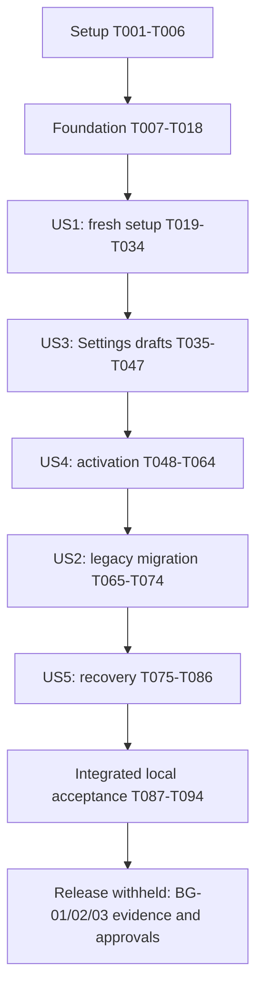

# Tasks: Librarian v2 Secure Installation and Instance Settings

**Input**: [spec.md](spec.md), [plan.md](plan.md), [research.md](research.md), [data-model.md](data-model.md), [API contract](contracts/instance-api.md), [configuration contract](contracts/configuration.md), [quickstart.md](quickstart.md), [reconciliation](requirements-traceability.md), [constitution v3.0.0](../../.specify/memory/constitution.md).
**Generated**: 2026-10-19 | **Feature**: `002-instance-configuration` | **Git branch**: `main`, unchanged.
**Status**: Planned, all tasks unchecked. Task generation implements nothing and grants no branch/commit/push/live-operation approval.

**Tests are mandatory** for this functional/security feature. Write tests before implementation and confirm meaningful failures; demonstrate functional defects before fixing them. No styling-class-only assertions. Never weaken security, assertions, instrumentation or the independent 95% statement/branch/function/line thresholds.

**Paths**: Relative to `D:\Repos\VPS & Homelab Infrastructure\librarian`. New paths are proposed implementation files. Reuse existing helpers/dependencies; no scaffold, new service or speculative refactor. Preserve original001 and unrelated changes.

**Format**: `- [ ] Tnnn [P?] [USn?] action with exact paths and requirements`. `[P]` identifies independent authoring jobs only within the named ready group; it does not authorize another story early or conflicting servers/databases. Unmarked tasks are sequential within their phase. Shared-file implementations stay sequential. Requirement references use the full V2 namespace.

## Phase 1: Setup — Reuse Existing Infrastructure

All later phases depend on T001-T006. Do not reinitialize the application or install new dependencies.

- [ ] T001 Revalidate approved D1-D3/constitution, current callers, installed peers and relevant `node_modules/next/dist/docs/` guides; preserve original001 and unrelated changes, and reconcile actual implementation-file scope in `specs/002-instance-configuration/plan.md` before edits. References: V2-FR-033, V2-FR-034, V2-QG-008.
- [ ] T002 Extend `tests/integration/http-harness.ts` through `tests/integration/instance-harness.ts` with explicit instance IDs, protected synthetic marker/root-key/bootstrap files, actual standalone Mongo/Next processes, controlled OIDC/GitHub and safe restart/shutdown. Retain loopback disposable-only DB restrictions; never use `librarian_dev` or shared services. References: V2-QG-003, V2-QG-004, V2-QG-005.
- [ ] T003 Add failing C7/global source inventory, missing/zero-hit/stale reports, independent sub-95% metrics and excluded-runtime cases to `tests/unit/coverage-checker.test.ts`, `tests/unit/coverage-collector.test.ts` and `tests/integration/coverage-conformance.test.ts`, preserving existing C1-C6 cases. References: V2-QG-001, V2-QG-002.
- [ ] T004 Extend `scripts/check-coverage.mjs` and `scripts/collect-coverage.mjs` to enforce the exact C7 union in `specs/002-instance-configuration/plan.md`, retaining global/C1-C6, source provenance and unexecuted files. Missing instrumentation/report or an applicable metric below95% fails. Make T003 pass. References: V2-QG-002, V2-SC-011.
- [ ] T005 Add failing selected-feature artifact tests in `tests/unit/artifact-checker.test.ts` for 002 IDs, task syntax/dependencies, contract/source inventories and links while retaining original001 validation. References: V2-QG-008, V2-SC-013.
- [ ] T006 Extend `scripts/validate-artifacts.mjs` for selected002 spec/plan/tasks/contracts without weakening001 or reusing its fixed92-task count; derive inventories from artifacts and distinguish document checks from coverage-required implementation completion. References: V2-FR-033, V2-QG-008, V2-SC-013.

## Phase 2: Foundational — Storage, Root Trust and Shared Guards

**Blocking checkpoint**: Finish T007-T018 before story implementation. Valid legacy operation remains available; missing002 records cannot expose fresh ownership enrollment.

### Tests first

T007-T010 may be authored independently after T002/T006, with distinct fixture resources.

- [ ] T007 [P] Add strict schema/state/revision/size/nullable-field tests in `tests/unit/instance-schema.test.ts` for every model entity, safe DTOs, unknown/newer schemas, cross-instance mismatch, invalid/backward timestamps and boundary values. References: V2-FR-003, V2-FR-018, V2-FR-025, V2-QG-003.
- [ ] T008 [P] Add host prerequisite/classification/precedence tests in `tests/unit/instance-bootstrap.test.ts`: valid legacy, explicitly prepared fresh, absent optional credentials, sealed/missing marker, mismatched identity/recovery epoch, missing database/key and lost singleton must preserve legacy or fail maintenance, never reset fresh. References: V2-FR-001, V2-FR-002, V2-FR-027, V2-FR-029, V2-FR-030.
- [ ] T009 [P] Add crypto/replacement tests in `tests/unit/instance-secrets.test.ts` for canonical malformed envelopes, independent root keys, wrong key, nonce/tag/ciphertext/AAD context substitution, random nonce generation and unchanged legacy OAuth decryptability. References: V2-FR-004, V2-FR-020, V2-QG-003.
- [ ] T010 [P] Add real standalone Mongo tests in `tests/integration/instance-store.test.ts` for singleton uniqueness, CAS edits, atomic bundle/owner/bootstrap transitions, concurrent actors, indexes/explicit expiry, audit outbox crash/replay and cross-instance denial. References: V2-FR-003, V2-FR-008, V2-FR-018, V2-FR-021, V2-QG-003.

### Implementation

- [ ] T011 Define strict entities in `lib/instance/store.ts`, quoting/enforcing model constraints: `_id/instanceId/schemaVersion` are "Literal `instance`, UUID, integer `1`"; counters are "Monotonic safe integers"; lifecycle is "`configuring`, `awaiting_owner`, `ready`, `maintenance`, `legacy_migrating`"; timestamps are "Server dates; initialization nullable until finalization"; bundles are "Nullable complete bundles below; one of each"; bindings are "<=20 stable issuer/subject bindings; exactly one current owner after initialization"; gate is "`open`, `closing`, `maintenance`; activation token; deadline"; admissions are "<=64 request pins and <=1 worker pin"; activation has "at most 20 catalog entries" and outbox "<=128 bounded events". Binding schema includes "kind: owner|administrator, status: active|retired" and "Unique active `(issuer,subject,projectId)` within the installation; exactly one current owner, immutable history of first enrollment". Enforce <=512 KiB encoded BSON, exact supported schema, revision-bound bootstrap/epoch/impact fields and no client-supplied authority/time. References: V2-FR-003, V2-FR-008, V2-FR-018, V2-FR-021.
- [ ] T012 Implement `lib/instance/secrets.ts` with independent host-keyring AES-256-GCM and preserve `lib/auth/tokens.ts` format/key. Enforce model wording: "All binary fields are canonical base64; nonce decodes to 12 bytes and tag to 16; key ID must exist in the host keyring". Bind AAD to instance/purpose/format/key/credential version; retain exact version in bundle and reject tampering before plaintext use. References: V2-FR-004, V2-FR-020, V2-FR-028.
- [ ] T013 Implement host prerequisites/classification in `lib/instance/bootstrap.ts`, splitting `lib/config.ts`/`lib/mongo.ts` from optional integrations. Enforce contract host names, immutable UUID/trusted setup origin/protected monotonic marker/independent keys, validated legacy precedence, standalone journaled writes and credential-free builds/imports. No DB/key/marker failure becomes fresh or silently falls back to legacy provider files after migration. References: V2-FR-001, V2-FR-002, V2-FR-005, V2-FR-027, V2-FR-029, V2-FR-030, V2-FR-032.
- [ ] T014 Implement CAS storage/indexes/editRevision/safe DTOs and bounded audit outbox in `lib/instance/store.ts`. Enforce "Display name 1–120 Unicode code points, description <=500, normalized non-escaping docs folder <=1024 bytes and <=32 segments; reject controls and executable markup", "Exact HTTPS origin, no credentials/path/query/fragment; loopback HTTP only in isolated DEV", "Exact approved issuer origin; client/project/audience identifiers retain current config validation; no subject/email hints as authorization", "Positive decimal App ID; provider fixed to GitHub; no repository write scopes", "<=12 typed revision/time-bound results; status `not_run`, `passed`, `failed`, `warning`; safe code only", "Optional candidate instance/version/issuer/subject/project/security epoch/nonce/expiry; derived from actual candidate callback, not browser input", and "Previous bundle only; <=24 h, or explicit protected maintenance recovery hold". Bundle version/date/actor are "Monotonic safe integer, server date, stable actor or protected operator action ID"; preserve purpose-keyed envelopes/one expiring old webhook secret, separate admission/edit counters, atomic linked writes and server-derived impact/proof. References: V2-FR-003, V2-FR-016, V2-FR-018, V2-FR-019, V2-FR-021.
- [ ] T015 Add failing shared authority/CSRF/origin/epoch/admission tests in `tests/unit/instance-access.test.ts` and `tests/integration/instance-access.test.ts`, including binding-only/role-only/wrong-project identities, exact15-minute failed role refresh, unsafe anonymous DTOs and saturated/expired pins. References: V2-FR-007, V2-FR-014, V2-FR-022, V2-FR-025, V2-QG-004.
- [ ] T016 Implement shared guards/admission in `lib/instance/access.ts`, reusing `lib/auth/admin.ts`/`lib/auth/roles.ts` mechanics: binding AND current `librarian-instance-admin`, issuer/subject/project and current security/recovery epoch; no implicit catalog/reader authority. Pins have <=30s request/120s worker hard deadlines, <=64 requests/one worker, no late renewals/effects; nested calls reuse context and gate CAS closes new admission. References: V2-FR-007, V2-FR-014, V2-FR-022, V2-FR-025.
- [ ] T017 Add fixed bounds in `lib/limits.ts` and safe no-store DTO/error/audit/rate handling in `lib/instance/access.ts`/`lib/operations/logging.ts`: JSON64KiB, App key16KiB/client secret4KiB/webhook secret1KiB, bounded durable quotas, trusted expiry and no submitted secret/ciphertext/path/env/provider-body logging. References: V2-FR-020, V2-FR-021, V2-FR-025, V2-FR-036.
- [ ] T018 Run foundation unit/integration/coverage/type/lint/build gates from `package.json` with zero-hit inventory and applicable C7/global/C1-C6 metrics; record exact results/blockers in `specs/002-instance-configuration/tasks.md`. Do not proceed on failed root trust, persistence, authority or coverage. References: V2-QG-001, V2-QG-002, V2-QG-007.

## Phase 3: User Story 1 — Authorize and Complete a Fresh Installation (P1, MVP)

**Goal**: Protected seven-step setup commits exactly one verified owner/configuration before normal runtime starts.
**Independent test**: Empty disposable instance, explicit host intent and controlled providers; complete setup, restart/resume and reject unauthorized/expired/replayed/concurrent attempts. No optional provider credentials before setup. This is a local fresh-instance MVP, not release or migration approval.

### Tests first

T019-T022 are parallel authoring groups after T018, using isolated resources.

- [ ] T019 [P] [US1] Add US1.1-9 unit scenarios in `tests/unit/instance-setup.test.ts`: >=32-byte random credential/no default or URL exposure,24h fresh authority,30-minute/eight-session bounds,10-minute single-use proof, exact expiry and durable cross-process guessing/replay quotas. References: V2-FR-005, V2-FR-006, V2-FR-007, V2-FR-008, V2-FR-012, V2-FR-013.
- [ ] T020 [P] [US1] Add direct status/setup authorize/read/patch/check/finalize/candidate-auth contract/race/crash cases in `tests/integration/instance-setup.test.ts`: If-Match conflict, edited proof invalidation, sealed creation interruption, repeated accepted attempt versus different attempt and committed-but-unadopted state cannot create another owner. References: V2-FR-001, V2-FR-008, V2-FR-009, V2-FR-012, V2-FR-013, V2-QG-003, V2-QG-004.
- [ ] T021 [P] [US1] Add typed provider/branding and SSRF tests in `tests/unit/instance-validation.test.ts` and `tests/integration/instance-validation.test.ts`: redirects/rebinding/private/metadata/IPv4-mapped denial, protected private exception, DNS/connect/body/JWKS limits, discovery-success/login-failure, invalid RSA/permissions and absent installation/delivery. References: V2-FR-010, V2-FR-011, V2-FR-019, V2-FR-024, V2-FR-025.
- [ ] T022 [P] [US1] Add seven-step/expiry/browser-close/restart/owner-login/concurrent-finalizer/closed-setup journeys in `tests/browser/instance-setup.spec.ts`, with keyboard/mobile/focus/theme/errors and no secret sentinels in HTML/navigation/browser storage. References: V2-FR-009, V2-FR-012, V2-FR-013, V2-QG-005, V2-SC-001, V2-SC-002, V2-SC-003.

### Implementation

- [ ] T023 [US1] Implement local protected `prepare` in `scripts/instance-operator.mjs`: verify ignore rules and empty dedicated storage, provision identity/origin/expiring authority safely, seal durable intent before DB initialization, emit only safe action IDs, and require maintenance recovery after ambiguous interruption; no live provisioning. References: V2-FR-001, V2-FR-002, V2-FR-006, V2-FR-030.
- [ ] T024 [US1] Implement setup sessions and status/authorize handlers in `lib/instance/access.ts`, `app/api/instance/status/route.ts` and `app/api/instance/setup/authorize/route.ts`. Enforce "Unique `_id`, index `(instanceId,expiresAt)`, TTL index on `purgeAt` with `expireAfterSeconds:0`; purgeAt is expiresAt plus one hour" and "Explicit absolute 30-minute expiry check is mandatory even if TTL deletion is delayed"; hash opaque tokens/CSRF, bind purpose/epochs, cap8 sessions and5 failed attempts/minute/100 per day, require host trusted origin/pre-session CSRF and Secure/HttpOnly/SameSite cookies. References: V2-FR-006, V2-FR-007, V2-FR-008, V2-FR-025.
- [ ] T025 [US1] Implement GET/PATCH `app/api/instance/setup/route.ts` using `lib/instance/store.ts`: strict If-Match/editRevision/candidateVersion, encrypted durable draft, invalidated checks/proof after edits, safe metadata, host-only database Retry Connection and no partial active change/reveal. References: V2-FR-003, V2-FR-009, V2-FR-018, V2-FR-019, V2-FR-020.
- [ ] T026 [US1] Implement pinned DNS/HTTPS/checks in `lib/instance/validation.ts`: approved origin/address plus TLS hostname verification, no redirects,5s DNS/connect,10s request/30s workflow,512KiB total response budget, bounded JWKS and one concurrent check; protect actual candidate provider connections, including narrow private-origin exceptions. References: V2-FR-010, V2-FR-011, V2-FR-024, V2-FR-025.
- [ ] T027 [US1] Implement isolated candidate Auth.js in `app/api/instance/auth/[...nextauth]/route.ts`, `auth.ts` and `lib/instance/access.ts`: signature/issuer/audience, PKCE/state/nonce, separate cookies/basePath, exact callback/local return, revision/purpose-bound single-use proof and current instance-admin role. No email/first-login/client-subject ownership or ordinary runtime account linking. References: V2-FR-010, V2-FR-012, V2-FR-023.
- [ ] T028 [US1] Implement `app/api/instance/setup/check/route.ts` and bounded signed-proof handling in `app/api/webhooks/github/route.ts`: fixed check enum/revision/time/status, read-only App/installation checks, original-byte signature, no pre-ready operational queue, truthful unperformed/failure/warning results and no invented delivery success. References: V2-FR-005, V2-FR-010, V2-FR-011, V2-FR-019.
- [ ] T029 [US1] Implement finalize handler `app/api/instance/setup/finalize/route.ts` and initial CAS in `lib/instance/activation.ts`: current check/owner/role/impact nonce, atomic bundle/binding/consumed-bootstrap/audit commit, one accepted attempt with idempotent reconciliation; pending/maintenance on postcommit adoption failure and no second owner/ready-to-fresh transition. References: V2-FR-008, V2-FR-012, V2-FR-013, V2-FR-021, V2-SC-002.
- [ ] T030 [US1] Integrate initial lifecycle/active settings in `auth.ts`, `lib/auth/adapter.ts`, `lib/auth/authorization.ts`, `lib/auth/admin.ts`, `lib/sync/worker-startup.ts`, `lib/mongo.ts` and `lib/config.ts`: normal auth/delivery/catalog/worker only for ready or validated legacy, separate roles and server/cache guards preserved, no002 record leaves valid legacy operational. References: V2-FR-001, V2-FR-005, V2-FR-010, V2-FR-013, V2-FR-033.
- [ ] T031 [US1] Implement independently guarded `app/repositories/setup/page.tsx` with safe prerequisite/version welcome, protected trusted origin and closed enrollment after readiness; avoid catalog-only parent guards and preserve root setup/settings catalogs. References: V2-FR-001, V2-FR-009, V2-FR-014, V2-FR-033.
- [ ] T032 [US1] Implement `components/instance-setup.tsx` for seven durable steps, configured-only secrets, accessible validation/focus/loading/navigation, candidate login, precise check warnings and current explicit final review; never persist submitted secrets/bootstrap to browser storage. References: V2-FR-009, V2-FR-010, V2-FR-011, V2-FR-012, V2-FR-013, V2-FR-017.
- [ ] T033 [US1] Wire safe initial adoption/restart recovery in `instrumentation.ts`, `lib/sync/worker-startup.ts`, `lib/operations/health.ts` and `app/api/health/route.ts`: current lifecycle/revision/local adoption required, old heartbeat cannot prove readiness, interrupted finalized setup resumes the same identity and health stays non-sensitive no-store200/503. References: V2-FR-013, V2-FR-030, V2-FR-036.
- [ ] T034 [US1] Run US1.1-9 and preserved-legacy-startup acceptance plus applicable global/C1-C7 coverage/type/lint/build and browser checks from `package.json`; record exact local counts/results/blockers in `specs/002-instance-configuration/tasks.md`. References: V2-QG-001, V2-QG-002, V2-QG-005, V2-QG-007, V2-SC-001, V2-SC-002, V2-SC-003, V2-SC-011.

## Phase 4: User Story 3 — Review and Edit Instance Settings (P1)

**Goal**: Bound instance administrators inspect/edit durable candidates without secrets or accidental activation.
**Independent test**: Seed a ready instance/active bundle and owner/admin/reader/wrong-role identities through controlled fixtures; test every Settings/audit read/write/check directly and across restart. No setup wizard prerequisite. Apply/rotation depends on US4; draft success is not activation.

### Tests first

T035-T038 may be authored in parallel after T034, each using isolated resources.

- [ ] T035 [P] [US3] Add direct page/API authorization cases in `tests/integration/instance-settings-access.test.ts`: anonymous, binding-only, role-only, catalog-only admin, reader, wrong issuer/project, bound admin/owner and exact expired-role denial; instance access grants no catalog mutations/private bytes. References: V2-FR-014, V2-FR-015, V2-FR-025, V2-QG-004, V2-SC-004.
- [ ] T036 [P] [US3] Add edit/CAS/blank-secret/schema/provenance/restart tests in `tests/integration/instance-settings.test.ts`: exact stale409, atomic rejection, canonical PATCH, configured-only secrets, no reveal/delete, durable draft/active isolation and unchanged existing catalog fields. References: V2-FR-016, V2-FR-018, V2-FR-019, V2-FR-020, V2-FR-032, V2-SC-005.
- [ ] T037 [P] [US3] Add behavioral Save/Cancel/conflict/unsaved-navigation/check-state/replacement tests in `tests/client/instance-settings.test.tsx` using canonical server fixtures/secret sentinels; no class-only assertions or blanket persistence/security mocks. References: V2-FR-017, V2-FR-018, V2-FR-020, V2-QG-001.
- [ ] T038 [P] [US3] Add grouped Settings, denied routes, bounded audit pagination, restart persistence and phone/tablet/desktop keyboard/theme/focus/error journeys in `tests/browser/instance-settings.spec.ts`, distinguishing saved candidate from active. References: V2-FR-014, V2-FR-015, V2-FR-017, V2-FR-032, V2-QG-005, V2-SC-004, V2-SC-005, V2-SC-012.

### Implementation

- [ ] T039 [US3] Complete bound-owner/admin access in `lib/instance/access.ts`/`lib/auth/roles.ts`: current instance/security/recovery epoch and issuer/subject/project, exact15-minute refresh with no renewal-age reset, owner-only continuity impacts and independent catalog/private-reader permissions. References: V2-FR-012, V2-FR-014, V2-FR-023, V2-FR-025.
- [ ] T040 [US3] Implement GET/PATCH `app/api/instance/settings/route.ts`: ETag/If-Match/editRevision/candidateVersion, strict allowlisted fields, explicit encrypted replacement, safe canonical DTOs and proof invalidation on edit; active unchanged and no conflict/oversize/unknown-field partial writes. References: V2-FR-015, V2-FR-016, V2-FR-018, V2-FR-019, V2-FR-020.
- [ ] T041 [US3] Implement GET `app/api/instance/audit/route.ts` with `lib/instance/store.ts`, opaque instance-bound cursor and contract limits "limit 1–50"/"<=50 safe events"; return bounded actor/operation/revision/time/result only, never secret/ciphertext/path/provider-body history or unlimited export. References: V2-FR-015, V2-FR-021, V2-FR-025.
- [ ] T042 [US3] Implement POST `app/api/instance/settings/check/route.ts` through shared transport and current binding/role/CSRF/rate guards:6 checks/min and30 mutations/min per authorized actor/session, actual revision/time proof and invalidated results after edits. References: V2-FR-017, V2-FR-019, V2-FR-024, V2-FR-025.
- [ ] T043 [US3] Implement independently authorized `app/repositories/settings/page.tsx` with safe General/Authentication/GitHub/Documentation/Security/System groups, metadata and audit; no inherited catalog-only guard or private config in metadata/prefetch. References: V2-FR-014, V2-FR-015, V2-FR-033.
- [ ] T044 [US3] Implement `components/instance-settings.tsx`: safe grouped fields/configured indicators, explicit replacement, canonical Save, Cancel/no-write, stale-refresh guidance, unsaved warning, truthful check/activation/restart status and accessible responsive loading/errors/focus; no reveal/implicit deletion. References: V2-FR-015, V2-FR-017, V2-FR-018, V2-FR-020, V2-FR-032.
- [ ] T045 [US3] Add verified Settings navigation and active safe name/description preferences in `components/site-navigation.tsx`, `lib/layout.shared.tsx`, `app/layout.tsx` and `app/page.tsx`; inspect `components/directory.tsx` as the affected directory caller, expose no draft/provider values or broader authority, and preserve bottom-left sync badges/three-card skeletons. References: V2-FR-014, V2-FR-016, V2-FR-033, V2-FR-034.
- [ ] T046 [US3] Pass active docs-folder defaults through `lib/admin.ts`, `app/repositories/page.tsx` and `components/admin-console.tsx` for new-draft initialization/reset only; preserve explicit `docsPath` validation in `app/api/admin/repos/route.ts` and existing catalogs/edit drafts/visibility/roles. Extend `tests/client/admin-console.test.tsx`; do not invent an absent catalog-form component. References: V2-FR-016, V2-FR-029, V2-FR-033.
- [ ] T047 [US3] Run US3.1-7 draft editing/denial/browser/seeded-active persistence and applicable coverage/type/lint/build via `package.json`, recording local evidence in `specs/002-instance-configuration/tasks.md`; complete active Apply/rotation acceptance only after US4. References: V2-QG-001, V2-QG-002, V2-QG-005, V2-QG-007, V2-SC-004, V2-SC-005, V2-SC-011, V2-SC-012.

## Phase 5: User Story 4 — Activate Settings and Rotate Credentials Safely (P1)

**Goal**: Bounded coherent cutover across Auth.js, delivery, webhook and workers on standalone Mongo.
**Independent test**: Seed active/candidate bundles and two v2-aware processes; serve private content and ingest while activating/rotating/failing at durable boundaries. No setup or migration journey needed; actual runtime/storage remain under test.

### Tests first

T048-T052 may be authored in parallel after T047 with isolated fixture resources.

- [ ] T048 [P] [US4] Add unit gate/nonce/revision/rollback/deadline cases in `tests/unit/instance-activation.test.ts`: stale actors/proofs, repeated attempts, monotonic versions/epochs, one active/previous/candidate, expired pins cannot renew or authorize later effects. References: V2-FR-018, V2-FR-019, V2-FR-022, V2-FR-026.
- [ ] T049 [P] [US4] Add standalone two-process drain/activation/crash tests in `tests/integration/instance-activation.test.ts` at every CAS/catalog fence, delayed old claim/publication/blob/cleanup, timeout, restart and stale reconciler; require <=120s adoption or coherent maintenance, not mixed runtime. References: V2-FR-022, V2-FR-030, V2-FR-034, V2-QG-003, V2-SC-006.
- [ ] T050 [P] [US4] Add issuer/client/project/audience/origin continuity and old-callback/session/role-cache tests in `tests/integration/instance-auth-activation.test.ts`: email substitution, both callbacks, invalid candidate role, late old-epoch writes, preserved OAuth decryption and justified unrelated sessions. References: V2-FR-010, V2-FR-012, V2-FR-023, V2-FR-028, V2-SC-007.
- [ ] T051 [P] [US4] Add App replacement/access-loss, original-byte webhook/dedupe and exact five-minute overlap/retirement/rollback cases in `tests/integration/instance-rotation.test.ts`; no automatic sender mutation/deadline resurrection, invalid replacement retains recoverable active credentials. References: V2-FR-011, V2-FR-020, V2-FR-026, V2-FR-033, V2-SC-007.
- [ ] T052 [P] [US4] Add save/check/impact/Apply/pending/active/rollback/wrong-owner browser journeys in `tests/browser/instance-activation.spec.ts`, including host-only/pending-restart guidance, failed adoption without false success and affected logout/back/private cache. References: V2-FR-017, V2-FR-022, V2-FR-023, V2-FR-026, V2-FR-032, V2-QG-005.

### Implementation

- [ ] T053 [US4] Implement cutover/reconciliation in `lib/instance/activation.ts`/`lib/instance/access.ts`: current check/role/continuity/nonce, exclusive gate CAS, <=30s request/stream drain, <=120s total, complete <=20-catalog fencing, atomic bundle/binding/epoch/audit commit, adoption then reopen/success. A singleton read followed by unrelated catalog write is not atomic fencing. References: V2-FR-018, V2-FR-019, V2-FR-021, V2-FR-022, V2-FR-023, V2-FR-030.
- [ ] T054 [US4] Add separate runtime revision/activation authority in `lib/catalog.ts`, `lib/sync/jobs.ts`, `lib/sync/worker.ts` and `lib/sync/worker-startup.ts`: gate creates/claims, monotonic lease fences, revalidate/rebind or supersede old jobs, preserve receipts/mappings; ordinary preferences never bump catalog content configRevision. References: V2-FR-022, V2-FR-028, V2-FR-033, V2-FR-034.
- [ ] T055 [US4] Carry live revision/activation/catalog-lease fences through publication/cleanup/blob effects in `lib/content/generations.ts`, `lib/content/blob-cache.ts`, `lib/sync/worker.ts` and `lib/sync/github.ts`; reject expired/fenced late effects, retain active snapshots/read pins/original-blob integrity and stop old workers before reopening. References: V2-FR-022, V2-FR-030, V2-FR-033, V2-FR-034, V2-FR-036.
- [ ] T056 [US4] Replace lifetime captures with bounded immutable bundle/security-epoch caches in `auth.ts`, `lib/auth/adapter.ts`, `lib/auth/tokens.ts`, `lib/auth/roles.ts` and `lib/config.ts`; check authority at admission/callback/renewal and invalidate logically before cleanup. Apply pinned transport to actual active auth/token/role clients, preserving legacy ciphertext. References: V2-FR-004, V2-FR-010, V2-FR-022, V2-FR-023, V2-FR-024, V2-FR-028.
- [ ] T057 [US4] Enforce operation revision/epoch before cached content and before/after bounded delivery in `lib/auth/authorization.ts`, `lib/content/source.ts`, `app/[repoSlug]/[[...page]]/page.tsx`, `app/api/search/[repoSlug]/route.ts` and `app/api/assets/[repoSlug]/[...path]/route.ts`; track stream drain/abort and retain metadata/navigation/search/assets, freshness/logout/cache protection. References: V2-FR-022, V2-FR-023, V2-FR-025, V2-FR-033, V2-QG-006.
- [ ] T058 [US4] Implement current+one-previous webhook secret in `app/api/webhooks/github/route.ts`/`lib/instance/activation.ts`, checking acceptUntil per original-byte delivery. State sender action/gap/manual resync honestly, retain App namespaces/dedupe and reject retired signatures at/after five minutes even on rollback. References: V2-FR-011, V2-FR-022, V2-FR-026, V2-FR-028.
- [ ] T059 [US4] Implement `app/api/instance/settings/activate/route.ts` and `app/api/instance/settings/rollback/route.ts` with binding+role/owner/CSRF/origin/If-Match checks; canonical adopted200/pending202/conflict409, rollback becomes a newly validated candidate, never counter rewind/retired-secret revival/setup reopening. References: V2-FR-018, V2-FR-022, V2-FR-023, V2-FR-026, V2-FR-030.
- [ ] T060 [US4] Finish check/impact/continuity/confirmation/Apply/rollback in `components/instance-settings.tsx`: current-owner candidate login, saved/pending/adopted distinction, exact callback/webhook URLs and host/restart/operator prerequisites; no false success or root/provider secret exposure. References: V2-FR-017, V2-FR-019, V2-FR-022, V2-FR-023, V2-FR-026, V2-FR-032.
- [ ] T061 [US4] Require current lifecycle/schema/revision/local adoption in `lib/operations/health.ts`, `app/api/health/route.ts`, `lib/sync/worker.ts` and `instrumentation.ts`; resume recorded pre/postcommit operations idempotently, keep timeout/failure maintenance and never accept an old healthy-worker heartbeat. References: V2-FR-013, V2-FR-022, V2-FR-030, V2-FR-036.
- [ ] T062 [US4] Audit remaining admission/config callers in `lib/auth/admin.ts`, `app/api/admin/csrf/route.ts`, `app/api/admin/repos/route.ts`, `app/api/admin/repos/[id]/route.ts`, `app/api/admin/repos/[id]/sync/route.ts`, `app/api/admin/repos/sync/route.ts` and `app/api/auth/[...nextauth]/route.ts`; enforce shared revision/gate without weakening catalog auth/CSRF/approval/canonical response contracts. References: V2-FR-005, V2-FR-022, V2-FR-025, V2-FR-033.
- [ ] T063 [US4] Bound bundle/provider/Auth.js retention to active/previous/candidate and <=24h previous in `lib/instance/store.ts`/`lib/instance/activation.ts`; preserve explicit protected recovery holds/backup-key decryption, prune retired credentials after grace and never revive sessions/signatures. References: V2-FR-019, V2-FR-022, V2-FR-026, V2-FR-031, V2-FR-036.
- [ ] T064 [US4] Run US4.1-6 multi-process/stream/rotation/private/browser acceptance and all applicable C1-C7/global coverage/type/lint/build from `package.json`; record measured outcomes in `specs/002-instance-configuration/tasks.md`, complete US3 active-save acceptance and never call controlled providers or unmodified v1 overlap compatible live evidence. References: V2-QG-002, V2-QG-003, V2-QG-004, V2-QG-005, V2-QG-006, V2-QG-007, V2-SC-006, V2-SC-007, V2-SC-011.

## Phase 6: User Story 2 — Upgrade an Existing Installation Safely (P1)

**Goal**: Deliberately import legacy settings through the proved cutover without losing identities/routes/snapshots/jobs/receipts.
**Independent test**: Complete synthetic legacy dataset remains operational until protected enrollment/import; compare before/during/after failed/successful migration/rollback, including setup/settings catalogs. US2 follows US4 because migration needs coherent activation. Legacy startup preservation was mandatory from Phase2.

### Tests first

T065-T067 may be authored independently after T064.

- [ ] T065 [P] [US2] Add migration/enrollment/precedence cases in `tests/integration/instance-migration.test.ts` with full legacy accounts/sessions/OAuth ciphertext/grants/catalogs/installations/jobs/leases/control+webhook receipts/operational records/generation pointers; deny role-only/operator-only/wrong identity, blanks and silent merges. References: V2-FR-012, V2-FR-027, V2-FR-028, V2-FR-029, V2-SC-008.
- [ ] T066 [P] [US2] Add cutover/failed-import/schema/key/crash/compatible previous-image recovery cases in `tests/integration/instance-migration-rollback.test.ts`; require unmodified v1 drain before commit, old legacy authority before activation, no migrated fallback/destructive collection conversion. References: V2-FR-022, V2-FR-027, V2-FR-028, V2-FR-029, V2-FR-030, V2-FR-031.
- [ ] T067 [P] [US2] Add protected legacy enrollment/import and route compatibility in `tests/browser/instance-migration.spec.ts`: root setup/settings and nested catalog pages remain unchanged/no redirects; new pages under repositories; existing role/cache/reader/catalog behavior preserved. References: V2-FR-014, V2-FR-027, V2-FR-028, V2-FR-033, V2-QG-005, V2-SC-010.

### Implementation

- [ ] T068 [US2] Implement `app/api/instance/migration/authorize/route.ts` and legacy-purpose authority in `lib/instance/access.ts`: protected operator credential plus current verified legacy librarian-admin AND instance-admin roles, CSRF/origin and explicit stable owner confirmation; no automatic binding from role alone. References: V2-FR-007, V2-FR-012, V2-FR-014, V2-FR-027.
- [ ] T069 [US2] Implement import/provenance in `lib/instance/store.ts`, `lib/instance/bootstrap.ts` and `app/api/instance/migration/route.ts`; preserve originals/host prerequisites, keyed safe secret fingerprints/field-name conflicts only, no blank overwrite or env/path/secret echo. References: V2-FR-003, V2-FR-004, V2-FR-027, V2-FR-028, V2-FR-029.
- [ ] T070 [US2] Implement local `enroll` in `scripts/instance-operator.mjs` and protected legacy review in `components/instance-setup.tsx`/`app/repositories/setup/page.tsx`; deliberate immutable host identity/marker, verified target proof/both roles, no open fresh-owner enrollment for existing data. References: V2-FR-001, V2-FR-006, V2-FR-012, V2-FR-027, V2-FR-030.
- [ ] T071 [US2] Route confirmed migration through `lib/instance/activation.ts`, `lib/config.ts`, `lib/auth/adapter.ts` and `lib/sync/jobs.ts`; enforce v1 drain, preserve IDs/slugs/content configRevision/installations/accounts/OAuth/receipts/snapshots and switch eligible precedence only at complete committed cutover. References: V2-FR-022, V2-FR-027, V2-FR-028, V2-FR-029, V2-FR-033.
- [ ] T072 [US2] Confirm namespace compatibility in `lib/catalog.ts`, `app/repositories/page.tsx`, `app/[repoSlug]/[[...page]]/page.tsx` and `components/site-navigation.tsx`: do not reserve setup/settings, rename catalogs, add root aliases/redirects or change `/api/admin/...`; connect actual changed callers to regression tests without editing original001. References: V2-FR-014, V2-FR-028, V2-FR-033.
- [ ] T073 [US2] Write `docs/guides/instance-upgrade.md` for explicit import/precedence/v1 drain and proved schema/OAuth/envelope/config compatibility before image rollback; include consistent DB/content/root-key recovery, safe failure/operator/role prerequisites and no unverified rollback claims. References: V2-FR-027, V2-FR-028, V2-FR-029, V2-FR-031, V2-FR-035.
- [ ] T074 [US2] Run US2.1-6 preservation/denial/browser/rollback and affected V1/ST-01 through V1/ST-13 with global/C1-C7 coverage/type/lint/build; record actual local evidence and outstanding live recovery proof in `specs/002-instance-configuration/tasks.md`. References: V2-FR-033, V2-QG-002, V2-QG-005, V2-QG-006, V2-QG-007, V2-SC-008, V2-SC-010, V2-SC-011.

## Phase 7: User Story 5 — Recover and Operate a Durable Instance (P2)

**Goal**: Protected operators/owners recover consistent initialized state and follow complete self-hosting/admin guides without turning failures into ownership enrollment.
**Independent test**: Seed configuring/ready/legacy states, disconnect providers/storage, remove/substitute keys/markers and restore synthetic consistent recovery sets. Initialized/consumed state and identities survive; unverified replacement identities cannot recover authority.

### Tests first

T075-T077 may be authored in parallel after T074, using disposable fixtures.

- [ ] T075 [P] [US5] Add outage/record/key/marker/restore/epoch/draft-resume/audit-pressure tests in `tests/integration/instance-recovery.test.ts`, crashing at durable boundaries: no public fresh fallback, no restored bootstrap/OIDC/session replay and coherent catalog/job/receipt/snapshot recovery. References: V2-FR-001, V2-FR-021, V2-FR-030, V2-FR-031, V2-SC-009.
- [ ] T076 [P] [US5] Add protected prepare/enroll/transfer/recover/rotate-key cases in `tests/unit/instance-operator.test.ts` and `tests/integration/instance-operator.test.ts`: wrong purpose/instance/revision, missing owner/verified target/dedicated role, command-line/log secret exposure, interrupted re-encryption, retained backup key and unchanged OAuth format. References: V2-FR-004, V2-FR-006, V2-FR-012, V2-FR-023, V2-FR-026, V2-FR-030, V2-FR-031.
- [ ] T077 [P] [US5] Add restart/maintenance/recovery/resume/operator walkthrough in `tests/browser/instance-recovery.spec.ts`, with safe truthful diagnostics and keyboard recovery guidance; no public reset or falsely recovered state. References: V2-FR-009, V2-FR-017, V2-FR-030, V2-FR-035, V2-QG-005, V2-SC-009, V2-SC-012.

### Implementation

- [ ] T078 [US5] Implement protected transfer/recover in `scripts/instance-operator.mjs`, `lib/instance/access.ts` and `lib/instance/activation.ts`: new out-of-band purpose/epoch, maintenance, verified replacement/current instance-admin role and current owner where available; atomically retire/bind owner, retain first-enrollment/consumption history and never reset setup. References: V2-FR-012, V2-FR-023, V2-FR-030, V2-FR-031.
- [ ] T079 [US5] Implement host-assisted rotate-key in `scripts/instance-operator.mjs`/`lib/instance/secrets.ts`: separate root key ID, maintenance CAS re-encryption of all retained envelopes with crash recovery/restart validation, old keys retained for surviving backup sets, OAuth key/format unchanged and no MongoDB root keys. References: V2-FR-004, V2-FR-026, V2-FR-028, V2-FR-031.
- [ ] T080 [US5] Complete audit/session/rate/retired-state cleanup in `lib/instance/store.ts`/`lib/instance/access.ts`, enforcing "Unique `_id`; index `(instanceId,at)` and TTL `at + 90 days`; hard count <=10,000 per instance enforced by bounded trimming before insert", "Each event <=1 KiB", outbox128 and48h rate buckets. Full outbox denies mutations, replay remains idempotent and active/recovery-held credentials/snapshots survive. References: V2-FR-021, V2-FR-030, V2-FR-031, V2-FR-036.
- [ ] T081 [US5] Write `docs/guides/instance-installation.md` and placeholder-only local `docs/guides/examples/instance.compose.yml`: separate root inputs/protected marker/disposable Mongo, minimal setup, both callbacks, first catalog/sync/read and later Settings; label local-only and keep production Swarm/Traefik/secrets descriptors infrastructure-owned. References: V2-FR-002, V2-FR-009, V2-FR-010, V2-FR-035.
- [ ] T082 [US5] Write `docs/guides/instance-administration.md`, `docs/guides/instance-configuration.md` and `docs/guides/instance-secrets.md` covering finite settings/classes/precedence, binding+role and catalog/reader separation, saved-versus-active/host-restart, sender rotation/key backup and safe audit; no speculative options. References: V2-FR-014, V2-FR-016, V2-FR-020, V2-FR-026, V2-FR-029, V2-FR-032, V2-FR-035.
- [ ] T083 [US5] Write combined troubleshooting/recovery guide `docs/guides/instance-recovery.md`: consistent quiesced DB/auth/config/jobs/receipts/audit+content backup, separately protected roots/marker, recovery-epoch advance, stale session/proof retirement, verified replacement, maintenance/restart and compatible previous-image rollback. Label <=120s reconciliation/<=30min corpus recovery as targets until proved. References: V2-FR-030, V2-FR-031, V2-FR-035, V2-FR-036.
- [ ] T084 [US5] Link six guides from `README.md`; reconcile `.env.example`, `.gitignore`, `.dockerignore` and `Dockerfile` only for required host split/non-public marker/snapshot packaging. Add `tests/unit/build-config.test.ts` assertions; placeholders only, no generated roots/private data in tracked examples or images. References: V2-FR-002, V2-FR-004, V2-FR-031, V2-FR-035.
- [ ] T085 [US5] Complete isolated operator/self-host walkthrough from `specs/002-instance-configuration/quickstart.md` using `tests/integration/instance-recovery.test.ts`: restart/recreate/compatible upgrade, catalog/sync/read/Settings, transfer/key rotation/consistent restore; record sanitized timings/limitations without claiming controlled providers live. References: V2-FR-028, V2-FR-031, V2-FR-032, V2-FR-035, V2-SC-009, V2-SC-012.
- [ ] T086 [US5] Run US5.1-5 recovery/operator/browser/retention and applicable global/C1-C7 coverage/type/lint/build via `package.json`; record actual local results and remaining BG-02/live rollback proof in `specs/002-instance-configuration/tasks.md`. References: V2-QG-002, V2-QG-003, V2-QG-004, V2-QG-005, V2-QG-007, V2-SC-009, V2-SC-011, V2-SC-012.

## Phase 8: Polish and Cross-Cutting Local Acceptance

All story checkpoints precede T087-T094. No speculative cleanup, standalone visual-test work or deployment is implied.

- [ ] T087 Add/run sentinel/trust-boundary regressions in `tests/integration/instance-security.test.ts` and `tests/unit/operations.test.ts` across responses/errors/redirects/audit/outbox/logs/browser storage/bundles: zero root/bootstrap/provider secret/ciphertext/private-body/env/path/response escape; retain parse-only static MDX/safe branding and actual active-provider SSRF protection. References: V2-FR-004, V2-FR-006, V2-FR-020, V2-FR-024, V2-FR-025, V2-FR-033, V2-FR-034, V2-QG-004.
- [ ] T088 Run affected v1 public/anonymous-private/reader/wrong-role/admin-without-reader, exact freshness/logout-back/cache/repository isolation/disable/visibility in `tests/integration/authorization.test.ts`, `tests/browser/private-cache.spec.ts` and existing reader/admin suites; existing sync suites must prove signatures/dedupe/wrong branch/invalid content/leases/restarts/access loss/last-good/original-blob. Add defect-first regressions before fixes. References: V2-FR-028, V2-FR-033, V2-FR-034, V2-QG-006, V2-SC-010.
- [ ] T089 Finalize source/provenance/C7 enforcement in `scripts/check-coverage.mjs`, `scripts/collect-coverage.mjs`, `vitest.config.ts` and `.github/workflows/ci.yml`; amend `specs/002-instance-configuration/plan.md` exact C7 set for actual changed/new executable files before acceptance, retain C1-C6 and reject absent/zero-hit evidence, required skips/failures or any applicable metric below95%. References: V2-QG-002, V2-QG-007, V2-QG-008, V2-SC-011.
- [ ] T090 Run `npm run test:coverage`, `npm run coverage:check`, `npm run typecheck`, `npm run lint` and `npm run build` from `package.json`; fix in-scope failures without weakened assertions/exclusions/retry masking, recording exact global/C1-C7 statement/branch/function/line results, source scope/provenance in `specs/002-instance-configuration/tasks.md`. References: V2-QG-001, V2-QG-002, V2-QG-003, V2-QG-004, V2-QG-006, V2-QG-007, V2-SC-011.
- [ ] T091 Run `npm run test:e2e` with `playwright.config.ts` in Chromium/Firefox/WebKit, then build/test only a disposable local image via `Dockerfile`/`npm run test:container`; verify protected root/marker/snapshot placement, persistence/safe recreation and record actual results in `specs/002-instance-configuration/tasks.md`. Publish nothing. References: V2-FR-031, V2-FR-032, V2-QG-005, V2-QG-007, V2-SC-011, V2-SC-012.
- [ ] T092 Execute full local `specs/002-instance-configuration/quickstart.md`, validate docs/example links/schema, run v2-aware `npm run validate:artifacts`/`git diff --check`, reconcile handlers/callers/source sets and preserve original001/unrelated changes. Close IN-01 only with fresh full evidence, never saved-report reuse. References: V2-FR-033, V2-FR-035, V2-QG-008, V2-SC-011, V2-SC-012, V2-SC-013.
- [ ] T093 Reconcile actual code/test evidence in `specs/002-instance-configuration/requirements-traceability.md`, `spec.md`, `plan.md`, `checklists/requirements.md` and `tasks.md`; retain all73 original dispositions/history and identify unbuilt work without labelling unperformed workload/live checks verified. References: V2-FR-033, V2-QG-008, V2-SC-013, V2-SC-014.
- [ ] T094 Prepare concrete BG-01/02/03 evidence/approval handoff in `specs/002-instance-configuration/tasks.md` using `scripts/measure-workload.mjs`, `docs/guides/instance-upgrade.md` and `docs/guides/instance-recovery.md`: exact corpus/resources/latency, provider/infra/DB/storage prerequisites, coherent backup/prior-image compatibility, rollback and proposed DEV/live actions. Execute no out-of-scope/live actions; keep release blocked while evidence/approvals are absent. References: V2-FR-036, V2-QG-007, V2-SC-014.

## Dependencies and Execution Order

- US1/US2/US3/US4 are all P1, preceding P2 US5. Reordering equal-priority stories reflects actual dependencies; never assume conflicting shared-module work is independent.
- T003 precedes T004, T005 precedes T006, and T015 precedes T016. Foundation implementation follows tests. A story's initial test group precedes its implementation; unmarked tasks within phases are sequential. Every checkpoint must pass before the next phase.
- US1 initializes with no preexisting catalogs. US4 proves changed-revision admission/fencing before US2 migrates existing data. Legacy startup preservation is required throughout T013/T030, not deferred to migration.
- US3 draft APIs/seeded-active restart are independently testable; active Apply acceptance completes with T064 after US4. Do not expose a working-looking unsafe Apply placeholder or call a draft saved state active.
- Independent story acceptance uses seeded configuring/ready/legacy fixtures, avoiding repeated unrelated UI journeys while retaining real storage/auth/provider/lease boundaries. No blanket mocks of the behavior under test.
- `[P]` permits only the listed ready authoring groups; existing test-harness concurrency/isolation/shutdown restrictions still apply. These examples do not request automatic sub-agent dispatch.

## Parallel Execution Examples

| Story / ready point | Independent authoring jobs | Join before |
|---|---|---|
| US1 after T018 | T019 setup unit; T020 setup integration; T021 provider tests; T022 setup browser | T023 |
| US3 after T034 | T035 access; T036 edits/persistence; T037 client; T038 browser | T039 |
| US4 after T047 | T048 activation unit; T049 multi-process; T050 identity; T051 rotation; T052 browser | T053 |
| US2 after T064 | T065 import/legacy dataset; T066 rollback; T067 migration browser | T068 |
| US5 after T074 | T075 recovery; T076 operator; T077 browser | T078 |

Each named job owns distinct files as specified in its task. Shared implementation modules remain sequential. Parallel authoring is not concurrent execution against a shared database/port.

## Requirement-to-Task Crosswalk

All IDs are from [spec.md](spec.md). Each FR maps to implementation and acceptance. Ranges are inclusive task references; overlaps are intentional. Original v1 scenario/edge details remain normative in the reconciliation, not replaced by this index.

| Requirement | Implementation | Tests / verification |
|---|---|---|
| V2-FR-001 | T013, T023, T030-T031, T070 | T008, T020, T022, T065, T075 |
| V2-FR-002 | T013, T023, T081, T084 | T008, T022, T076, T085 |
| V2-FR-003 | T011, T014, T025, T069 | T007, T010, T020, T036, T065 |
| V2-FR-004 | T012, T069, T079 | T009, T036, T076, T087 |
| V2-FR-005 | T013, T028, T030, T062 | T019-T020, T022, T088 |
| V2-FR-006 | T023-T024, T070 | T019-T020, T076, T087 |
| V2-FR-007 | T016, T024, T068 | T015, T019-T020, T035 |
| V2-FR-008 | T011, T014, T024, T029 | T010, T019-T020 |
| V2-FR-009 | T025, T031-T032 | T020, T022, T077 |
| V2-FR-010 | T026-T028, T030, T056 | T021-T022, T050, T088 |
| V2-FR-011 | T026, T028, T058 | T021, T051, T064 |
| V2-FR-012 | T016, T027, T029, T039, T068, T070, T078 | T019-T020, T050, T065, T076 |
| V2-FR-013 | T029-T030, T033 | T019-T020, T022, T034 |
| V2-FR-014 | T016, T031, T039, T043, T045, T068 | T015, T035, T038, T067 |
| V2-FR-015 | T040-T041, T043-T044 | T035, T037-T038 |
| V2-FR-016 | T014, T040, T045-T046 | T007, T036-T037, T047 |
| V2-FR-017 | T032, T042, T044, T060 | T022, T037-T038, T052, T077 |
| V2-FR-018 | T011, T014, T025, T040, T053, T059 | T007, T010, T036, T048-T049 |
| V2-FR-019 | T014, T025, T028, T040, T042, T053, T060 | T021, T036, T048, T052 |
| V2-FR-020 | T012, T017, T025, T040, T044 | T009, T036-T037, T051, T087 |
| V2-FR-021 | T014, T017, T029, T041, T053, T080 | T010, T038, T075, T087 |
| V2-FR-022 | T016, T053-T059, T061-T063, T071 | T015, T048-T052, T064, T066 |
| V2-FR-023 | T027, T039, T053, T056-T057, T059-T060, T078 | T050, T052, T076, T088 |
| V2-FR-024 | T026, T042, T056 | T021, T050, T087 |
| V2-FR-025 | T016-T017, T024, T026, T039, T041-T042, T057, T062 | T007, T015, T019, T021, T035, T087 |
| V2-FR-026 | T053, T058-T060, T063, T079 | T048, T051-T052, T076 |
| V2-FR-027 | T013, T068-T071, T073 | T008, T065-T067, T074 |
| V2-FR-028 | T012, T054, T056, T058, T069, T071, T073, T079 | T009, T050, T065-T066, T074, T085, T088 |
| V2-FR-029 | T013, T046, T069, T071, T073, T082 | T008, T036, T065-T066 |
| V2-FR-030 | T013, T023, T029, T033, T053, T055, T059, T061, T070, T078, T080, T083 | T008, T049, T066, T075-T077, T086 |
| V2-FR-031 | T063, T073, T078-T080, T083-T084 | T066, T075-T076, T085, T091 |
| V2-FR-032 | T013, T044, T060, T082, T084 | T036, T038, T052, T085, T091 |
| V2-FR-033 | T030-T031, T045-T046, T054-T055, T057, T062, T071-T072, T093 | T001, T005-T006, T067, T074, T088, T092 |
| V2-FR-034 | T026, T030, T054-T056 | T001, T021, T049, T087-T088 |
| V2-FR-035 | T073, T081-T084 | T077, T085, T092 |
| V2-FR-036 | T017, T033, T055, T061, T063, T080, T083, T094 | T049, T075, T086, T091, T094; BG-01/02/03 |
| V2-QG-001 | Test-first every phase; T003-T004 | T018, T034, T047, T064, T074, T086, T090 |
| V2-QG-002 | T004, T089 | T003, every checkpoint, T090 |
| V2-QG-003 | T002 and real storage/auth/fence implementation | T007-T010, T015, T020-T021, T036, T049-T051, T065-T066, T075-T076, T090 |
| V2-QG-004 | T016-T017, T024, T026, T039, T056 | T015, T019-T021, T035, T048-T051, T075-T076, T087 |
| V2-QG-005 | T031-T032, T043-T046, T060, T070 | T022, T038, T052, T067, T077, T091 |
| V2-QG-006 | T030, T054-T058, T062, T071-T072 | T074, T088, T090-T091 |
| V2-QG-007 | Existing commands/CI, T089 | Every checkpoint, T090-T094; live evidence separate |
| V2-QG-008 | T001, T006, exact plan/C7 scope | T005, T089, T092-T093 |
| V2-SC-001 | T023-T032 | T019-T022, T034 |
| V2-SC-002 | T024, T027, T029, T033 | T019-T020, T022, T034 |
| V2-SC-003 | T026-T028, T042 | T021-T022, T034 |
| V2-SC-004 | T039-T044 | T035-T038, T047, T087 |
| V2-SC-005 | T014, T040, T044, T053 | T036-T038, T047, T049, T064 |
| V2-SC-006 | T053-T057, T061-T062 | T049-T050, T064 |
| V2-SC-007 | T056, T058-T060, T063 | T050-T052, T064 |
| V2-SC-008 | T068-T073 | T065-T067, T074 |
| V2-SC-009 | T013, T078-T080, T083 | T075-T077, T085-T086 |
| V2-SC-010 | T030, T057, T071-T072 | T067, T074, T088 |
| V2-SC-011 | T004, T089 | Every checkpoint, T090-T092 |
| V2-SC-012 | T032, T044, T060, T081-T084 | T022, T038, T052, T077, T085, T091-T092 |
| V2-SC-013 | T006, original matrix and this crosswalk | T005, T092-T093 |
| V2-SC-014 | T093-T094 and withheld release | BG-01/02/03 evidence/approval below |

## Interface and Entity Coverage

| Contract / entity | Owning tasks | Acceptance |
|---|---|---|
| GET status; POST setup authorize | T024 | T019-T020 |
| GET/PATCH setup; POST check/finalize | T025, T028-T029 | T020-T022 |
| Candidate Auth.js GET/POST catch-all | T027 | T020-T022, T050 |
| GET/PATCH settings; POST check | T040, T042 | T035-T038 |
| POST activate/rollback | T053, T059 | T048-T052 |
| GET audit | T041 | T035, T038, T075 |
| POST migration authorize/import | T068-T071 | T065-T067 |
| Local prepare/enroll/transfer/recover/rotate-key | T023, T070, T078-T079 | T076, T085 |
| Host marker/prerequisites | T013, T023 | T008, T020, T075-T076 |
| Control/bundles/checks/envelopes/bindings | T011-T014, T027-T029, T039, T053 | T007-T010, T020-T021, T035-T036, T049-T051 |
| Setup sessions/audit/outbox | T014, T024, T041, T080 | T010, T019-T020, T038, T075 |
| Catalog/job/worker authority and snapshots/blob/read pins | T054-T055, T057, T061-T062, T071 | T049, T051, T065-T066, T075, T088 |
| Auth accounts/sessions/role epochs | T027, T030, T039, T056, T078 | T015, T035, T050, T065-T066, T075-T076 |

## Carried-Forward Release Gates — Not Automatic Implementation Tasks

These stay open even if all local checkboxes pass. T094 prepares a reviewable handoff only; a later implement request cannot deploy/provision merely to clear this table. Preserve original v1 task IDs/checkboxes and reference evidence here instead of editing historical001.

| Destination / original requirements | Required evidence | Status / boundary |
|---|---|---|
| IN-01: V1/QG-007, V1/SC-011; original T087 | T090-T093 fresh full local quickstart, source provenance/four metrics, browser/container/guide acceptance | Included now; historical saved coverage is insufficient |
| BG-01: V1/FR-036, V1/ST-11 measured part, V1/SC-012; original T086 | Representative 3catalogs,500pages+100assets each,50KiB average pages/10MiB assets per catalog,10readers at20requests/s for15min with ingestion/restart/retention/v2 overhead under0.5CPU/512MB. Warm page p95<=2s/search<=1s/ack<=2s/cold<=5s/publish<=120s/recover<=45s | Unverified; operator-owned target/resource scope before measurement, no unapproved shared-service use/limit increase |
| BG-02: V1/FR-035 recovery,V1/FR-037,V1/QG-006 live,V1/ST-14,V1/SC-013; original T088-T090 | Actual DEV infra/provider/Gitea/Zitadel/DB/storage revalidation,login/refresh/logout/role removal/all private paths,signed sync,consistent restore/proved previous-image rollback<=30min for corpus | Unverified; concrete approval for live mutations/credentials, fixtures do not close this gate |
| BG-03: V1/FR-038,V1/ST-14,V1/SC-013; original T091 | Approved image/private-content/infrastructure/deployment scope,prior image/config/keys and consistent backup,DEV before PROD,established ssh contabo/actual checkout,health/browser/rollback proof | Not authorized by tasks/local implementation; production descriptors stay infrastructure-owned |

## Implementation Strategy and Completion Rules

1. **MVP**: Setup+Foundation+US1 (T001-T034), a protected fresh-install local demonstration with actual controlled-provider/storage boundaries and applicable tests/coverage/type/lint/build. Preserve legacy startup. No release/legacy migration approval implied.
2. **Incremental delivery**: US3 drafts, US4 coherent activation/rotation, US2 deliberate legacy migration, US5 recovery/operator documentation. Seed isolated state to test stories independently; never call partial draft functionality fully active Settings.
3. **Integrated local completion**: T087-T094 validates local behavior/documents and prepares the handoff. Each metric is independently>=95% globally and per applicable scope, including unexecuted sources; mandatory browser/container/type/lint/build still apply.
4. **Boundaries**: No automatic branch/commit/push/release, remote restart/provider/role/credential mutation, image/private-content publication or deployment. Only approved disposable local tests; preserve installed skills/templates/unrelated files. Never expose secrets or private content.
5. **Truthful state**: Check tasks only after code plus stated verification are evidenced. Track failures/unbuilt work. BG-01/02/03 remain release blockers until genuine evidence and approvals exist, regardless of local checkbox count.

## Generation Validation

This invocation checks sequential unique task IDs, checklist/phase/story syntax, concrete paths, requirement/contract/source coverage, dependency/parallel groups and local links. All implementation/test/checkpoint tasks remain unchecked. No application tests/build/coverage/provider/workload/recovery/deployment ran as part of task generation. Inspect pre/post hooks before reporting completion.

Validated result: 94 sequential tasks; Setup6/Foundation12/US1=16/US3=13/US4=17/US2=10/US5=12/Final8; 23 independent authoring tasks; all58 new requirement IDs, all66 declared C7 file paths and all15 API method rows mapped; all10 local links resolve. Existing318 tracked/prior-feature files retain their baseline aggregate SHA-256, including original001 and unrelated working changes. New-file whitespace checks pass; no extensions.yml is present for before_tasks/after_tasks hooks. These are document-generation checks, not implementation evidence.
